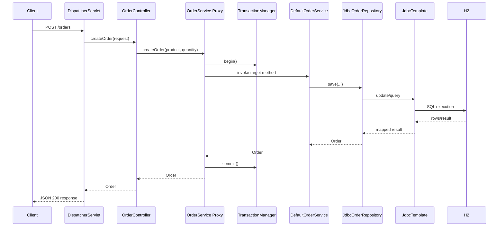

# Example App Request Flow

이 문서는 `example-app`의 실제 요청 한 건이 `spring-lite` 런타임을 어떻게 통과하는지 추적한다. 목표는 웹, 서비스, 트랜잭션, JDBC, JSON 응답이 하나의 실행 흐름으로 연결된다는 사실을 보여 주는 것이다.

## 대상 시나리오

- `POST /orders`
- 요청 바디: `{"product":"book","quantity":2}`

## 전체 흐름

## 단계별 추적

### 1. 요청 수신과 핸들러 선택

- 시작 클래스:
  - `DispatcherServlet`
  - `RequestMappingHandlerMapping`
- 하는 일:
  - URL `/orders`
  - HTTP 메서드 `POST`
  - 컨트롤러 메서드 `OrderController.createOrder(...)` 선택

### 2. 요청 본문 바인딩과 검증

- 시작 클래스:
  - `RequestMappingHandlerAdapter`
  - `RequestBodyArgumentResolver`
  - `SimpleValidator`
- 하는 일:
  - JSON을 `CreateOrderRequest`로 역직렬화
  - `@Valid` 제약 검사

### 3. 서비스 프록시 진입

- 시작 클래스:
  - `TransactionalBeanPostProcessor`
  - 프록시 인스턴스
- 하는 일:
  - `DefaultOrderService`는 실제 객체가 아니라 프록시를 통해 호출된다.
  - `TransactionInterceptor`가 begin/commit/rollback을 담당한다.

### 4. 비즈니스 로직 실행

- 시작 클래스:
  - `DefaultOrderService`
- 하는 일:
  - `@Value`로 주입된 기본 주문 상태를 사용한다.
  - 저장 책임을 `OrderRepository`에 위임한다.

### 5. JDBC 실행

- 시작 클래스:
  - `JdbcOrderRepository`
  - `JdbcTemplate`
- 하는 일:
  - 현재 트랜잭션 커넥션을 재사용한다.
  - insert 후 select 또는 필요한 매핑을 수행한다.

### 6. 응답 직렬화

- 시작 클래스:
  - `JsonReturnValueHandler`
  - `JsonMapper`
- 하는 일:
  - `Order` 객체를 JSON 응답 바디로 변환한다.

## 디버깅 포인트

- 404가 나면:
  - `RequestMappingHandlerMapping`
- 400이 나면:
  - `RequestBodyArgumentResolver`, `SimpleValidator`
- 트랜잭션이 안 걸리면:
  - `TransactionalBeanPostProcessor`, `TransactionManager`
- DB 반영이 이상하면:
  - `JdbcTemplate`, 현재 커넥션 재사용 여부
- 응답 JSON이 이상하면:
  - `JsonMapper`, `JsonReturnValueHandler`

## 독자가 직접 따라가 볼 파일

- `example-app/src/main/java/lite/spring/example/order/OrderController.java`
- `example-app/src/main/java/lite/spring/example/order/DefaultOrderService.java`
- `example-app/src/main/java/lite/spring/example/order/JdbcOrderRepository.java`
- `spring-lite-web/src/main/java/lite/spring/web/support/DispatcherServlet.java`
- `spring-lite-tx/src/main/java/lite/spring/tx/support/TransactionalBeanPostProcessor.java`
- `spring-lite-jdbc/src/main/java/lite/spring/jdbc/JdbcTemplate.java`
