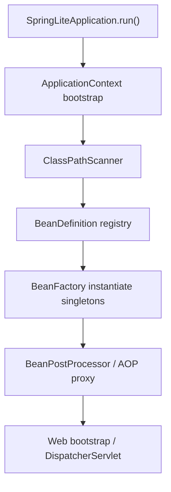
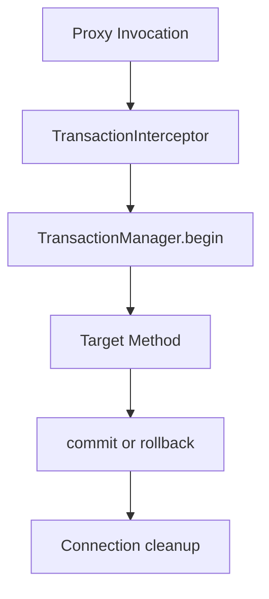

# Architecture Overview

## 시스템 관점

`spring-lite`는 크게 다섯 흐름으로 나뉜다.

1. 클래스패스 스캔과 Bean 정의 수집
2. 의존성 해결과 Bean 인스턴스 생성
3. 후처리와 프록시 적용
4. 웹 요청 디스패치
5. JDBC/트랜잭션 실행

## 초기 런타임 흐름

## 웹 요청 흐름

## 트랜잭션 흐름

## 설계 메모

- IoC 컨테이너는 `BeanDefinition` 중심으로 설계한다.
- AOP와 Transaction은 Bean 후처리 단계에서 프록시를 씌우는 방향으로 통일한다.
- MVC는 `HandlerMethod` 실행 파이프라인을 명시적으로 드러내는 구조를 유지한다.
- Boot는 다른 모듈의 얇은 조합 계층이어야 하며 핵심 로직을 직접 소유하지 않는다.
