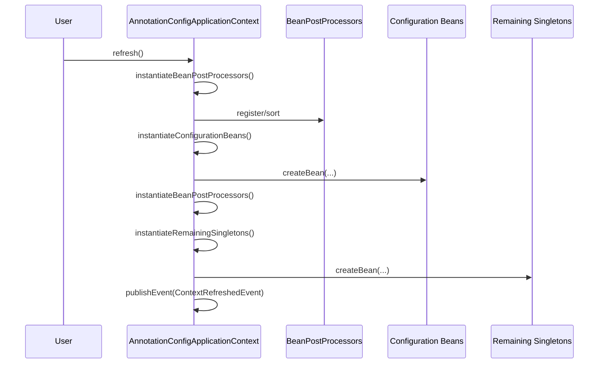
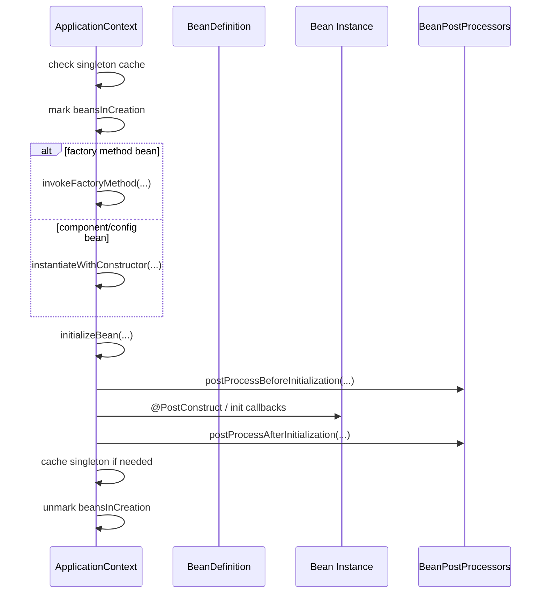
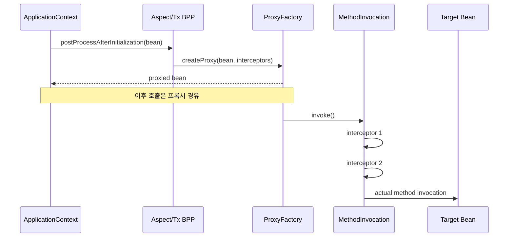
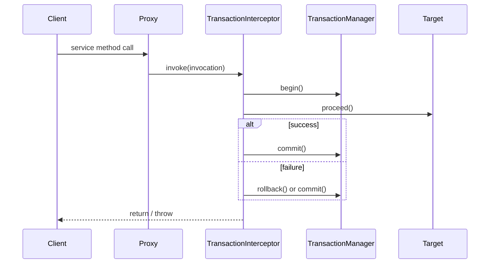
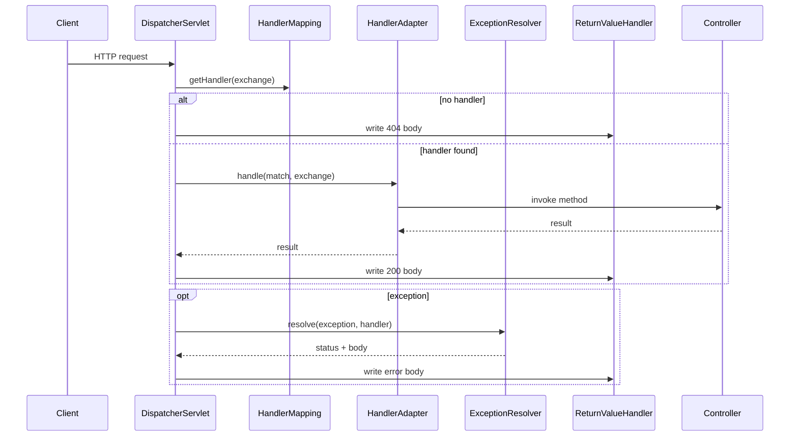
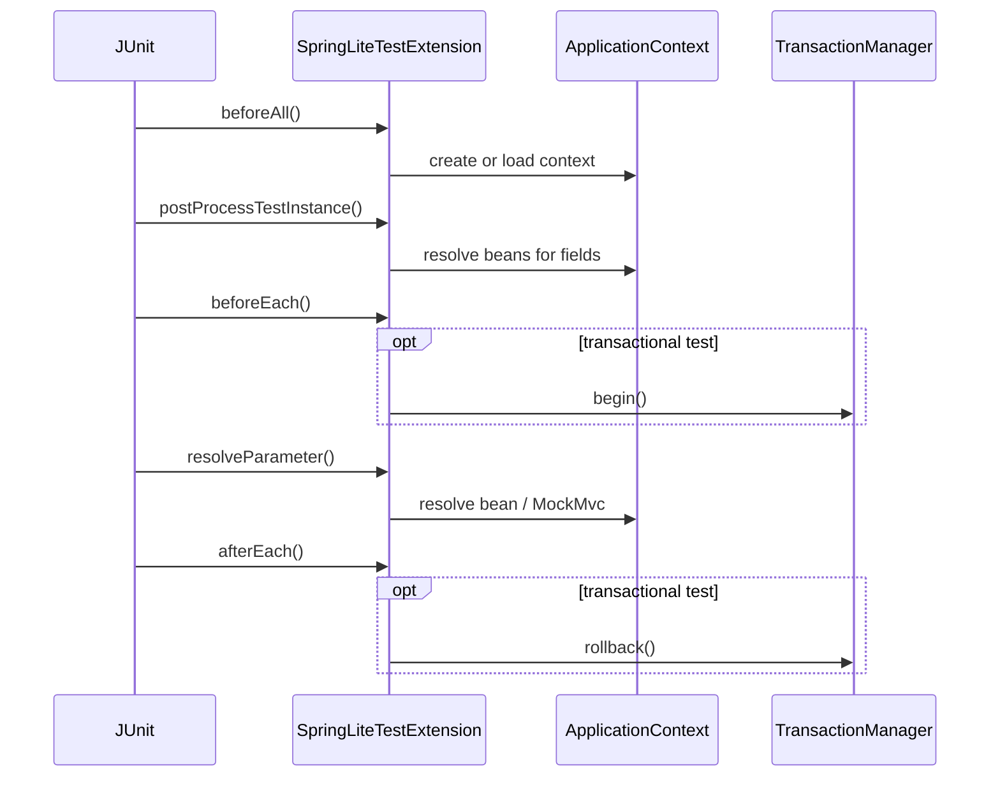

# Runtime Sequence Diagrams

이 문서는 `spring-lite`의 핵심 런타임 메서드를 시퀀스 다이어그램으로 정리한 문서다. 책 본문과 코드를 함께 읽을 때 호출 순서를 빠르게 붙잡는 데 목적이 있다.

## 1. `AnnotationConfigApplicationContext.refresh()`

## 2. `AnnotationConfigApplicationContext.createBean()`

## 3. 프록시 합성과 호출 체인

## 4. `TransactionInterceptor.invoke()`

## 5. `DispatcherServlet.handle()`

## 6. `SpringLiteTestExtension`

