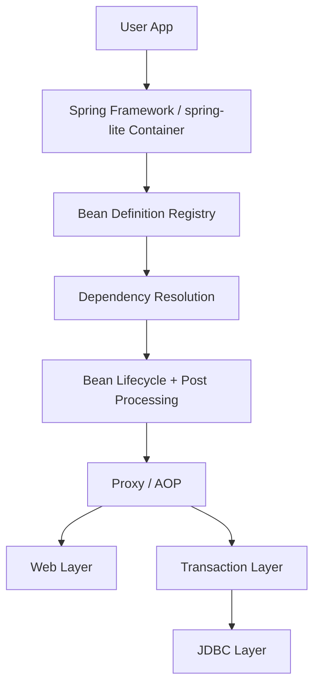
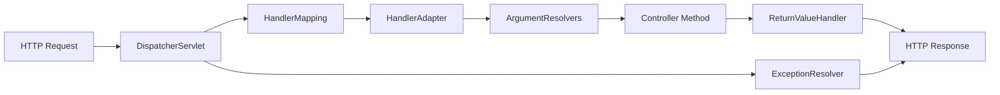

# Spring Framework Comparison And Architecture Guide

이 문서는 실제 Spring Framework의 아키텍처와 `spring-lite`의 구현을 나란히 비교해서 설명하는 문서다. 목표는 "Spring 비슷한 기능이 있다"는 수준이 아니라, 어떤 개념이 어떤 런타임 구조와 클래스 설계로 이어지는지 이해하는 것이다.

비교 기준은 두 가지다.

1. 현재 저장소의 `spring-lite` 코드
2. Spring Framework 공식 레퍼런스와 공개 소스 구조

주요 공식 참고 자료:

- [Spring Framework Reference: IoC Container and Beans](https://docs.spring.io/spring-framework/reference/core/beans/introduction.html)
- [Spring Framework Reference: DispatcherServlet](https://docs.spring.io/spring-framework/reference/web/webmvc/mvc-servlet.html)
- [Spring Framework Reference: Declarative Transaction Management](https://docs.spring.io/spring-framework/reference/data-access/transaction/declarative.html)
- [Spring Framework Reference: Data Access with JDBC](https://docs.spring.io/spring-framework/reference/data-access/jdbc.html)
- [Spring Framework Reference: Testing](https://docs.spring.io/spring-framework/reference/testing/index.html)
- [Spring `AbstractApplicationContext`](https://github.com/spring-projects/spring-framework/blob/main/spring-context/src/main/java/org/springframework/context/support/AbstractApplicationContext.java)
- [Spring `DefaultListableBeanFactory`](https://github.com/spring-projects/spring-framework/blob/main/spring-beans/src/main/java/org/springframework/beans/factory/support/DefaultListableBeanFactory.java)
- [Spring `DispatcherServlet`](https://github.com/spring-projects/spring-framework/blob/main/spring-webmvc/src/main/java/org/springframework/web/servlet/DispatcherServlet.java)

## 1. 큰 그림

Spring과 `spring-lite`는 둘 다 아래 질문에 답하는 구조다.

- 객체를 누가 만들고 연결하는가
- 공통 관심사를 어디서 가로채는가
- HTTP 요청을 어떻게 메서드 호출로 변환하는가
- 트랜잭션과 JDBC 자원을 어떻게 묶는가

다만 구현 깊이는 크게 다르다.

| 관점 | Spring Framework | `spring-lite` |
| --- | --- | --- |
| 컨테이너 계층 | `BeanFactory` + `ApplicationContext` + 다양한 post-processor | 단일 `AnnotationConfigApplicationContext` 중심 |
| Bean 메타데이터 | 매우 풍부한 `BeanDefinition`, scope, parent, aliases, merged definition | 단순 `BeanDefinition` |
| AOP | `Advice`, `Advisor`, `Pointcut`, auto proxy creator, `@AspectJ` | `MethodInterceptor` 체인과 `ProxyFactory` |
| MVC | `DispatcherServlet` + 전략 인터페이스 다수 + message converter + validation | `DispatcherServlet` + mapping/adapter/argument/return handler 최소 버전 |
| 트랜잭션 | `PlatformTransactionManager`, propagation, rollback rules, synchronization | 단일 `TransactionManager`, 단순 begin/commit/rollback |
| Boot 성격 | 대규모 조건부 자동 설정과 환경 추상화 | 소수의 조건부 자동 설정과 단순 서버 부트스트랩 |

## 2. 아키텍처 대응도

### 대응 관계

| 역할 | Spring | `spring-lite` |
| --- | --- | --- |
| 컨텍스트 진입점 | `AbstractApplicationContext`, `AnnotationConfigApplicationContext` | [AnnotationConfigApplicationContext](../../spring-lite-context/src/main/java/lite/spring/context/support/AnnotationConfigApplicationContext.java) |
| Bean 생성 저장소 | `DefaultListableBeanFactory` | [BeanDefinition](../../spring-lite-context/src/main/java/lite/spring/context/bean/BeanDefinition.java) + 내부 singleton map |
| 컴포넌트 스캔 | classpath scanning infrastructure | [ClassPathScanner](../../spring-lite-context/src/main/java/lite/spring/context/scan/ClassPathScanner.java) |
| Bean 후처리 | `BeanPostProcessor` 계열 | [BeanPostProcessor](../../spring-lite-context/src/main/java/lite/spring/context/factory/BeanPostProcessor.java) |
| MVC front controller | `DispatcherServlet` | [DispatcherServlet](../../spring-lite-web/src/main/java/lite/spring/web/support/DispatcherServlet.java) |
| 트랜잭션 AOP | `TransactionInterceptor`, transaction advisor | [TransactionalBeanPostProcessor](../../spring-lite-tx/src/main/java/lite/spring/tx/support/TransactionalBeanPostProcessor.java) |
| JDBC template | `JdbcTemplate` | [JdbcTemplate](../../spring-lite-jdbc/src/main/java/lite/spring/jdbc/JdbcTemplate.java) |
| Boot 실행 계층 | Spring Boot auto-configuration, embedded server factories | [MiniSpringApplication](../../spring-lite-boot/src/main/java/lite/spring/boot/MiniSpringApplication.java), [WebServer](../../spring-lite-boot/src/main/java/lite/spring/boot/web/WebServer.java) |

## 3. IoC Container 비교

### 3.1 Spring은 무엇을 제공하나

Spring 공식 문서는 IoC 컨테이너를 `BeanFactory`와 `ApplicationContext` 중심으로 설명하고, 그 위에 dependency injection, bean scopes, lifecycle callbacks, `@Autowired`, `@Qualifier`, `@Value`, classpath scanning, Java-based configuration을 계층적으로 배치한다. 공식 레퍼런스의 목차만 봐도 이 계층이 드러난다. `@Autowired`, qualifiers, `@Value`, `@PostConstruct`, classpath scanning, `@Bean`, `@Configuration`, `AnnotationConfigApplicationContext`가 별도 항목으로 정리돼 있다. [Spring IoC reference](https://docs.spring.io/spring-framework/reference/core/beans/introduction.html)

실제 Spring 소스에서 `AbstractApplicationContext.refresh()`는 아래 순서로 움직인다.

1. `prepareRefresh()`
2. `obtainFreshBeanFactory()`
3. `prepareBeanFactory(beanFactory)`
4. 각종 post-processing
5. listener / event multicaster 준비
6. `finishBeanFactoryInitialization(beanFactory)`
7. `finishRefresh()`

이 흐름은 `refresh()`와 `finishBeanFactoryInitialization()` 인접 코드에서 직접 드러난다. [AbstractApplicationContext.refresh](https://github.com/spring-projects/spring-framework/blob/main/spring-context/src/main/java/org/springframework/context/support/AbstractApplicationContext.java) [Spring source excerpt](https://github.com/spring-projects/spring-framework/blob/main/spring-context/src/main/java/org/springframework/context/support/AbstractApplicationContext.java#L3219-L3278)

### 3.2 `spring-lite`는 어떻게 단순화했나

`spring-lite`는 위 구조를 훨씬 얇게 줄였다.

- Bean registry, singleton cache, lifecycle orchestration을 [AnnotationConfigApplicationContext](../../spring-lite-context/src/main/java/lite/spring/context/support/AnnotationConfigApplicationContext.java)에 모았다.
- 실제 객체 생성 메타데이터는 [BeanDefinition](../../spring-lite-context/src/main/java/lite/spring/context/bean/BeanDefinition.java)에 둔다.
- 리프레시 흐름은 `instantiateBeanPostProcessors()`, `instantiateConfigurationBeans()`, `instantiateRemainingSingletons()` 정도로 축약돼 있다.

### 3.3 차이의 의미

| 항목 | Spring | `spring-lite` | 의미 |
| --- | --- | --- | --- |
| 컨텍스트와 팩토리 분리 | 명확 | 거의 합쳐짐 | 학습은 쉬워지지만 확장 지점은 적다 |
| 이벤트 인프라 | 내장 | 아직 없음 | 생명주기 확장성이 줄어든다 |
| scope 모델 | 다양함 | singleton 중심 | 생성 전략 이해는 쉽지만 실제 Spring 재현도는 낮다 |
| Bean metadata | 풍부함 | 최소 필드만 보유 | 디버깅은 쉬우나 기능 확장은 제한적 |

## 4. Bean Definition 과 생성 모델 비교

Spring에서 핵심 추상화는 "객체"보다 "객체를 만드는 정의"다. 이 점은 `DefaultListableBeanFactory`가 전역 Bean 정의 저장소 역할을 한다는 구조에서 드러난다. [DefaultListableBeanFactory](https://github.com/spring-projects/spring-framework/blob/main/spring-beans/src/main/java/org/springframework/beans/factory/support/DefaultListableBeanFactory.java)

`spring-lite`도 같은 철학을 따른다.

- 클래스 스캔 결과를 바로 인스턴스화하지 않는다.
- 먼저 `BeanDefinition`으로 저장한다.
- 나중에 `getBean()` 시점 또는 refresh 시점에 생성한다.

관련 코드:

- [ClassPathScanner](../../spring-lite-context/src/main/java/lite/spring/context/scan/ClassPathScanner.java)
- [BeanNameGenerator](../../spring-lite-context/src/main/java/lite/spring/context/support/BeanNameGenerator.java)
- [AnnotationConfigApplicationContext](../../spring-lite-context/src/main/java/lite/spring/context/support/AnnotationConfigApplicationContext.java)

## 5. 의존성 주입 비교

### Spring

Spring 공식 문서는 annotation-based container configuration 아래에 `@Autowired`, qualifiers, `@Value`, lifecycle callback, classpath scanning을 별도 항목으로 둔다. 이건 단순 문법 소개가 아니라, 주입 해석 규칙이 꽤 크고 독립적인 서브시스템이라는 뜻이다. [Spring IoC reference](https://docs.spring.io/spring-framework/reference/core/beans/introduction.html)

실제 Spring은 타입 매칭, qualifier, primary/fallback, generic resolution, optional dependency 같은 다양한 규칙을 지원한다.

### `spring-lite`

현재 `spring-lite`는 아래만 지원한다.

- 생성자 주입
- `@Qualifier`
- `@Value`
- `ApplicationContext` 자기 주입

이 로직은 [AnnotationConfigApplicationContext](../../spring-lite-context/src/main/java/lite/spring/context/support/AnnotationConfigApplicationContext.java)에 집중돼 있다.

### 비교 포인트

| 규칙 | Spring | `spring-lite` |
| --- | --- | --- |
| 생성자 주입 | 지원 | 지원 |
| 필드 주입 | 지원 | `@Value` 필드만 지원 |
| 세터 주입 | 지원 | 미지원 |
| `@Qualifier` | 지원 | 지원 |
| `@Primary` | 지원 | 미지원 |
| 컬렉션 주입 | 지원 | 미지원 |
| optional / lazy | 지원 | 미지원 |

이 차이 때문에 `spring-lite`는 Spring의 "핵심 원리"는 보여주지만, 실제 실무 애플리케이션에서 기대하는 주입 유연성은 아직 재현하지 않는다.

## 6. 컴포넌트 스캔 비교

Spring 공식 문서에서 classpath scanning은 IoC 컨테이너 핵심 기능의 일부로 다뤄진다. [Spring IoC reference](https://docs.spring.io/spring-framework/reference/core/beans/introduction.html)

`spring-lite`의 스캐너는 아래 특징이 있다.

- 파일 시스템 스캔 지원
- JAR 스캔 지원
- 메타 애노테이션 기반 관리 대상 판별

관련 코드:

- [ClassPathScanner](../../spring-lite-context/src/main/java/lite/spring/context/scan/ClassPathScanner.java)
- [AnnotationUtils](../../spring-lite-context/src/main/java/lite/spring/context/support/AnnotationUtils.java)

Spring과의 차이는 후보 탐지 파이프라인의 깊이다.

| 항목 | Spring | `spring-lite` |
| --- | --- | --- |
| class metadata reading | 매우 정교함 | 클래스 로딩 중심 |
| annotation synthesis | 풍부함 | 단순 메타 애노테이션 추적 |
| exclude/include filters | 지원 | 미지원 |
| conditional scanning | 다양함 | 등록 단계 조건 평가 |

## 7. Lifecycle 와 Post-Processor 비교

Spring 공식 문서는 Bean lifecycle과 container extension points를 독립 주제로 다룬다. 여기에는 `BeanPostProcessor`, lifecycle callback, Java-based configuration 확장 지점이 포함된다. [Spring IoC reference](https://docs.spring.io/spring-framework/reference/core/beans/introduction.html)

`spring-lite`에서 이 축은 다음 코드로 연결된다.

- [BeanPostProcessor](../../spring-lite-context/src/main/java/lite/spring/context/factory/BeanPostProcessor.java)
- [AnnotationConfigApplicationContext](../../spring-lite-context/src/main/java/lite/spring/context/support/AnnotationConfigApplicationContext.java)
- [TransactionalBeanPostProcessor](../../spring-lite-tx/src/main/java/lite/spring/tx/support/TransactionalBeanPostProcessor.java)

핵심 lifecycle 비교:

| 단계 | Spring | `spring-lite` |
| --- | --- | --- |
| 인스턴스 생성 | 있음 | 있음 |
| dependency population | 풍부함 | 생성자 위주 |
| `BeanPostProcessor#before` | 있음 | 있음 |
| `@PostConstruct` | 있음 | 있음 |
| `BeanPostProcessor#after` | 있음 | 있음 |
| destroy callback | 있음 | `@PreDestroy` + `AutoCloseable` |
| `FactoryBean`, aware interfaces | 폭넓음 | 미지원 |

## 8. AOP 비교

Spring 공식 문서는 AOP를 concepts, capabilities, proxies, `@AspectJ` support, advice API, advisor API, proxy factory, auto-proxy facility로 세분화해서 설명한다. [Spring AOP and IoC reference](https://docs.spring.io/spring-framework/reference/core/beans/introduction.html)

즉 실제 Spring AOP는 단순 프록시 생성기가 아니라 다음 계층을 갖는다.

- advice
- pointcut
- advisor
- proxying mechanism
- auto-proxy creator
- declarative aspect model

`spring-lite`는 현재 이 중 맨 안쪽 프록시/인터셉터 계층만 구현했다.

- [MethodInterceptor](../../spring-lite-aop/src/main/java/lite/spring/aop/MethodInterceptor.java)
- [MethodInvocation](../../spring-lite-aop/src/main/java/lite/spring/aop/MethodInvocation.java)
- [ProxyFactory](../../spring-lite-aop/src/main/java/lite/spring/aop/support/ProxyFactory.java)

### 프록시 방식 비교

Spring 공식 문서는 proxying mechanisms를 별도 항목으로 둔다. `spring-lite`도 JDK 동적 프록시와 클래스 기반 프록시를 모두 지원한다는 점에서 방향은 비슷하다. [Spring AOP reference](https://docs.spring.io/spring-framework/reference/core/beans/introduction.html)

| 항목 | Spring | `spring-lite` |
| --- | --- | --- |
| JDK proxy | 지원 | 지원 |
| class-based proxy | 지원 | 지원 |
| `Advisor` 체인 | 지원 | 미지원 |
| `@Aspect` | 지원 | 미지원 |
| pointcut 표현식 | 지원 | 미지원 |
| ordered advice | 지원 | 미지원 |

### 현재 해석

`spring-lite`의 AOP는 "프록시가 공통 관심사를 메서드 호출 전후에 삽입한다"는 핵심 원리를 보여주기에는 충분하다. 하지만 실제 Spring AOP를 닮았다고 보기 위해서는 `Advisor`, pointcut 매칭, auto-proxy creator, `@Aspect` 선언 모델이 추가로 필요하다.

## 9. MVC 아키텍처 비교

Spring 공식 문서에서 `DispatcherServlet`은 front controller이며, `HandlerMapping`, `HandlerAdapter`, method arguments, return values, `@RequestBody`, `ResponseEntity`, validation, exceptions, controller advice, message converters 같은 전략 계층을 사용한다. [DispatcherServlet reference](https://docs.spring.io/spring-framework/reference/web/webmvc/mvc-servlet.html)

실제 Spring 소스의 `DispatcherServlet`은 `HandlerAdapter`들을 탐지하고, 없으면 default strategies를 사용하며, `doDispatch()`에서 본격적인 요청 처리를 수행한다. [DispatcherServlet source](https://github.com/spring-projects/spring-framework/blob/main/spring-webmvc/src/main/java/org/springframework/web/servlet/DispatcherServlet.java#L3175-L3227) [doDispatch](https://github.com/spring-projects/spring-framework/blob/main/spring-webmvc/src/main/java/org/springframework/web/servlet/DispatcherServlet.java#L3851-L3869)

### `spring-lite` MVC 구조

현재 구현은 Spring MVC의 전략 구조를 최소 재현한다.

- front controller: [DispatcherServlet](../../spring-lite-web/src/main/java/lite/spring/web/support/DispatcherServlet.java)
- mapping: [RequestMappingHandlerMapping](../../spring-lite-web/src/main/java/lite/spring/web/handler/RequestMappingHandlerMapping.java)
- adapter: [RequestMappingHandlerAdapter](../../spring-lite-web/src/main/java/lite/spring/web/handler/RequestMappingHandlerAdapter.java)
- argument resolvers: [PathVariableArgumentResolver](../../spring-lite-web/src/main/java/lite/spring/web/bind/PathVariableArgumentResolver.java), [RequestParamArgumentResolver](../../spring-lite-web/src/main/java/lite/spring/web/bind/RequestParamArgumentResolver.java), [RequestBodyArgumentResolver](../../spring-lite-web/src/main/java/lite/spring/web/bind/RequestBodyArgumentResolver.java)
- return handler: [JsonReturnValueHandler](../../spring-lite-web/src/main/java/lite/spring/web/handler/JsonReturnValueHandler.java)
- exception resolver: [DefaultExceptionResolver](../../spring-lite-web/src/main/java/lite/spring/web/exception/DefaultExceptionResolver.java)

### MVC 비교

| 항목 | Spring MVC | `spring-lite-web` |
| --- | --- | --- |
| front controller | `DispatcherServlet` | `DispatcherServlet` |
| handler mappings | 다수 전략 | 단일 `RequestMappingHandlerMapping` |
| handler adapters | 다수 전략 | 단일 `RequestMappingHandlerAdapter` |
| return value handling | 매우 풍부 | JSON + `ResponseEntity` |
| message converter | 풍부, Jackson 등 | 자체 `JsonMapper` |
| validation | Bean Validation 통합 | 미지원 |
| controller advice | `@ControllerAdvice` 지원 | 미지원 |
| exception mapping | 풍부 | `@ExceptionHandler` 최소 버전 |

## 10. 트랜잭션 비교

Spring 공식 문서는 트랜잭션을 abstraction, declarative implementation, `@Transactional`, propagation, rollback rules, transaction-bound events까지 포함하는 큰 시스템으로 다룬다. [Spring transaction reference](https://docs.spring.io/spring-framework/reference/data-access/transaction/declarative.html)

### Spring 쪽 핵심

- 선언적 트랜잭션은 프록시 또는 AspectJ 기반으로 적용된다.
- `@Transactional`은 속성 모델을 가진다.
- propagation, isolation, rollback rule, read-only 같은 semantics가 존재한다.

### `spring-lite` 쪽 핵심

- [TransactionalBeanPostProcessor](../../spring-lite-tx/src/main/java/lite/spring/tx/support/TransactionalBeanPostProcessor.java)가 Bean 후처리 시 프록시를 감싼다.
- [TransactionManager](../../spring-lite-tx/src/main/java/lite/spring/tx/support/TransactionManager.java)가 `ThreadLocal` 기반으로 현재 커넥션을 관리한다.

### 비교

| 항목 | Spring | `spring-lite` |
| --- | --- | --- |
| transaction abstraction | `PlatformTransactionManager` 계열 | 단일 `TransactionManager` |
| propagation | 지원 | 미지원 |
| rollback rules | 지원 | 예외 발생 시 단순 rollback |
| synchronization | 지원 | 단순 current connection |
| transaction events | 지원 | 미지원 |
| AspectJ mode | 지원 | 미지원 |

`spring-lite`의 장점은 흐름이 눈에 보인다는 점이다. 반대로 실제 Spring은 훨씬 더 많은 정책과 확장 지점을 제공한다.

## 11. JDBC 추상화 비교

Spring JDBC 레퍼런스는 JDBC core classes, database connections, parameter handling, embedded DB support 등을 별도 주제로 정리한다. [Spring JDBC reference](https://docs.spring.io/spring-framework/reference/data-access/jdbc.html)

`spring-lite`의 JDBC 계층은 다음 클래스들에 집중돼 있다.

- [JdbcTemplate](../../spring-lite-jdbc/src/main/java/lite/spring/jdbc/JdbcTemplate.java)
- [RowMapper](../../spring-lite-jdbc/src/main/java/lite/spring/jdbc/RowMapper.java)
- [SingleConnectionProxy](../../spring-lite-jdbc/src/main/java/lite/spring/jdbc/SingleConnectionProxy.java)
- [DriverManagerDataSource](../../spring-lite-jdbc/src/main/java/lite/spring/jdbc/datasource/DriverManagerDataSource.java)

비교 포인트:

| 항목 | Spring JDBC | `spring-lite-jdbc` |
| --- | --- | --- |
| `JdbcTemplate` | 풍부한 query/update API | 핵심 query/update API |
| exception translation | 지원 | 미지원 |
| named parameters | 지원 | 미지원 |
| embedded DB utilities | 지원 | 테스트에서 H2 직접 사용 |
| transaction-aware connection handling | 지원 | `TransactionManager` current connection 재사용 |

## 12. Boot 아키텍처 비교

실제 Spring Boot는 매우 큰 자동 설정 시스템이며, 수많은 조건부 등록과 환경 추상화를 가진다. `spring-lite`는 그중 학습 가치가 높은 부분만 가져왔다.

현재 `spring-lite-boot` 구성:

- 실행 진입점: [MiniSpringApplication](../../spring-lite-boot/src/main/java/lite/spring/boot/MiniSpringApplication.java)
- 합성 애노테이션: [MiniSpringBootApplication](../../spring-lite-boot/src/main/java/lite/spring/boot/annotation/MiniSpringBootApplication.java)
- 자동 설정 등록기: [BootInfrastructureRegistrar](../../spring-lite-boot/src/main/java/lite/spring/boot/support/BootInfrastructureRegistrar.java)
- 설정 모듈: [JsonAutoConfiguration](../../spring-lite-boot/src/main/java/lite/spring/boot/support/autoconfigure/JsonAutoConfiguration.java), [TransactionAutoConfiguration](../../spring-lite-boot/src/main/java/lite/spring/boot/support/autoconfigure/TransactionAutoConfiguration.java), [JdbcAutoConfiguration](../../spring-lite-boot/src/main/java/lite/spring/boot/support/autoconfigure/JdbcAutoConfiguration.java), [WebAutoConfiguration](../../spring-lite-boot/src/main/java/lite/spring/boot/support/autoconfigure/WebAutoConfiguration.java)
- 서버 추상화: [WebServer](../../spring-lite-boot/src/main/java/lite/spring/boot/web/WebServer.java), [JdkWebServer](../../spring-lite-boot/src/main/java/lite/spring/boot/web/JdkWebServer.java)

### Boot 비교

| 항목 | Spring Boot | `spring-lite-boot` |
| --- | --- | --- |
| conditional auto-config | 매우 풍부 | 일부 지원 |
| externalized config | 풍부 | 단순 YAML property loading |
| environment abstraction | 강력 | 최소 버전 |
| embedded servers | Tomcat/Jetty/Undertow 등 | JDK HTTP server 추상화 |
| actuator/metrics | 지원 | 미지원 |

## 13. 테스트 아키텍처 비교

Spring 공식 문서는 `TestContext Framework`, `MockMvc`, web mocks, context caching, transactional test support를 폭넓게 제공한다. [Spring testing reference](https://docs.spring.io/spring-framework/reference/testing/index.html)

현재 `spring-lite`는 아직 별도 테스트 DSL이 거의 없고, 각 모듈이 직접 컨텍스트를 띄워 검증한다.

예:

- [AnnotationConfigApplicationContextTest](../../spring-lite-context/src/test/java/lite/spring/context/AnnotationConfigApplicationContextTest.java)
- [DispatcherServletTest](../../spring-lite-web/src/test/java/lite/spring/web/support/DispatcherServletTest.java)
- [JdbcIntegrationTest](../../spring-lite-jdbc/src/test/java/lite/spring/jdbc/JdbcIntegrationTest.java)

즉 테스트 철학은 비슷하지만, 프레임워크화된 테스트 지원은 아직 초기 단계다.

## 14. 실제 Spring 소스와 `spring-lite`를 함께 읽는 순서

### 1단계. 컨테이너

- Spring: `AbstractApplicationContext.refresh()`, `DefaultListableBeanFactory`
- `spring-lite`: [AnnotationConfigApplicationContext](../../spring-lite-context/src/main/java/lite/spring/context/support/AnnotationConfigApplicationContext.java)

### 2단계. Bean 정의와 등록

- Spring: `@Configuration`, `@Bean`, classpath scanning 관련 레퍼런스
- `spring-lite`: [BeanDefinition](../../spring-lite-context/src/main/java/lite/spring/context/bean/BeanDefinition.java), [ClassPathScanner](../../spring-lite-context/src/main/java/lite/spring/context/scan/ClassPathScanner.java)

### 3단계. 웹 요청 처리

- Spring: `DispatcherServlet`, `HandlerAdapter`, method arguments, `ResponseEntity`
- `spring-lite`: [DispatcherServlet](../../spring-lite-web/src/main/java/lite/spring/web/support/DispatcherServlet.java), [RequestMappingHandlerAdapter](../../spring-lite-web/src/main/java/lite/spring/web/handler/RequestMappingHandlerAdapter.java), [ResponseEntity](../../spring-lite-web/src/main/java/lite/spring/web/http/ResponseEntity.java)

### 4단계. 트랜잭션

- Spring: declarative transaction management, `@Transactional`
- `spring-lite`: [TransactionalBeanPostProcessor](../../spring-lite-tx/src/main/java/lite/spring/tx/support/TransactionalBeanPostProcessor.java), [TransactionManager](../../spring-lite-tx/src/main/java/lite/spring/tx/support/TransactionManager.java)

## 15. 현재 `spring-lite`가 Spring을 닮은 부분과 아닌 부분

### 충분히 닮은 부분

- 컨테이너가 Bean 정의를 관리하고 DI를 수행한다.
- `@Configuration` / `@Bean` 모델이 있다.
- Bean post-processing으로 트랜잭션 프록시를 적용한다.
- MVC가 front controller + 전략 인터페이스 구조를 가진다.
- `ResponseEntity`와 `@ExceptionHandler` 같은 웹 개념을 이해할 수 있다.
- Boot 계층이 핵심 모듈 위의 얇은 조합 계층이라는 방향이 맞다.

### 아직 의도적으로 단순한 부분

- `Advisor`, pointcut, `@Aspect`
- `@Primary`, 컬렉션 주입, optional/lazy dependency
- validation, conversion service, message converter 확장성
- propagation, rollback rule, transaction synchronization
- event model, scope model, test context framework

## 16. 결론

`spring-lite`는 실제 Spring Framework를 완전히 복제하는 프로젝트가 아니라, Spring의 핵심 축을 "읽을 수 있는 코드 크기"로 줄여놓은 학습용 프레임워크다.

비교 관점에서 보면 다음이 핵심이다.

1. 방향은 실제 Spring과 맞다.
2. 계층 수와 정책 수는 훨씬 적다.
3. 따라서 원리는 이해하기 좋지만, 실제 Spring의 운영 기능과 확장성은 아직 일부만 반영한다.

이 프로젝트를 더 Spring답게 만들려면 다음 순서가 자연스럽다.

1. `Advisor` / pointcut / `@Aspect` 도입
2. scope / event / validation 확장
3. transaction propagation 과 rollback rules 추가
4. `spring-lite-test` 실체화
5. 예제 앱을 JDBC 중심으로 확장
