# Spring Lite Module Code Guide

이 문서는 `spring-lite`의 각 모듈을 코드 레벨에서 해설하는 아키텍처 가이드다. 목표는 "이 모듈이 무슨 기능을 한다"는 수준을 넘어서, 어떤 클래스가 어떤 책임을 가지고 어떻게 협력하는지까지 추적할 수 있게 만드는 것이다.

읽는 순서는 아래를 권장한다.

1. `spring-lite-core`
2. `spring-lite-context`
3. `spring-lite-aop`
4. `spring-lite-tx`
5. `spring-lite-web`
6. `spring-lite-jdbc`
7. `spring-lite-boot`
8. `spring-lite-test`
9. `example-app`

이 문서를 읽을 때도 기능 이름보다 실행 단계를 기준으로 보는 편이 좋다. `context`는 등록과 생성, `aop`와 `tx`는 호출 경계 개입, `web`은 요청 디스패치, `jdbc`는 데이터 접근, `boot`는 조립 자동화, `test`는 프레임워크 계약 검증이라는 식으로 분해해 보면 모듈 경계가 더 또렷해진다.

## 코드 해설을 읽는 기준

각 모듈 설명은 아래 네 질문을 염두에 두고 읽으면 가장 효과적이다.

1. 이 모듈은 런타임의 어느 단계에서 개입하는가
2. 이 모듈이 읽는 메타데이터는 무엇인가
3. 이 모듈이 실패하면 어떤 증상으로 드러나는가
4. 실제 Spring에서는 어떤 더 큰 추상화로 확장되는가

## 1. 모듈 의존 관점

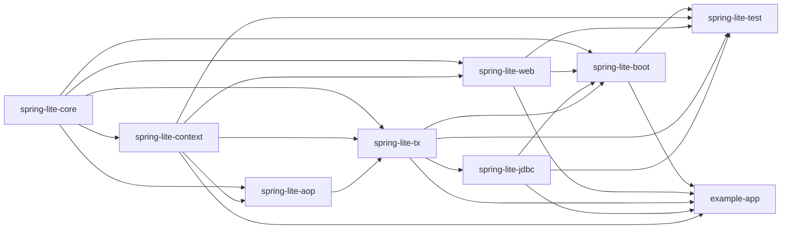

## 2. `spring-lite-core`

### 역할

`spring-lite-core`는 다른 모든 모듈이 공유하는 가장 낮은 레벨의 공통 기반이다. 애너테이션 모델, 예외 타입, 리플렉션 유틸리티, 프로퍼티 해석, 값 변환, 검증 규칙이 여기에 있다.

### 핵심 패키지

- `lite.spring.core.annotation`
- `lite.spring.core.exception`
- `lite.spring.core.reflect`
- `lite.spring.core.util`
- `lite.spring.core.convert`
- `lite.spring.core.validation`

### 클래스 다이어그램

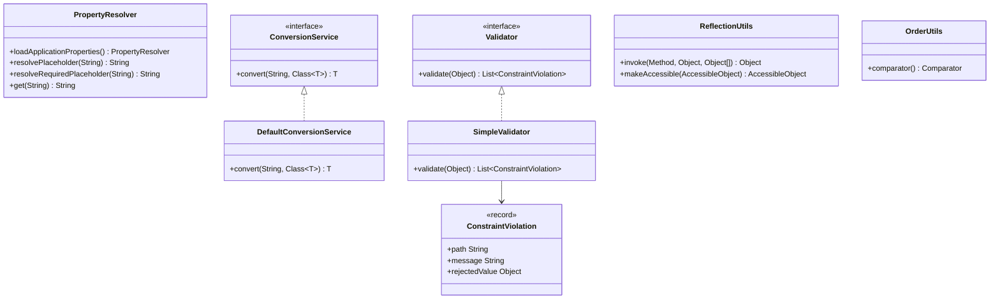

### 코드 읽기 포인트

- `PropertyResolver`는 `application.yml`, 프로파일별 설정, 런타임 오버라이드를 하나의 조회 모델로 합친다.
- `DefaultConversionService`는 컨테이너의 `@Value` 주입과 웹 바인딩 양쪽에서 공통적으로 쓰이는 타입 변환 축이다.
- `SimpleValidator`는 record와 일반 객체를 모두 순회하며 `@NotNull`, `@Min`, `@Size`, 중첩 `@Valid`를 처리한다.
- `OrderUtils`는 `@Order` 애너테이션과 `Ordered` 인터페이스를 함께 읽어 정렬 기준을 만든다. AOP와 Bean 후처리 정렬에서 핵심이다.

### 이 모듈이 중요한 이유

다른 모듈 대부분은 "자기 로직"보다 "메타데이터를 어떻게 읽을 것인가"에 크게 의존한다. 그 메타데이터 해석의 기반이 바로 core다. `spring-lite-context`가 `@Configuration`과 `@Value`를 읽고, `spring-lite-web`이 바인딩과 검증을 수행하고, `spring-lite-aop`가 `@Order`를 해석하는 공통 기반이 모두 여기 있다.

### 디버깅 관점에서 볼 포인트

- 프로퍼티 값이 이상하면 `PropertyResolver` 병합 순서를 먼저 본다.
- 웹 바인딩과 `@Value` 주입의 타입 변환이 다르게 보이면 `DefaultConversionService` 공유 여부를 확인한다.
- 검증 응답이 기대와 다르면 `SimpleValidator`가 위반 목록을 어떻게 쌓는지 본다.

### 실제 Spring과 비교할 축

- `Environment`, `PropertySources`, `ConversionService`, `Validator`
- 즉, core는 눈에 띄지 않지만 실제 Spring에서도 거의 모든 상위 기능이 기대는 저수준 기반이다.

### 메서드 구조 해설

#### `PropertyResolver`

- `loadApplicationProperties()`
  - 역할: 기본 설정 파일, 프로파일별 파일, 런타임 오버라이드를 병합해 최종 프로퍼티 뷰를 만든다.
  - 왜 중요한가: 이 메서드 하나가 "환경도 런타임 입력"이라는 사실을 코드로 보여 준다.
- `resolvePlaceholder(String)`
  - 역할: `${...}` 문법을 해석하되, 값이 없으면 `null`을 돌려줄 수 있는 느슨한 조회다.
  - 사용 위치: 선택적 값 해석, 내부 보조 로직.
- `resolveRequiredPlaceholder(String)`
  - 역할: 값이 반드시 있어야 하는 경우 예외까지 포함해 강하게 해석한다.
  - 사용 위치: `@Value` 주입, 필수 설정 로딩.

#### `DefaultConversionService`

- `convert(String, Class<T>)`
  - 역할: 문자열 기반 외부 입력을 자바 타입으로 바꾼다.
  - 다루는 책임: 숫자, 불리언, enum, 문자열, 일부 박싱 타입.
  - 설계 포인트: 컨테이너와 웹이 같은 변환 규칙을 쓰도록 공통 축을 제공한다.

#### `SimpleValidator`

- `validate(Object)`
  - 역할: 객체 그래프를 순회하며 제약 조건을 수집한다.
  - 출력: `ConstraintViolation` 목록.
  - 설계 포인트: 예외를 바로 던지지 않고 위반 목록을 먼저 수집하게 해, 호출자 계층이 HTTP 400 또는 다른 방식으로 매핑할 수 있게 한다.
- 내부 순회 메서드들
  - 역할: record/일반 객체 분기, 필드 접근, 중첩 `@Valid` 탐색.
  - 설계 포인트: 검증 엔진이 도메인 객체 구조를 "반사적으로 읽는 리더"라는 사실을 드러낸다.

## 3. `spring-lite-context`

### 역할

`spring-lite-context`는 Spring Lite의 IoC 컨테이너 본체다. 빈 정의 등록, 컴포넌트 스캔, 생성자 주입, 설정 클래스 처리, 스코프, 이벤트, 라이프사이클, Bean 후처리까지 모두 여기서 조율한다.

### 디버깅 관점에서 볼 포인트

- 빈이 아예 보이지 않으면 등록과 스캔을 먼저 본다.
- 빈은 보이는데 생성 실패가 나면 생성자 선택과 의존성 해석을 본다.
- 생성은 되는데 기대 기능이 안 붙으면 라이프사이클과 후처리기 적용 순서를 본다.

### 핵심 클래스

- `AnnotationConfigApplicationContext`
- `BeanDefinition`
- `ClassPathScanner`
- `AnnotationUtils`
- `BeanNameGenerator`
- `BeanPostProcessor`
- `ApplicationEvent`, `ApplicationListener`

### 클래스 다이어그램

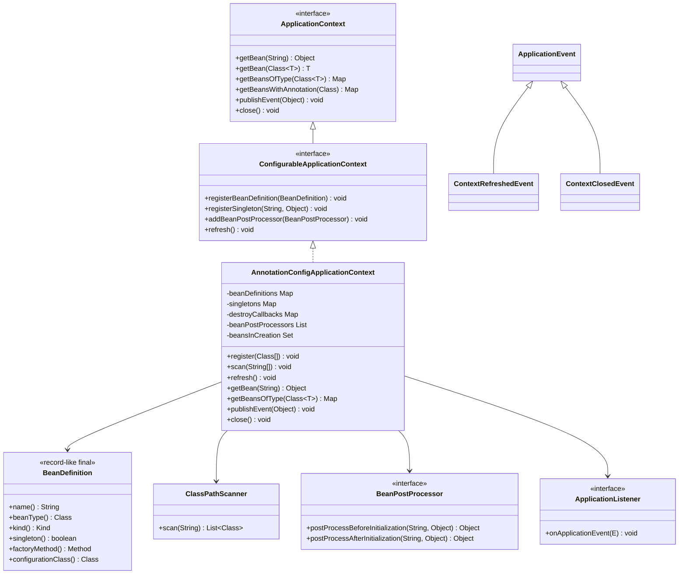

### 내부 구조 해설

#### `AnnotationConfigApplicationContext`

이 클래스는 저장소와 오케스트레이터 역할을 동시에 가진다.

- `beanDefinitions`: 아직 인스턴스화되지 않은 빈의 생성 계획
- `singletons`: 이미 생성된 싱글톤 빈 캐시
- `destroyCallbacks`: `@PreDestroy`, `AutoCloseable` 정리 콜백
- `conditionMetadata`: `@ConditionalOnBean`, `@ConditionalOnMissingBean`, `@ConditionalOnProperty`, `@ConditionalOnClass` 평가 메타데이터
- `beanPostProcessors`: 후처리기 체인
- `beansInCreation`: 생성 중 빈 추적, 순환 참조 탐지

`refresh()`는 컨테이너의 런타임 조립 순서를 명확히 드러낸다.

1. `BeanPostProcessor` 빈을 먼저 인스턴스화
2. `@Configuration` 빈을 먼저 생성
3. 다시 후처리기를 재수집
4. 남은 싱글톤 빈 생성
5. `ContextRefreshedEvent` 발행

##### 주요 메서드별 책임

- `register(Class<?>...)`
  - 역할: 설정 클래스를 수동 등록하고, 필요하면 `@ComponentScan`을 해석해 추가 스캔을 시작한다.
  - 입력: 사용자 지정 설정 클래스.
  - 출력: 즉시 객체를 만들지 않고 `BeanDefinition`만 쌓는다.
- `scan(String...)`
  - 역할: 패키지를 기준으로 관리 대상 클래스를 찾고 등록한다.
  - 설계 포인트: 등록과 생성 시점을 분리한다.
- `refresh()`
  - 역할: 정의 단계에서 실행 단계로 전환하는 메서드다.
  - 설계 포인트: 후처리기, 설정 빈, 일반 싱글톤의 순서를 고정해 컨테이너 생명주기의 기준 시점을 만든다.
- `getBean(String)` / `getBean(Class<T>)`
  - 역할: 이름 또는 타입으로 빈을 조회한다.
  - 설계 포인트: 조회 시점에 지연 생성이 가능하며, 타입 조회는 모호성 예외를 통해 컨테이너의 판단 규칙을 드러낸다.
- `createBean(...)`
  - 역할: 생성 전략 선택, 순환 참조 감지, 초기화, 캐시 저장을 한곳에서 수행한다.
  - 설계 포인트: 컨테이너의 핵심 조립 알고리즘이 집중된 메서드다.
- `initializeBean(...)`
  - 역할: 필드 값 주입, 전후 후처리기, `@PostConstruct`, 종료 콜백 등록까지 수행한다.
  - 설계 포인트: "생성"과 "준비 완료"가 다르다는 사실을 코드 구조로 드러낸다.
- `publishEvent(Object)`
  - 역할: 현재 컨텍스트에 등록된 `ApplicationListener` 빈을 찾아 이벤트를 전달한다.
  - 설계 포인트: 런타임 내부 결합을 느슨하게 만든다.
- `close()`
  - 역할: `ContextClosedEvent`를 발행하고 종료 콜백을 역순으로 실행한다.
  - 설계 포인트: 생성 순서와 반대 방향으로 정리하는 것이 자원 관리에 유리하다.

#### `BeanDefinition`

`BeanDefinition`은 인스턴스가 아니라 "인스턴스를 어떻게 만들 것인가"를 표현한다.

- `Kind.COMPONENT`
- `Kind.CONFIGURATION`
- `Kind.FACTORY_METHOD`
- `Kind.INFRASTRUCTURE`

이 구분 때문에 스캔된 컴포넌트와 `@Bean` 메서드 반환 객체가 같은 컨테이너 파이프라인 안에서 공존할 수 있다.

##### 필드별 의미

- `name`
  - 컨테이너 내부 조회 키다.
- `beanType`
  - 타입 기반 주입과 후처리기 대상 판별의 기준이다.
- `kind`
  - 생성 전략과 특수 취급 여부를 결정한다.
- `configurationClass`
  - 팩토리 메서드 빈일 때 어떤 설정 인스턴스 위에서 메서드를 호출할지 알려준다.
- `factoryMethod`
  - `@Bean` 방식 생성의 실제 진입점이다.
- `singleton`
  - 캐시 저장 여부를 결정한다.
- `qualifier`
  - 다중 후보 상황에서 선택 힌트를 제공한다.

#### `ClassPathScanner`

파일 시스템 경로와 JAR 양쪽을 스캔한다. 학습용 구현이지만 실전적인 제약을 어느 정도 반영했다. `AnnotationUtils`와 함께 작동하며 메타 애너테이션까지 고려해 후보를 수집한다.

##### 주요 메서드별 책임

- `scan(String basePackage)`
  - 역할: 스캔 진입점. URL 자원을 모으고, 파일/JAR 스캔 결과를 병합한다.
- `scanDirectory(...)`
  - 역할: 개발 환경의 클래스 디렉터리를 재귀 순회한다.
- `scanJar(...)`
  - 역할: 배포 환경의 JAR 엔트리를 훑는다.
- `addClasses(...)`
  - 역할: 중복을 제거하며 결과를 누적한다.

이 구조가 중요한 이유는 스캔이 단순 문자열 매칭이 아니라 배포 형태까지 고려하는 메타데이터 수집기라는 사실을 드러내기 때문이다.

### 호출 흐름

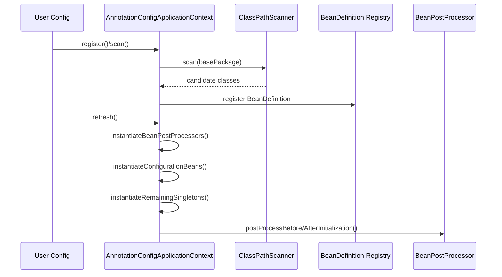

### 코드 읽기 순서

1. `BeanDefinition`
2. `AnnotationUtils`
3. `ClassPathScanner`
4. `AnnotationConfigApplicationContext.registerDiscoveredClass()`
5. `AnnotationConfigApplicationContext.createBean()`
6. `initializeBean()`, `publishEvent()`, `close()`

## 4. `spring-lite-aop`

### 역할

`spring-lite-aop`는 프록시 기반 메서드 가로채기 인프라를 제공한다. AOP의 핵심인 `MethodInterceptor`, `MethodInvocation`, 프록시 생성기, `@Aspect` 해석용 후처리기가 모두 여기에 있다.

### 핵심 클래스

- `ProxyFactory`
- `MethodInvocation`
- `MethodInterceptor`
- `AspectBeanPostProcessor`
- `@Aspect`, `@Before`, `@Around`, `@AfterReturning`

### 클래스 다이어그램

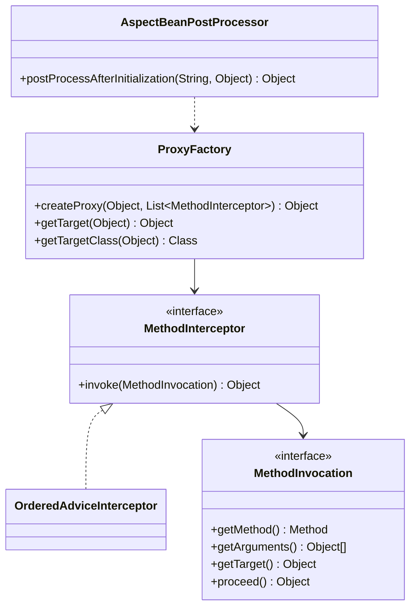

### 내부 구조 해설

#### `ProxyFactory`

`ProxyFactory`는 현재 프레임워크에서 프록시 생성을 한곳으로 모아 둔 핵심 유틸리티다.

- 타깃이 인터페이스를 구현하면 JDK 동적 프록시 사용
- 인터페이스가 없으면 ByteBuddy + Objenesis 기반 클래스 프록시 사용
- 이미 프록시인 대상을 다시 프록시화할 때는 `unwrapProxy()`로 원 타깃과 기존 인터셉터를 추출한 뒤 체인을 병합
- 인터셉터 병합 후 `OrderUtils.comparator()`로 정렬

즉, 프록시는 단발성 래퍼가 아니라 누적 가능한 호출 체인이다.

##### 주요 메서드별 책임

- `createProxy(Object, List<MethodInterceptor>)`
  - 역할: 프록시 전략을 선택하고 최종 프록시 인스턴스를 만든다.
  - 분기: 인터페이스가 있으면 JDK 동적 프록시, 없으면 클래스 기반 프록시.
- `unwrapProxy(Object)`
  - 역할: 이미 프록시된 대상을 다시 감쌀 때 원 타깃과 기존 인터셉터를 추출한다.
  - 설계 포인트: AOP와 트랜잭션이 별도 후처리기로 작동해도 같은 체인으로 병합될 수 있게 한다.
- `mergeInterceptors(...)`
  - 역할: 기존 체인과 새 체인을 합친 뒤 순서를 정렬한다.
- `createClassProxy(...)`
  - 역할: ByteBuddy로 subclass proxy를 만들고, invocation handler를 심는다.
  - 설계 포인트: 인터페이스가 없는 구체 클래스도 프록시 가능하게 만든다.

#### `MethodInvocation`

이 인터페이스는 "메서드 호출 그 자체"를 객체로 다루게 만든다. AOP가 가능한 이유는 호출 대상을 메서드, 인자, `proceed()`를 가진 데이터 구조로 취급하기 때문이다.

##### 메서드별 의미

- `getMethod()`
  - 현재 가로채는 메서드 시그니처를 노출한다.
- `getArguments()`
  - 인터셉터가 인자를 읽거나 수정할 수 있게 한다.
- `getTarget()`
  - 최종 타깃 객체를 노출한다.
- `proceed()`
  - 다음 인터셉터 또는 최종 타깃 메서드로 흐름을 넘긴다.
  - 설계 포인트: 체인 실행 모델의 중심이다.

#### `AspectBeanPostProcessor`

이 클래스는 선언형 AOP 해석기다.

- `@Aspect` 빈을 찾는다.
- advice 메서드를 `AdviceDescriptor`로 변환한다.
- 대상 빈 메서드에 매칭되는 advice를 찾아 `OrderedAdviceInterceptor`로 감싼다.
- 최종적으로 `ProxyFactory.createProxy()`를 호출해 프록시를 만든다.

즉, `@Aspect` 문법은 별도 실행 엔진이 아니라 인터셉터 생성 규칙의 문법적 표면이다.

##### 주요 메서드별 책임

- `postProcessAfterInitialization(...)`
  - 역할: 특정 빈에 적용할 advice를 계산하고, 필요하면 프록시를 반환한다.
- `resolveInterceptors(...)`
  - 역할: 대상 빈 메서드와 aspect 정의를 매칭해 인터셉터 목록을 만든다.
- `resolveAdviceDescriptors(...)`
  - 역할: aspect 클래스의 메서드들을 advice 메타데이터로 정규화한다.

이 클래스는 선언형 AOP를 "실행 로직"이 아니라 "해석 로직"으로 이해하게 만드는 핵심 컴포넌트다.

### 호출 흐름

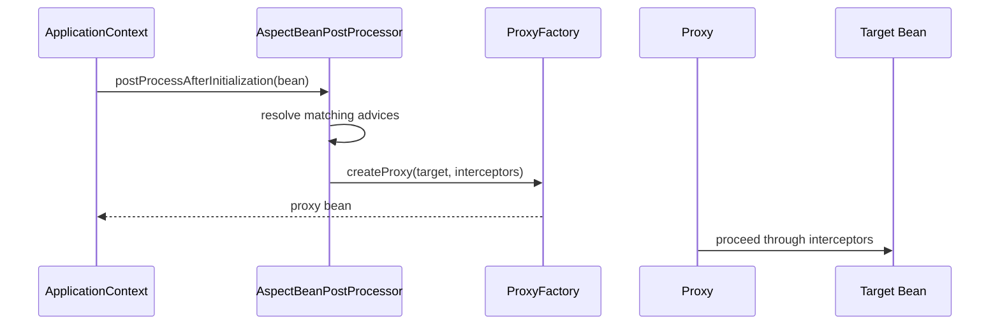

### 코드 읽기 순서

1. `MethodInterceptor`
2. `MethodInvocation`
3. `ProxyFactory`
4. `AspectBeanPostProcessor`

## 5. `spring-lite-tx`

### 역할

`spring-lite-tx`는 선언형 트랜잭션 모듈이다. `@Transactional` 메타데이터를 읽고, 트랜잭션 프록시를 적용하고, 스레드 로컬 기반으로 커넥션 문맥을 관리한다.

### 핵심 클래스

- `TransactionalBeanPostProcessor`
- `TransactionManager`
- `ConnectionHolder`
- `@Transactional`
- `Propagation`

### 클래스 다이어그램

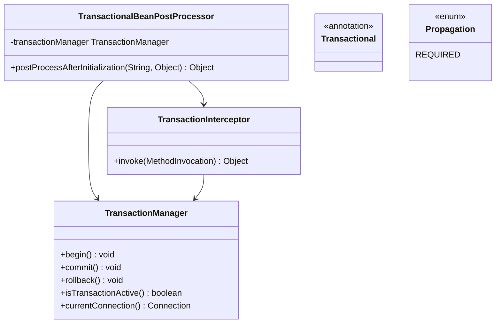

### 내부 구조 해설

#### `TransactionManager`

이 클래스는 아주 작은 `PlatformTransactionManager` 축소판이다.

- `ThreadLocal<TransactionContext>`에 현재 트랜잭션 문맥 저장
- `begin()`에서 depth 증가 또는 새 커넥션 획득
- `commit()`에서 depth가 0이 될 때 실제 커밋
- `rollback()`에서 rollback-only를 마킹하고 최종 깊이에서 실제 롤백
- `currentConnection()`으로 JDBC 모듈과 현재 문맥 공유

즉, 이 구현의 핵심은 "트랜잭션은 스레드에 묶인 문맥"이라는 점을 작게 드러내는 데 있다.

##### 주요 메서드별 책임

- `begin()`
  - 역할: 새 트랜잭션 시작 또는 중첩 깊이 증가.
  - 설계 포인트: `REQUIRED` 전파의 최소 모델을 구현한다.
- `commit()`
  - 역할: 깊이가 0이 되는 마지막 경계에서 실제 커밋 또는 rollback-only 처리.
- `rollback()`
  - 역할: rollback-only를 마킹하고 마지막 경계에서 실제 롤백.
- `currentConnection()`
  - 역할: JDBC 계층이 현재 트랜잭션 문맥에 참여하도록 연결을 노출한다.

#### `TransactionalBeanPostProcessor`

컨테이너 단계에서 `@Transactional` 대상 빈을 탐지한다. 그 후 빈 자체를 직접 바꾸는 대신 프록시를 씌운다. 이 방식 때문에 self-invocation 문제가 생기며, 동시에 선언형 트랜잭션이 메서드 호출 경계에 존재한다는 사실이 분명하게 드러난다.

내부 `TransactionInterceptor`는 다음 순서를 가진다.

1. 대상 메서드의 `@Transactional` 메타데이터 확인
2. `transactionManager.begin()`
3. 실제 메서드 `proceed()`
4. 성공 시 `commit()`
5. 예외 시 `rollbackFor`, `noRollbackFor` 정책 평가 후 `rollback()` 또는 `commit()`

##### 메서드 구조 해설

- `postProcessAfterInitialization(...)`
  - 역할: 트랜잭션 대상 판별과 프록시 적용.
  - 설계 포인트: 선언은 메타데이터고, 동작은 프록시라는 구조를 분명히 한다.
- `requiresTransactionProxy(...)`
  - 역할: 클래스/메서드 수준 `@Transactional` 존재 여부를 판단한다.
- `TransactionInterceptor.invoke(...)`
  - 역할: begin, proceed, commit/rollback을 하나의 호출 경계 알고리즘으로 묶는다.
- `shouldRollback(...)`
  - 역할: 예외 타입과 롤백 정책 간의 매칭을 수행한다.

### 호출 흐름

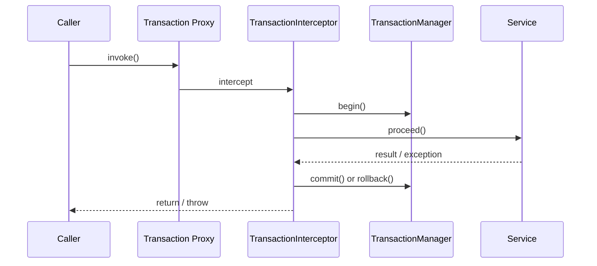

### 코드 읽기 순서

1. `@Transactional`, `Propagation`
2. `TransactionManager`
3. `TransactionalBeanPostProcessor`

## 6. `spring-lite-web`

### 역할

`spring-lite-web`는 경량 MVC 모듈이다. HTTP 요청을 컨트롤러 메서드 호출로 바꾸고, 인자를 바인딩하고, 검증하고, 응답을 직렬화하고, 예외를 HTTP 응답으로 변환한다.

### 핵심 클래스

- `DispatcherServlet`
- `RequestMappingHandlerMapping`
- `RequestMappingHandlerAdapter`
- `HandlerMethod`
- `HandlerMethodMatch`
- `HandlerMethodArgumentResolver` 계열
- `JsonReturnValueHandler`
- `DefaultExceptionResolver`
- `JsonMapper`

### 클래스 다이어그램

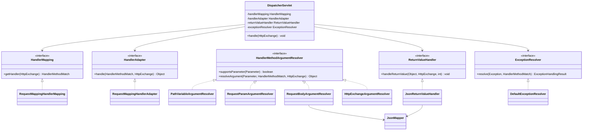

### 내부 구조 해설

#### `DispatcherServlet`

웹 모듈의 조립 루트다. 생성자에서 전략 객체를 한 번에 조립한다.

- `RequestMappingHandlerMapping`
- `RequestMappingHandlerAdapter`
- `JsonReturnValueHandler`
- `DefaultExceptionResolver`

`handle()`은 파이프라인을 명확하게 보여 준다.

1. 핸들러 매핑
2. 핸들러 실행
3. 반환값 렌더링
4. 예외 발생 시 예외 해석
5. 응답 작성 후 `exchange.close()`

##### 주요 메서드별 책임

- 생성자
  - 역할: `HandlerMapping`, `HandlerAdapter`, `ReturnValueHandler`, `ExceptionResolver`를 조립한다.
  - 설계 포인트: 웹 모듈의 전략 객체 배선을 한곳에 모은다.
- `handle(HttpExchange)`
  - 역할: 요청 1건의 전체 실행 파이프라인.
  - 설계 포인트: 성공/실패 경로를 같은 메서드에서 통제해 Front Controller의 알고리즘을 드러낸다.

#### `RequestMappingHandlerMapping`

`@RestController` 빈을 순회해 `HandlerMethod` 목록을 만든다. 단순 URL 매핑을 넘어서 아래 조건을 함께 평가한다.

- HTTP method
- path pattern
- `consumes`
- `produces`
- `headers`
- `params`

패턴은 정규식으로 바꿔 `HandlerMethodMatch`와 path variable map을 함께 반환한다.

##### 주요 메서드별 책임

- 생성자
  - 역할: 컨텍스트에서 `@RestController` 빈을 수집하고 핸들러 목록을 미리 계산한다.
- `getHandler(HttpExchange)`
  - 역할: 요청 메서드, 경로, 조건을 평가해 최종 핸들러를 찾는다.
- `discoverHandlers(...)`
  - 역할: 컨트롤러 메서드를 `HandlerMethod`로 정규화한다.
- `matchesConditions(...)`
  - 역할: `consumes`, `produces`, `headers`, `params`를 함께 평가한다.
- `newHandler(...)`
  - 역할: path pattern을 regex와 메타데이터를 가진 실행 단위로 바꾼다.

#### `RequestMappingHandlerAdapter`

핸들러 실행기다. 여러 `HandlerMethodArgumentResolver`를 순회하며 파라미터별 인자를 구성하고, `Validator`를 통해 `@Valid`를 평가한 뒤 실제 컨트롤러 메서드를 호출한다.

##### 주요 메서드별 책임

- `handle(...)`
  - 역할: 인자 해석, 검증, 메서드 호출까지 담당한다.
- `resolveArguments(...)`
  - 역할: 각 파라미터를 어떤 resolver가 처리할지 선택하고 값을 만든다.
- `validateIfNecessary(...)`
  - 역할: `@Valid`가 붙은 인자에만 검증을 적용한다.

이 클래스는 "요청을 메서드 호출로 번역하는 책임"을 가장 직접적으로 가진다.

#### `DefaultExceptionResolver`

예외 처리 우선순위를 코드로 드러낸다.

1. 컨트롤러 내부 `@ExceptionHandler`
2. `@ControllerAdvice`
3. `ValidationException` 기본 처리
4. 일반 500 에러 처리

즉, MVC 후반부의 실패 응답 표준화를 담당한다.

##### 주요 메서드별 책임

- `resolve(...)`
  - 역할: 예외를 HTTP 응답 모델로 번역하는 최상위 진입점.
- `findExceptionHandlerMethod(...)`
  - 역할: 예외 타입 계층을 따라 가장 적합한 핸들러 메서드를 찾는다.
- `invokeHandler(...)`
  - 역할: 찾은 핸들러를 호출해 `ExceptionHandlingResult`로 정규화한다.

### 요청 흐름

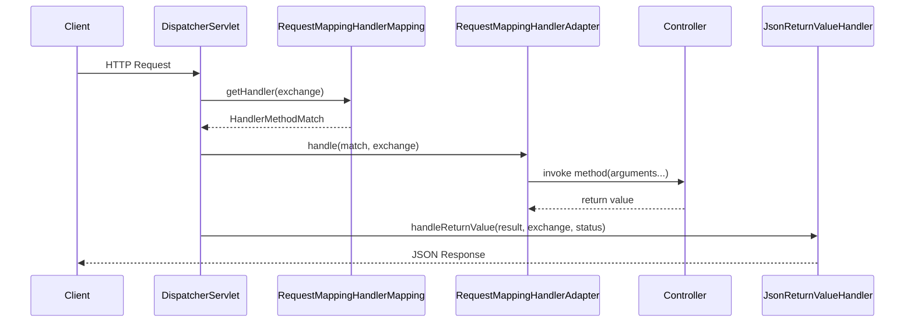

### 코드 읽기 순서

1. `HandlerMethod`
2. `RequestMappingHandlerMapping`
3. `HandlerMethodArgumentResolver` 구현들
4. `RequestMappingHandlerAdapter`
5. `JsonMapper`
6. `JsonReturnValueHandler`
7. `DefaultExceptionResolver`
8. `DispatcherServlet`

## 7. `spring-lite-jdbc`

### 역할

`spring-lite-jdbc`는 JDBC 반복 코드를 줄이고, 트랜잭션 문맥과 커넥션 재사용을 연결하는 데이터 접근 모듈이다.

### 핵심 클래스

- `JdbcTemplate`
- `RowMapper`
- `DriverManagerDataSource`
- `SingleConnectionProxy`

### 클래스 다이어그램

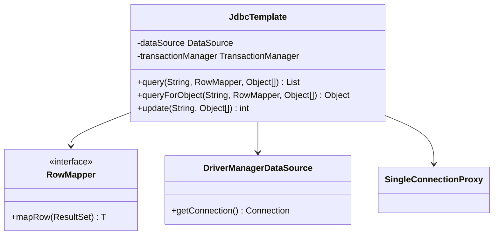

### 내부 구조 해설

#### `JdbcTemplate`

이 클래스는 SQL 실행의 불변 골격을 소유한다.

- 커넥션 획득
- `PreparedStatement` 생성
- 파라미터 바인딩
- SQL 실행
- `ResultSet` 순회
- 자원 해제

가변 지점은 `RowMapper`와 SQL 문자열이다. 즉, 템플릿 메서드 패턴을 작게 구현한 형태다.

특히 중요한 부분은 `obtainConnectionIfNeeded()`다.

- 현재 트랜잭션 커넥션이 있으면 `SingleConnectionProxy` 반환
- 없으면 새 커넥션 획득

이 구조 덕분에 JDBC 모듈은 트랜잭션 문맥을 투명하게 따른다.

##### 주요 메서드별 책임

- `query(...)`
  - 역할: 여러 행 결과를 `RowMapper`로 매핑한다.
- `queryForObject(...)`
  - 역할: 단일 결과를 기대하는 조회를 수행한다.
- `update(...)`
  - 역할: insert/update/delete 계열 SQL을 실행한다.
- `obtainConnectionIfNeeded()`
  - 역할: 트랜잭션 참여 여부에 따라 현재 커넥션 또는 새 커넥션을 선택한다.
- `bind(...)`
  - 역할: varargs 인자를 `PreparedStatement` 파라미터로 연결한다.

#### `SingleConnectionProxy`

트랜잭션이 보유한 실제 커넥션을 감싸되, 템플릿 내부의 `try-with-resources`가 커넥션 전체를 닫아 버리지 않도록 막는 보호 계층이다. 즉, "닫는 것처럼 보이지만 실제로는 트랜잭션 경계까지 유지되는" 연결 프록시다.

### 호출 흐름

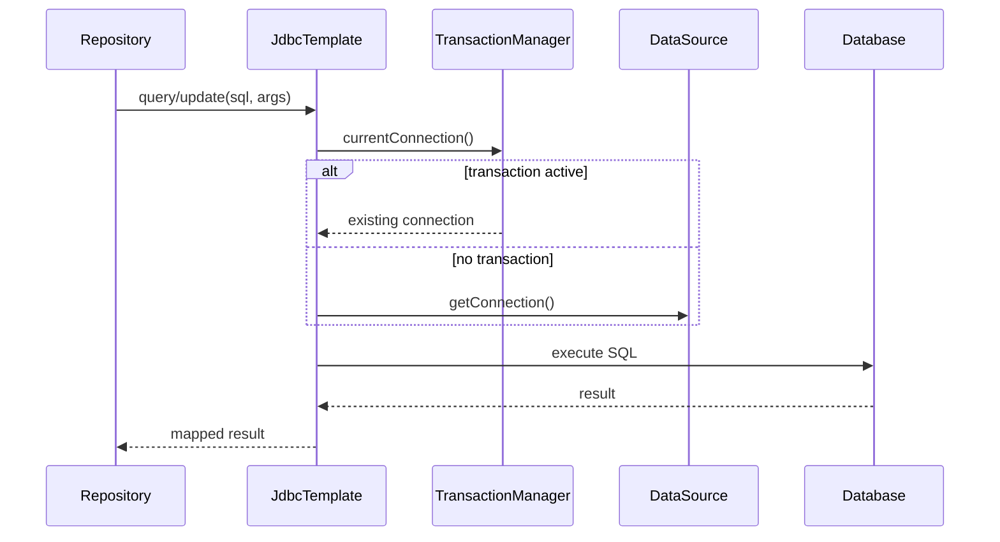

## 8. `spring-lite-boot`

### 역할

`spring-lite-boot`는 여러 모듈을 실제 실행 가능한 애플리케이션으로 묶는 부트스트랩 계층이다. 설정 클래스 등록, 기본 auto-configuration 등록, 웹 서버 기동을 한 번에 묶는다.

### 핵심 클래스

- `SpringLiteApplication`
- `BootInfrastructureRegistrar`
- `ApplicationProperties`
- `WebServer`, `WebServerFactory`
- `JdkWebServer`, `JdkWebServerFactory`
- `JsonAutoConfiguration`, `AopAutoConfiguration`, `TransactionAutoConfiguration`, `JdbcAutoConfiguration`, `WebAutoConfiguration`

### 클래스 다이어그램

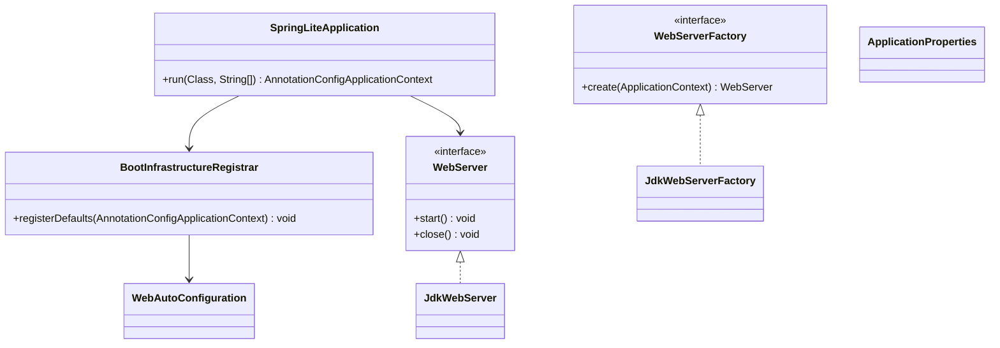

### 내부 구조 해설

#### `SpringLiteApplication`

`run()`은 Boot 계층의 전체 목적을 드러낸다.

1. 커맨드라인 `--key=value` 인자 파싱
2. `PropertyResolver.withOverrides(...)`로 런타임 프로퍼티 오버라이드 적용
3. 새 `AnnotationConfigApplicationContext` 생성
4. 사용자 애플리케이션 클래스 등록
5. `commandLineApplicationProperties` 싱글톤 등록
6. `BootInfrastructureRegistrar.registerDefaults(context)`
7. `refresh()`
8. `WebServer` 조회 후 `start()`

즉, Boot의 역할은 새 프레임워크를 만드는 것이 아니라 기존 모듈의 조립을 단순화하는 것이다.

##### 주요 메서드별 책임

- `run(Class<?>, String...)`
  - 역할: 애플리케이션 전체 부트스트랩 진입점.
  - 설계 포인트: 설정 등록, 오버라이드 적용, 기본 auto-config, refresh, 서버 기동을 한 메서드에 모은다.
- `parseCommandLineArgs(...)`
  - 역할: `--key=value` 형식 인자를 프로퍼티 오버라이드 맵으로 바꾼다.
  - 설계 포인트: Boot가 코드 밖 입력을 조립에 반영하는 가장 얇은 예시다.

#### `BootInfrastructureRegistrar`

기본 auto-configuration 진입점이다. 여러 `*AutoConfiguration` 클래스를 컨텍스트에 등록하는 매우 얇은 계층이다. 핵심 로직을 직접 소유하지 않고, 컨텍스트와 설정 메타데이터 위에 얹히는 구성 모듈이라는 점이 중요하다.

#### `WebAutoConfiguration`

웹 모듈과 서버 모듈이 만나는 지점이다. `DispatcherServlet`, `WebServerFactory`, `WebServer` 빈을 조립해 HTTP 요청 파이프라인이 실제 서버 포트에서 실행되도록 연결한다.

### 부트스트랩 흐름

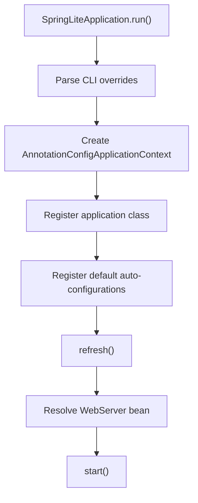

## 9. `spring-lite-test`

### 역할

`spring-lite-test`는 JUnit 5 위에 Spring Lite 테스트 실행 환경을 제공한다. 테스트 컨텍스트 생성, 필드 주입, 파라미터 주입, `MockMvc`, 테스트용 트랜잭션 롤백을 담당한다.

### 핵심 클래스

- `SpringLiteTest`
- `SpringLiteTestExtension`
- `MockMvc`
- `MockHttpRequest`
- `MockHttpResponse`

### 클래스 다이어그램

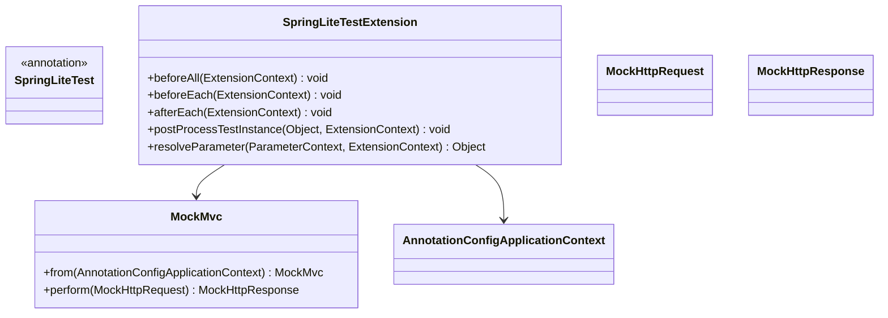

### 내부 구조 해설

#### `SpringLiteTestExtension`

테스트 모듈의 중심이다.

- `beforeAll()`: 컨텍스트 생성/캐시
- `postProcessTestInstance()`: `@Autowired` 필드 주입
- `supportsParameter()/resolveParameter()`: `ApplicationContext`, `MockMvc`, 일반 빈 파라미터 주입
- `beforeEach()/afterEach()`: 테스트 메서드 또는 클래스에 `@Transactional`이 있으면 트랜잭션 시작 후 종료 시 롤백

또한 설정 클래스가 `@SpringLiteBootApplication`을 사용하면 `BootInfrastructureRegistrar`까지 자동 등록한다. 즉, 순수 context 테스트와 boot 통합 테스트를 하나의 확장 모델 안에서 다룬다.

##### 주요 메서드별 책임

- `beforeAll(...)`
  - 역할: 테스트 클래스 단위 컨텍스트를 미리 생성한다.
- `postProcessTestInstance(...)`
  - 역할: 테스트 인스턴스의 `@Autowired` 필드를 주입한다.
- `supportsParameter(...)` / `resolveParameter(...)`
  - 역할: 테스트 메서드 파라미터에 컨텍스트, `MockMvc`, 일반 빈을 주입한다.
- `beforeEach(...)`
  - 역할: 트랜잭션 테스트라면 테스트 시작 전에 트랜잭션을 연다.
- `afterEach(...)`
  - 역할: 열린 테스트 트랜잭션을 롤백해 테스트 간 오염을 막는다.

#### `MockMvc`

실제 소켓 서버를 띄우지 않고 `DispatcherServlet`을 직접 호출하는 테스트 어댑터다. 웹 계층 테스트를 빠르게 수행할 수 있게 해 준다.

### 테스트 실행 흐름

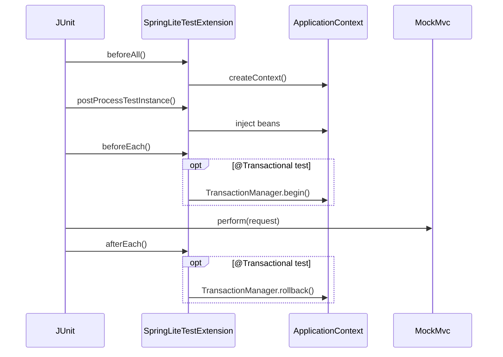

## 10. `example-app`

### 역할

`example-app`은 프레임워크 사용 예제가 아니라, 프레임워크 전체 런타임이 실제로 결합되는 검증용 애플리케이션이다. 컨트롤러, 서비스, 저장소, 설정 클래스, Boot 시작점이 모두 포함된다.

### 핵심 클래스

- `ExampleApplication`
- `AppConfig`
- `OrderController`
- `OrderService`
- `DefaultOrderService`
- `OrderRepository`
- `JdbcOrderRepository`
- `Order`
- `CreateOrderRequest`

### 클래스 다이어그램

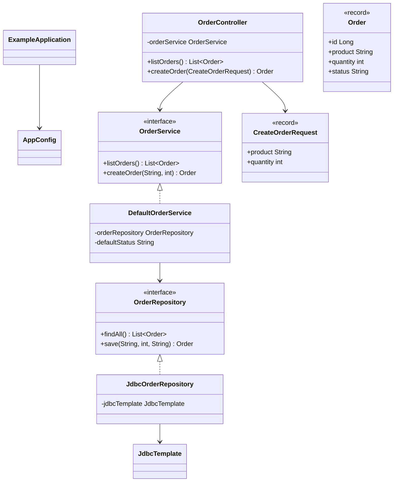

### 호출 흐름

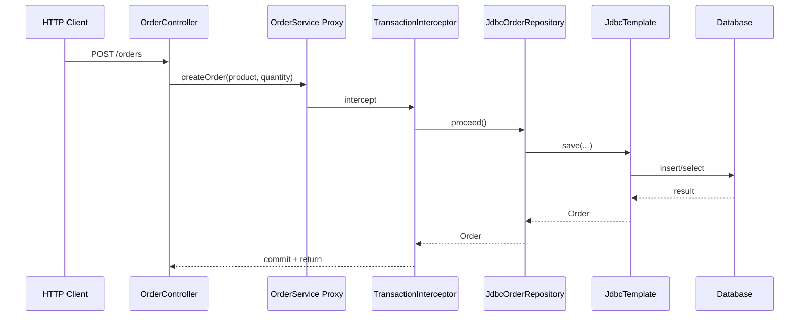

### 코드 읽기 포인트

- `ExampleApplication`은 Boot 시작점이다.
- `AppConfig`는 데이터소스, 기본 상태 값 같은 인프라 조립 지점을 보여 준다.
- `OrderController`는 MVC 바인딩, 검증, JSON 응답이 어떻게 적용되는지 보여 준다.
- `DefaultOrderService`는 선언형 트랜잭션이 실제 비즈니스 경계에 놓이는 지점이다.
- `JdbcOrderRepository`는 `JdbcTemplate`과 `RowMapper` 패턴의 실제 사용 예다.

### 클래스별 해설

#### `OrderController`

- 책임: HTTP 입력을 도메인 서비스 호출로 변환한다.
- 메서드 구조:
  - `listOrders()`: 조회 흐름의 최소 예.
  - `createOrder(...)`: `@RequestBody`, `@Valid`, 서비스 위임, JSON 응답까지 한 번에 보여 준다.

#### `DefaultOrderService`

- 책임: 주문 생성 유스케이스의 트랜잭션 경계를 제공한다.
- 메서드 구조:
  - `createOrder(...)`: 상태값 주입, 저장소 위임, `@Transactional` 적용 지점.
  - `listOrders()`: 읽기 경로의 가장 단순한 서비스 메서드.

#### `JdbcOrderRepository`

- 책임: SQL과 도메인 매핑을 소유한다.
- 메서드 구조:
  - `findAll()`: 조회 SQL + `RowMapper`.
  - `save(...)`: insert 후 재조회 또는 결과 구성.

## 11. 추천 읽기 시나리오

### 컨테이너 중심으로 읽기

1. `spring-lite-context`
2. `spring-lite-core`
3. `spring-lite-boot`

### AOP/트랜잭션 중심으로 읽기

1. `spring-lite-aop`
2. `spring-lite-tx`
3. `spring-lite-jdbc`
4. `example-app`

### 웹 실행 흐름 중심으로 읽기

1. `spring-lite-web`
2. `spring-lite-test`
3. `example-app`

## 12. 문서와 코드의 대응

- 전체 개요: [overview.md](./overview.md)
- 핵심 원리 해설: [spring-core-principles-and-code-guide.md](./spring-core-principles-and-code-guide.md)
- 실제 Spring 비교: [spring-framework-comparison-and-architecture-guide.md](./spring-framework-comparison-and-architecture-guide.md)

이 문서는 위 세 문서보다 더 코드 밀도가 높은 "모듈 인덱스" 역할을 한다. 전체 런타임 그림은 `overview.md`에서, 개념 설명은 `spring-core-principles-and-code-guide.md`에서, 실제 Spring 대응은 `spring-framework-comparison-and-architecture-guide.md`에서 보고, 모듈 내부 클래스 관계와 읽기 순서는 이 문서에서 따라가는 방식이 가장 효율적이다.
