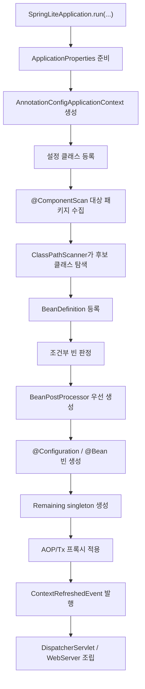
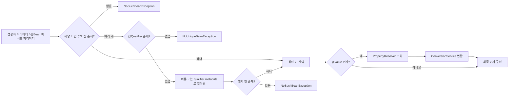
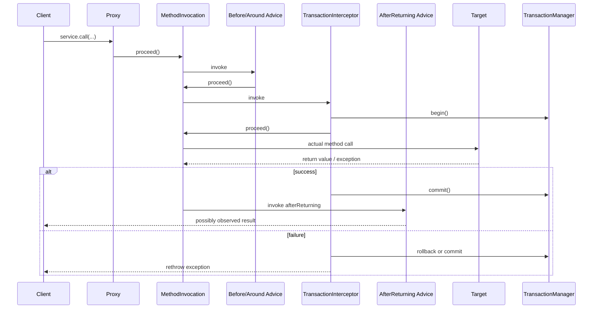
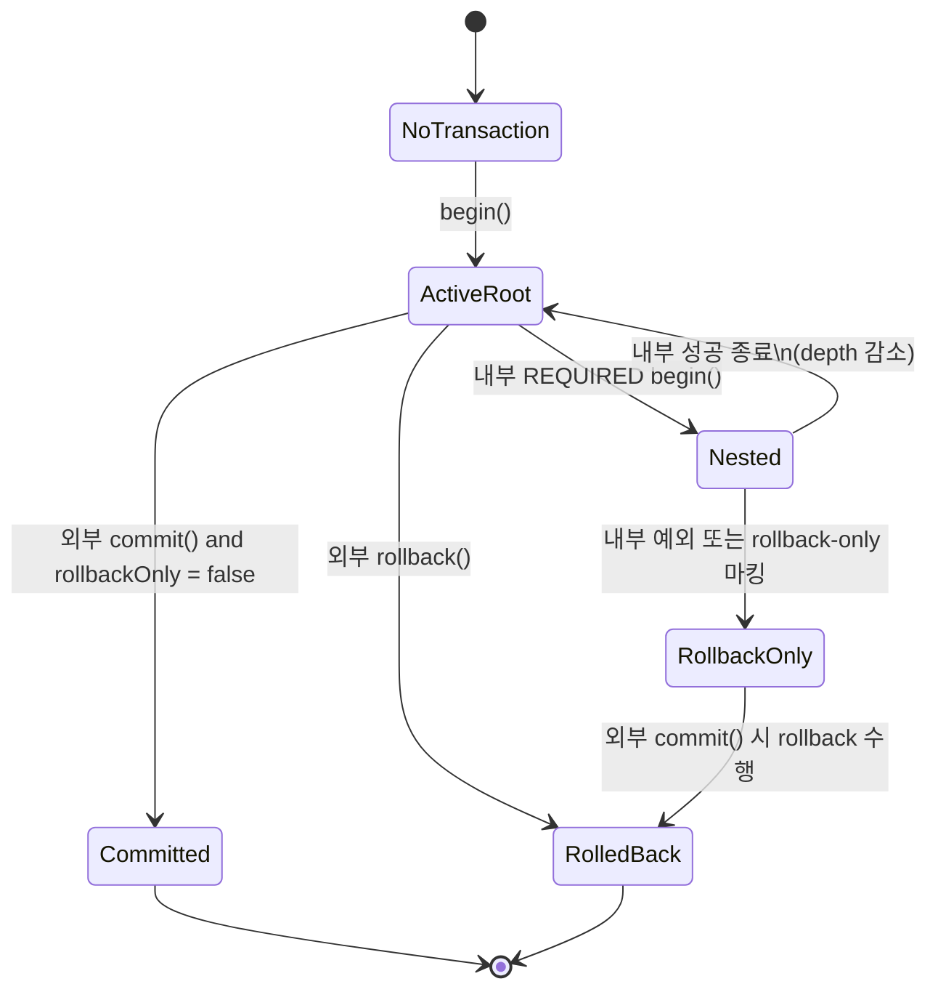
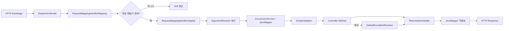
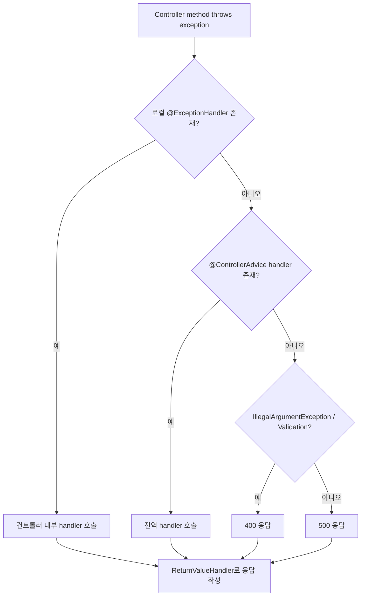
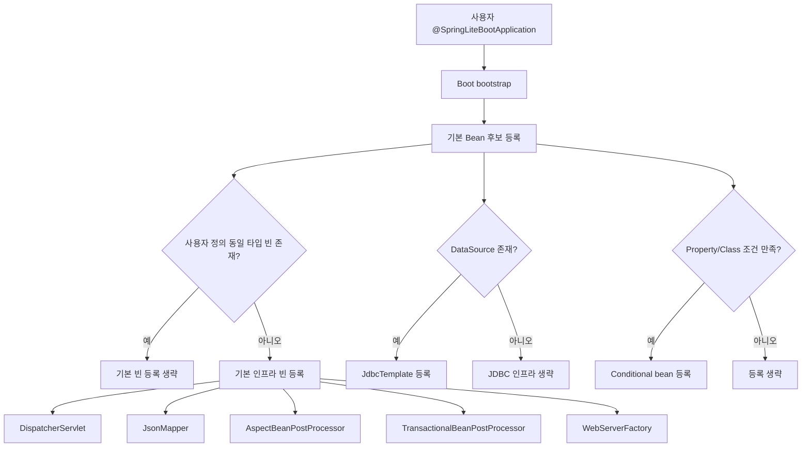

# Visual Architecture Guide

이 문서는 `spring-lite`의 구조, 내부 동작 원리, 모듈 간 연결 지점을 시각적으로 이해하기 위한 다이어그램 모음이다. 기존 [런타임 시퀀스 다이어그램](./runtime-sequence-diagrams.md)이 메서드 호출 순서를 중심으로 설명한다면, 이 문서는 "어떤 구성요소가 어떤 책임을 갖고 어떻게 이어지는가"를 구조도, 상태도, 시퀀스 다이어그램을 섞어서 보여준다.

## 1. 컨테이너 초기화 전체 흐름

`SpringLiteApplication.run()`에서 시작해 컨텍스트가 준비되고, BeanDefinition이 수집되며, 후처리기와 singleton이 생성되고, 마지막으로 웹 인프라가 연결되는 흐름이다.



### 무엇을 보여주는가

- Boot 계층은 직접 비즈니스 로직을 수행하지 않고 초기 조립을 담당한다.
- 컨테이너의 중심 산출물은 `BeanDefinition`이며, 실제 객체 생성은 그 다음 단계다.
- `BeanPostProcessor`는 먼저 준비돼야 이후 빈 생성 과정에 개입할 수 있다.
- 웹 계층은 컨테이너가 어느 정도 완성된 뒤에 조립되는 후반부 구조다.

### 대응 코드

- [SpringLiteApplication.java](/Users/hammac/Projects/spring-lite/spring-lite-boot/src/main/java/lite/spring/boot/SpringLiteApplication.java)
- [AnnotationConfigApplicationContext.java](/Users/hammac/Projects/spring-lite/spring-lite-context/src/main/java/lite/spring/context/support/AnnotationConfigApplicationContext.java)
- [ClassPathScanner.java](/Users/hammac/Projects/spring-lite/spring-lite-context/src/main/java/lite/spring/context/scan/ClassPathScanner.java)

## 2. 빈 생성과 생명주기

한 개의 빈이 컨테이너에 의해 생성될 때 어떤 단계들을 거치는지 보여준다. 단순 생성자 호출이 아니라 값 주입, 초기화, 후처리, 프록시 감싸기, 종료 콜백 등록까지 이어지는 것이 핵심이다.

```mermaid
sequenceDiagram
    participant Ctx as ApplicationContext
    participant Def as BeanDefinition
    participant Conv as ConversionService
    participant Bean as Target Instance
    participant BPP as BeanPostProcessor
    participant Destroy as Destroy Registry

    Ctx->>Ctx: createBean(beanName, definition)
    Ctx->>Ctx: singleton cache 확인
    Ctx->>Ctx: beansInCreation 표시
    alt @Bean factory method
        Ctx->>Ctx: factory method 인자 해석
        Ctx->>Conv: @Value 타입 변환
        Ctx->>Bean: factory method 호출
    else constructor/component bean
        Ctx->>Ctx: 생성자 선택
        Ctx->>Conv: @Value 타입 변환
        Ctx->>Bean: 생성자 호출
    end
    Ctx->>Bean: field @Value 주입
    Ctx->>BPP: postProcessBeforeInitialization
    Ctx->>Bean: @PostConstruct 호출
    Ctx->>BPP: postProcessAfterInitialization
    BPP-->>Ctx: 원본 또는 프록시 반환
    Ctx->>Destroy: @PreDestroy/AutoCloseable 등록
    Ctx->>Ctx: singleton cache 저장
    Ctx->>Ctx: beansInCreation 해제
```

### 무엇을 보여주는가

- 생성자 주입과 `@Value` 해석은 객체 생성보다 앞단에서 해결된다.
- `BeanPostProcessor`는 초기화 전과 후 두 지점에 개입한다.
- 컨테이너가 보관하는 최종 빈은 원본 객체일 수도 있고 프록시일 수도 있다.
- 종료 콜백 등록은 생성 시점에 함께 이뤄져야 close 단계에서 안전하게 회수된다.

### 이해 포인트

- `@PostConstruct`는 후처리기 사이의 특정 위치에 놓인다.
- 프록시가 적용되더라도 destroy callback은 원본 타깃 기준으로 유지돼야 한다.
- singleton/prototype 차이는 캐시 저장 여부에서 갈린다.

### 대응 코드

- [AnnotationConfigApplicationContext.java](/Users/hammac/Projects/spring-lite/spring-lite-context/src/main/java/lite/spring/context/support/AnnotationConfigApplicationContext.java)
- [DefaultConversionService.java](/Users/hammac/Projects/spring-lite/spring-lite-core/src/main/java/lite/spring/core/convert/DefaultConversionService.java)

## 3. 의존성 해결 구조

컨테이너가 빈을 만들기 전에 어떤 규칙으로 의존성을 선택하는지 구조적으로 표현한 그림이다.



### 무엇을 보여주는가

- DI 실패의 대부분은 "후보가 없다", "후보가 여러 개인데 기준이 없다", "설정값이 없다" 세 가지 축으로 환원된다.
- `@Qualifier`와 `@Value`는 모두 주입 문제를 해결하지만, 전자는 빈 선택, 후자는 설정값 주입이라는 점에서 전혀 다른 경로를 탄다.

### 대응 코드

- [AnnotationConfigApplicationContext.java](/Users/hammac/Projects/spring-lite/spring-lite-context/src/main/java/lite/spring/context/support/AnnotationConfigApplicationContext.java)
- [PropertyResolver.java](/Users/hammac/Projects/spring-lite/spring-lite-core/src/main/java/lite/spring/core/util/PropertyResolver.java)

## 4. AOP와 트랜잭션 호출 체인

프록시 기반 프레임워크를 이해할 때 가장 중요한 그림이다. 실제 호출은 타깃 객체로 바로 들어가지 않고, 인터셉터 체인을 거쳐 들어간다.



### 무엇을 보여주는가

- 트랜잭션도 AOP 인터셉터의 한 종류로 체인 안에 들어간다.
- `@Around`는 타깃 호출 전후를 모두 감쌀 수 있지만, `@AfterReturning`은 성공 반환 경로에만 개입한다.
- 트랜잭션 경계는 타깃 메서드 본문이 아니라 프록시 바깥에서 시작된다.

### 이해 포인트

- "왜 같은 클래스 내부 자기 호출은 트랜잭션이 안 걸리기 쉬운가" 같은 질문도 이 그림에서 설명할 수 있다.
- 인터셉터 순서가 바뀌면 로그, 보안, 트랜잭션, 반환값 가공의 의미가 달라진다.

### 대응 코드

- [AspectBeanPostProcessor.java](/Users/hammac/Projects/spring-lite/spring-lite-aop/src/main/java/lite/spring/aop/support/AspectBeanPostProcessor.java)
- [TransactionalBeanPostProcessor.java](/Users/hammac/Projects/spring-lite/spring-lite-tx/src/main/java/lite/spring/tx/support/TransactionalBeanPostProcessor.java)
- [TransactionInterceptor.java](/Users/hammac/Projects/spring-lite/spring-lite-tx/src/main/java/lite/spring/tx/support/TransactionInterceptor.java)
- [TransactionManager.java](/Users/hammac/Projects/spring-lite/spring-lite-tx/src/main/java/lite/spring/tx/support/TransactionManager.java)

## 5. 트랜잭션 상태 전이

`REQUIRED` 전파와 rollback-only 동작은 코드로만 보면 헷갈리기 쉽다. 상태 전이로 보면 훨씬 선명하다.



### 무엇을 보여주는가

- 내부 `REQUIRED` 호출은 새 트랜잭션을 만들기보다 depth를 증가시키는 방식이다.
- 내부 단계에서 rollback-only가 설정되면 외부가 정상 종료를 시도해도 최종 결과는 rollback이다.
- 실제 커넥션에 대한 `commit`/`rollback`은 최외곽 경계에서만 내려간다.

### 대응 코드

- [TransactionManager.java](/Users/hammac/Projects/spring-lite/spring-lite-tx/src/main/java/lite/spring/tx/support/TransactionManager.java)

## 6. MVC 요청 처리 파이프라인

이 구조는 `spring-lite-web`을 읽을 때 가장 먼저 머릿속에 있어야 할 그림이다. 요청이 어떻게 "컨트롤러 메서드 호출"로 바뀌는지를 한 장에 담고 있다.



### 무엇을 보여주는가

- `DispatcherServlet`은 스스로 모든 일을 하지 않고, 매핑기/어댑터/검증기/반환값 처리기를 오케스트레이션한다.
- JSON 역직렬화와 타입 변환은 인자 해석 단계에 속하고, JSON 직렬화는 반환값 처리 단계에 속한다.
- 예외 처리도 별도 해석기를 거친 뒤 동일한 응답 작성 경로로 합류한다.

### 대응 코드

- [DispatcherServlet.java](/Users/hammac/Projects/spring-lite/spring-lite-web/src/main/java/lite/spring/web/support/DispatcherServlet.java)
- [RequestMappingHandlerMapping.java](/Users/hammac/Projects/spring-lite/spring-lite-web/src/main/java/lite/spring/web/handler/RequestMappingHandlerMapping.java)
- [RequestMappingHandlerAdapter.java](/Users/hammac/Projects/spring-lite/spring-lite-web/src/main/java/lite/spring/web/handler/RequestMappingHandlerAdapter.java)
- [JsonReturnValueHandler.java](/Users/hammac/Projects/spring-lite/spring-lite-web/src/main/java/lite/spring/web/handler/JsonReturnValueHandler.java)
- [DefaultExceptionResolver.java](/Users/hammac/Projects/spring-lite/spring-lite-web/src/main/java/lite/spring/web/exception/DefaultExceptionResolver.java)

## 7. 예외 처리 우선순위

예외 처리는 분기 규칙이 분명해야 디버깅이 쉽다. Spring Lite는 로컬 핸들러 우선, 전역 핸들러 차선, 기본 에러 응답 최후 순서로 동작한다.



### 무엇을 보여주는가

- 예외 처리도 결국 일반 반환값처럼 동일한 응답 작성 파이프라인으로 흘러간다.
- 로컬 핸들러가 있으면 전역 핸들러가 덮어쓰지 않는다.

## 8. Boot 자동 조립 구조

Boot 계층은 "기본 인프라 제공"과 "사용자 정의 빈 우선" 사이의 균형을 잡는 조립 계층이다.



### 무엇을 보여주는가

- Boot는 전부 강제로 넣는 계층이 아니라 조건부 조립 계층이다.
- 사용자가 같은 역할의 빈을 직접 제공하면 기본 빈은 물러난다.
- `DataSource`처럼 선행 조건이 있는 인프라는 필요한 경우에만 활성화된다.

### 대응 코드

- [SpringLiteApplication.java](/Users/hammac/Projects/spring-lite/spring-lite-boot/src/main/java/lite/spring/boot/SpringLiteApplication.java)
- [ApplicationProperties.java](/Users/hammac/Projects/spring-lite/spring-lite-boot/src/main/java/lite/spring/boot/support/ApplicationProperties.java)

## 9. 추천 보는 순서

시각 자료만 빠르게 훑으려면 아래 순서가 가장 효율적이다.

1. 컨테이너 초기화 전체 흐름
2. 빈 생성과 생명주기
3. 의존성 해결 구조
4. AOP와 트랜잭션 호출 체인
5. 트랜잭션 상태 전이
6. MVC 요청 처리 파이프라인
7. 예외 처리 우선순위
8. Boot 자동 조립 구조

## 10. 함께 읽으면 좋은 문서

- [아키텍처 개요](./overview.md)
- [런타임 시퀀스 다이어그램](./runtime-sequence-diagrams.md)
- [모듈 코드 가이드](./spring-lite-module-code-guide.md)
- [예제 앱 요청 흐름 추적](./example-app-request-flow.md)
