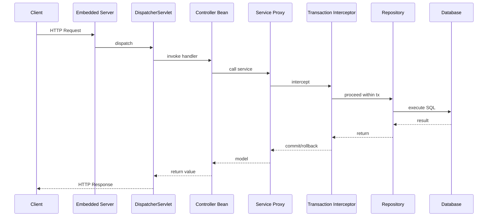

# Build Your Own Spring Lite

## 서문

이 책은 Spring을 "쓰는 법"보다 Spring이 "왜 그런 구조인지"를 이해하는 데 목적이 있다. 많은 개발자는 `@RestController`, `@Service`, `@Transactional`을 매일 사용한다. 하지만 장애를 디버깅하거나, 자동 설정 충돌을 해석하거나, 프록시 기반 동작을 설명해야 하는 순간이 오면 사용 경험만으로는 부족하다는 사실을 곧 마주한다.

Spring은 단순한 애너테이션 모음이 아니다. 객체 생성, 의존성 조립, 런타임 확장, 프록시 기반 공통 관심사, HTTP 요청 처리, 데이터 접근, 트랜잭션 경계, 애플리케이션 부트스트랩을 하나의 일관된 런타임으로 묶는 프레임워크다. 따라서 Spring을 이해한다는 말은 "애너테이션 이름을 안다"가 아니라 "그 애너테이션이 기대는 내부 계약과 호출 순서를 설명할 수 있다"는 뜻에 가깝다.

이 책은 그 구조를 직접 만들어가며 이해한다. 완전한 Spring을 복제하지는 않는다. 대신 `spring-lite`라는 학습용 경량 프레임워크를 통해 Spring의 핵심 원리를 드러낸다. 독자는 컨테이너를 만들고, 빈 라이프사이클을 다루고, 프록시를 조합하고, 트랜잭션과 MVC를 구현하고, 마지막에는 실행 가능한 애플리케이션으로 연결한다. 이 과정을 거치고 나면 실제 Spring의 복잡성도 더 공정하게 보이기 시작한다. 그것은 과잉 설계의 결과라기보다, 더 큰 문제를 풀기 위해 확장된 구조라는 점이 분명해진다.

이 책은 두 가지 방식으로 읽을 수 있다.

1. 구현 중심 독서: 각 장의 구조를 직접 구현하고 테스트를 통과시키며 읽는다.
2. 구조 이해 중심 독서: 이미 완성된 `spring-lite` 코드를 읽으며 런타임 흐름을 해부한다.

어느 방식을 택하든 중요한 것은 개념, 코드, 테스트, 실제 Spring 비교를 왕복하는 것이다. 이 책의 각 장은 다음 흐름을 유지한다.

1. 이 장이 해결하려는 문제
2. 먼저 이해해야 할 Spring 개념
3. `spring-lite`에서 구현한 구조
4. 테스트와 실패 사례
5. 실제 Spring은 여기서 어떻게 더 확장되는가
6. 실무에서 이 원리를 어떻게 활용할 수 있는가

이제 프레임워크를 사용하는 사람에서, 프레임워크를 설명할 수 있는 사람으로 넘어가 보자.

---

## Part 1. 왜 Spring을 직접 만들어봐야 하는가

### Chapter 1. 프레임워크를 사용하는 사람에서 이해하는 사람으로

대부분의 Spring 사용자는 생산성을 먼저 체감한다. 컨트롤러를 만들고, 서비스에 의존성을 주입하고, 저장소 계층에 `JdbcTemplate`이나 JPA를 붙이고, `@Transactional`을 선언하면 빠르게 기능을 만들 수 있다. 문제는 여기서 끝나지 않는다는 점이다. 규모가 커지고 런타임 문제가 생기기 시작하면, "왜 그렇게 동작하는지"를 모르는 상태에서는 생산성이 곧 불안으로 바뀐다.

예를 들어 다음 질문들은 Spring 실무에서 반복적으로 등장한다.

- 왜 어떤 빈은 잘 생성되는데 어떤 빈은 순환 참조로 실패하는가
- 왜 `@Bean`과 `@Component`는 비슷해 보여도 내부 모델이 다른가
- 왜 `@Transactional`은 self-invocation에서 기대대로 동작하지 않는가
- 왜 웹 요청은 컨트롤러에 바로 가지 않고 `DispatcherServlet`을 중심으로 움직이는가
- 왜 설정 파일 한 줄이 애플리케이션 전체 조립 결과를 바꿀 수 있는가

이 질문은 모두 "사용법"이 아니라 "구조"의 질문이다. Spring은 API 표면이 아니라 런타임 아키텍처로 이해해야 한다. 객체를 누가 만드는지, 어떤 메타데이터를 읽는지, 어느 시점에 후처리기가 개입하는지, 메서드 호출 경계에 프록시가 어떻게 끼어드는지를 설명할 수 있어야 한다.

그래서 이 책은 문서만 읽거나 소스 코드만 보는 방식을 넘어, 핵심 구조를 직접 구현해보는 방식을 택한다. 직접 만들어보면 추상 개념이 알고리즘으로 바뀐다. "마법"처럼 보이던 기능이 호출 순서로 바뀐다. 실제 Spring의 복잡성도 훨씬 더 설득력 있게 이해된다.

이 책에서 만들 `spring-lite`는 학습용 경량 프레임워크다. 운영용 대체품이 아니라, Spring이 해결하는 핵심 문제를 가장 작은 형태로 드러내는 구조 모델이다. 현재 저장소는 다음 모듈로 구성되어 있다.

- `spring-lite-core`: 애너테이션, 리플렉션 유틸리티, 프로퍼티/검증/변환 공통 기능
- `spring-lite-context`: IoC 컨테이너, 스캐닝, 라이프사이클, 이벤트
- `spring-lite-aop`: 프록시, 인터셉터, `@Aspect`, ordered chain
- `spring-lite-web`: MVC 디스패치, 인자 바인딩, 예외 처리, JSON 응답
- `spring-lite-jdbc`: `JdbcTemplate`, `RowMapper`, 커넥션 유틸리티
- `spring-lite-tx`: `@Transactional`, 전파, rollback 정책
- `spring-lite-boot`: 애플리케이션 시작점, 자동 설정, 내장 서버
- `spring-lite-test`: `@SpringLiteTest`, `MockMvc`, transactional test support
- `example-app`: 주문 예제 애플리케이션

여기서 중요한 것은 우리는 기능 목록을 따로따로 배우지 않는다는 점이다. 컨테이너, 라이프사이클, 프록시, MVC, JDBC, 트랜잭션, 부트스트랩을 한 요청 흐름과 한 실행 흐름 안에서 끝까지 연결한다. 이것이야말로 Spring을 "설정 묶음"이 아니라 "런타임 구조"로 이해하는 길이다.

### Chapter 2. Spring의 큰 그림: IoC, Lifecycle, AOP, MVC, Transaction

큰 그림 없이 세부 기능부터 배우면 지식은 금방 조각난다. `@Component`를 따로 배우고, `@Bean`을 따로 배우고, `@Transactional`을 따로 배우면 각각의 사용법은 기억에 남을 수 있다. 하지만 장애가 생기면 결국 기능이 아니라 흐름을 봐야 한다. 트랜잭션이 안 걸렸다면 데이터베이스가 아니라 프록시 경로를 봐야 하고, 컨트롤러 주입이 실패했다면 웹이 아니라 컨테이너 등록/생성 단계를 봐야 한다.

애플리케이션은 대략 다음 순서로 올라온다.

1. 설정 클래스와 스캔 기준을 찾는다.
2. 빈 정의를 등록한다.
3. 의존성을 해석하며 빈을 생성한다.
4. 라이프사이클 훅과 후처리기를 적용한다.
5. 필요한 빈은 프록시로 감싼다.
6. 웹 인프라와 서버를 조립한다.
7. 요청이 들어오면 디스패처가 이를 메서드 호출로 바꾼다.
8. 서비스 호출 경계에서 트랜잭션이 열리고, JDBC가 그 문맥을 따라간다.

이 구조를 가장 단순한 요청으로 그려보면 다음과 같다.

이 그림이 이후 책 전체의 기준선이다. 컨트롤러도 빈이고, 서비스도 빈이며, 트랜잭션은 서비스 호출 경계에서 개입하고, 저장소는 그 문맥 안에서 커넥션을 재사용한다. 부트스트랩 계층은 이 모든 조각을 사용자가 직접 조립하지 않아도 되도록 한 줄의 시작점으로 묶는다. Spring Boot의 생산성은 바로 여기서 나온다.

Part 2부터는 이 큰 그림의 바닥인 IoC 컨테이너부터 직접 구현한다.

---

## Part 2. IoC 컨테이너를 직접 만든다

### Chapter 3. 첫 번째 컨테이너: BeanDefinition과 Bean Registry

컨테이너가 실제로 먼저 관리하는 것은 객체가 아니다. 객체를 어떻게 만들 것인가에 대한 설명이다. 어떤 클래스를 대상으로 하는지, 이름은 무엇인지, 생성 전략은 생성자인지 팩토리 메서드인지, 싱글톤인지 프로토타입인지 같은 메타데이터가 먼저 있어야 한다. Spring이 객체보다 `BeanDefinition`을 먼저 다루는 이유가 여기에 있다.

`spring-lite`에서도 같은 철학을 따른다. 클래스패스를 스캔하거나 설정 클래스를 읽으면 곧바로 `new`를 하지 않는다. 먼저 `BeanDefinition`을 등록하고, 나중에 refresh 또는 `getBean()` 단계에서 실제 인스턴스를 만든다. 이 설계 덕분에 컨테이너는 스캔된 컴포넌트와 `@Bean` 메서드 결과물을 같은 생성 파이프라인으로 다룰 수 있다.

이 단계에서 중요한 분리는 두 가지다.

- 빈 정의 등록소: 아직 만들어지지 않은 빈의 생성 계획
- 싱글톤 캐시: 이미 생성된 빈 인스턴스

이 둘이 섞이면 생성 실패 시 상태 관리가 복잡해지고, 아직 만들어지지 않은 빈을 대상으로 타입 조회나 조건 판단을 하기가 어려워진다. 반대로 둘이 분리되면 빈 정의를 모두 수집한 뒤 생성 순서를 통제할 수 있고, 조건부 등록이나 후처리기 초기화도 훨씬 쉬워진다.

실제 Spring의 `DefaultListableBeanFactory`와 `BeanDefinitionRegistry` 분리도 결국 같은 문제를 푼다. 학습용 구현에서는 이 개념을 더 작게 축소했지만, 메타데이터와 인스턴스를 분리하는 발상 자체는 그대로다.

### Chapter 4. 생성자 주입과 의존성 해석

DI를 "외부에서 주입한다"는 문장으로만 이해하면 핵심을 놓친다. 컨테이너 입장에서 DI는 해석 알고리즘이다. 어떤 생성자를 선택할지, 각 파라미터에 대해 어떤 빈 후보를 찾을지, 후보가 없거나 여러 개면 어떤 예외를 낼지, `@Qualifier`가 있으면 어떤 규칙으로 선택을 좁힐지를 모두 결정해야 한다.

생성자 주입이 중요한 이유는 객체가 어떤 의존성을 반드시 요구하는지가 생성자 시그니처에 명시되기 때문이다. 컨테이너는 그 시그니처를 읽고, 파라미터 타입마다 후보 빈을 탐색한다. 후보가 없으면 즉시 실패해야 한다. 여러 후보가 있으면 모호성을 숨기지 말고 `NoUniqueBeanException`으로 실패해야 한다. 이것이 건강한 실패 전략이다.

생성자 주입은 순환 참조도 빨리 드러낸다. `A`를 만들려면 `B`가 필요하고, `B`를 만들려면 다시 `A`가 필요하면 어느 쪽도 완성될 수 없다. Spring은 역사적으로 이 문제를 더 복잡한 조기 노출 메커니즘으로 부분 해결해 왔지만, `spring-lite`는 오히려 이 실패를 그대로 드러내는 쪽을 택한다. 책의 목적이 구조를 설명하는 데 있기 때문이다. 생성자 순환 참조가 왜 구조적으로 어려운지 보이면, 이후 라이프사이클과 실패 전략 장이 훨씬 설득력 있게 이어진다.

### Chapter 5. 컴포넌트 스캔과 메타 애너테이션

수동 등록만으로는 프로젝트가 커질수록 유지 비용이 급격히 올라간다. 그래서 Spring은 어떤 클래스를 관리 대상으로 볼 것인지를 애너테이션 메타데이터로 선언하게 하고, 클래스패스를 스캔해 이를 자동 등록한다. `@Component`, `@Service`, `@Repository`는 모두 이 전략의 일부다.

여기서 흥미로운 점은 스캔이 단순 텍스트 검색이 아니라는 것이다. 개발 환경에서는 클래스가 디렉터리에 있지만, 배포 환경에서는 JAR 안에 있을 수 있다. 따라서 스캐너는 파일 시스템과 JAR 양쪽을 이해해야 한다. 또한 `@Service`가 왜 `@Component`처럼 동작하는지를 설명하려면 메타 애너테이션 탐색도 구현해야 한다. 결국 스캔은 "어떤 타입을 빈 후보로 볼 것인가"를 결정하는 클래스패스 메타데이터 시스템이다.

빈 이름 생성 전략도 같이 중요해진다. 이름을 자동 생성하면 충돌이 생길 수 있고, 충돌이 생기면 예측 가능성이 깨진다. 그래서 클래스명 규칙, 메서드명 규칙, 명시적 이름 우선순위 같은 정책이 필요하다. 편의를 제공하는 만큼 규칙을 명확히 해야 한다는 점에서, 스캔은 프레임워크 설계의 성숙도를 보여주는 좋은 주제다.

### Chapter 6. `@Configuration`과 `@Bean`

컴포넌트 모델만으로는 외부 라이브러리 빈 등록이나 조립 로직 표현에 한계가 있다. 이때 필요한 것이 설정 클래스와 팩토리 메서드다. `@Configuration`과 `@Bean`은 "이 클래스 자체가 빈이다"라는 말보다 "이 메서드 호출 결과를 빈으로 등록하라"는 선언에 가깝다.

이 차이는 컨테이너 입장에서 매우 중요하다. 클래스 기반 빈은 생성자를 호출해 만들지만, 팩토리 메서드 빈은 설정 빈을 먼저 만들고 그 위에서 특정 메서드를 호출해야 한다. 따라서 `BeanDefinition`은 타입뿐 아니라 생성 전략도 함께 표현해야 한다. `spring-lite`에서 `FACTORY_METHOD` kind가 따로 존재하는 이유가 바로 여기에 있다.

실제 Spring은 여기서 한 걸음 더 나아가 `@Configuration` 클래스를 CGLIB로 강화해 `@Bean` 메서드 간 호출도 컨테이너 semantics를 따르도록 만든다. 학습용 구현은 그만큼 복잡하지 않지만, 왜 실제 Spring이 더 무거운 모델을 채택하는지는 충분히 설명된다.

### Chapter 7. `@Qualifier`, `@Value`, 설정 값 주입

같은 인터페이스의 구현이 여러 개 생기면 타입만으로는 어떤 빈을 주입할지 결정할 수 없다. `@Qualifier`는 이 모호성을 줄이는 장치다. 이름 매칭처럼 보일 수 있지만, 실제로는 타입 기반 자동화 위에 개발자의 의도를 추가로 얹는 장치다. 같은 타입 후보가 여러 개일 때, 컨테이너는 `@Qualifier`와 빈 메타데이터를 함께 사용해 선택을 좁힌다.

`@Value`는 또 다른 차원의 확장을 보여준다. 설정 값 주입은 단순 편의 기능처럼 보이지만, 실제로는 프로퍼티 리졸버, placeholder 문법, 기본값, 타입 변환, 환경별 override 우선순위가 모두 필요한 문제다. `spring-lite`는 YAML 기반 `PropertyResolver`, profile-aware `application-{profile}.yml` 병합, 공통 `ConversionService`를 통해 이 문제를 최소 구현한다.

이 장은 컨테이너가 단순 생성기에서 정책 시스템으로 확장되는 과정을 보여준다. 타입 우선 규칙, qualifier 보조, 프로퍼티 로딩, 변환, 기본값, 프로파일 override가 쌓일수록 컨테이너는 더 많은 조립 결정을 대신하게 된다. 바로 이 지점이 Spring Boot의 강력함과 복잡성이 동시에 시작되는 자리다.

### Chapter 8. Scope와 컨테이너 이벤트

컨테이너는 객체를 한 번 만들어주는 유틸리티가 아니다. 시작과 종료, 재사용과 파괴, 이벤트 발행을 가진 런타임이다. `singleton`은 한 번 만든 인스턴스를 재사용하고, `prototype`은 매번 새 인스턴스를 만든다. 차이는 단순 성능이 아니라 수명과 책임의 차이다. 싱글톤은 생성부터 종료까지 컨테이너가 관리하지만, 프로토타입은 생성 이후 관리 범위가 줄어든다.

컨텍스트 이벤트도 이 런타임 성격을 드러낸다. refresh와 close 시점에 `ApplicationListener`가 반응할 수 있으면, 프레임워크 내부에서 느슨한 연결을 만들 수 있다. 초기화 완료 후 특정 작업을 수행하거나, 종료 시 정리 로직을 묶는 식이다. `ContextRefreshedEvent`, `ContextClosedEvent`는 작아 보이지만, 수동 팩토리와 ApplicationContext를 구분하는 핵심 요소다.

Part 2를 마치면 독자는 이제 컨테이너의 기본 골격을 설명할 수 있어야 한다. 메타데이터를 등록하고, 의존성을 해석하고, 설정과 스캔을 통해 후보를 모으고, 스코프와 이벤트로 런타임 성격을 부여하는 시스템. 이것이 Spring의 바닥이다.

---

## Part 3. Bean Lifecycle과 확장 포인트를 이해한다

### Chapter 9. Bean Lifecycle의 전체 흐름

객체가 생성되었다고 해서 곧바로 "준비 완료" 상태가 되는 것은 아니다. 프레임워크가 관리하는 빈은 인스턴스 생성 뒤에도 의존성 주입, 초기화 전 후처리, 초기화 콜백, 초기화 후 후처리, 종료 콜백 등록 같은 단계를 거친다. 이 순서를 이해하면 왜 어떤 기능은 생성 직후 작동하고, 어떤 기능은 후처리기 이후에만 적용되며, 어떤 문제는 "생성은 되었지만 아직 완전히 초기화되지 않은 상태"에서 발생하는지 설명할 수 있다.

`@PostConstruct`, `@PreDestroy`, `AutoCloseable` 지원은 이 흐름을 독자 눈앞에 드러낸다. 초기화와 파괴를 생성자 하나에 모두 넣지 않고, 컨테이너가 관리하는 생명주기 단계로 분리하는 이유가 명확해진다. 실제 Spring에서도 라이프사이클은 독립 주제로 다뤄질 만큼 중요하다. 프레임워크는 객체를 만드는 것뿐 아니라 "어떤 순서로 준비하고 정리할 것인가"를 관리하는 시스템이기 때문이다.

### Chapter 10. `BeanPostProcessor`

Spring이 강력한 가장 큰 이유를 하나만 꼽으라면, 많은 경우 답은 `BeanPostProcessor`다. 컨테이너가 객체를 만든 뒤 그 결과를 다시 변형할 수 있기 때문이다. 프록시를 감싸거나, 특정 애너테이션을 해석하거나, 인프라 빈과 애플리케이션 빈의 조합을 바꾸는 기능 대부분이 이 지점에 기대고 있다.

`spring-lite`에서도 후처리기는 초기화 전과 후 두 단계로 나뉜다. 초기화 전 훅은 메타데이터 준비나 값 주입 같은 작업에 적합하고, 초기화 후 훅은 프록시 생성처럼 완성된 빈을 다른 객체로 대체해야 하는 작업에 적합하다. 특히 트랜잭션과 AOP는 둘 다 이 단계에서 빈을 감싸는 방식으로 동작한다. 이 사실을 이해하면 Part 4의 프록시/AOP 장은 전혀 새로운 세계가 아니라, 지금 만든 컨테이너 위에 올라가는 자연스러운 확장처럼 보인다.

### Chapter 11. 순환 참조, 실패 전략, 설계 판단

프레임워크는 모든 문제를 해결해주는 시스템이 아니라, 어떤 문제를 어느 시점에 드러낼지까지 포함해 설계된 시스템이다. 생성자 순환 참조는 대표적인 예다. `spring-lite`는 이를 즉시 실패시킨다. 메시지가 좋을수록 학습용 프레임워크의 가치는 올라간다. 실패 원인과 의존성 경로가 빨리 드러날수록 독자는 구조 문제를 더 빨리 이해할 수 있기 때문이다.

실제 Spring은 조기 노출, 3단계 캐시, 다양한 주입 방식 등을 통해 이 문제를 더 유연하게 다룬다. 하지만 그 유연성은 복잡성의 대가를 치른 결과다. 이 장의 핵심은 "Spring은 왜 이렇게 복잡해졌는가"에 대한 공정한 설명이다. 그리고 실무적으로는 순환 참조를 컨테이너 문제가 아니라 설계 경계 문제로 보는 관점까지 가져가야 한다. 서비스가 서로를 직접 물고 있다면, 프레임워크 이전에 책임 분리가 잘못되었을 가능성이 높다.

---

## Part 4. 프록시, AOP, 트랜잭션을 직접 구현한다

### Chapter 12. 프록시의 본질

Spring이 객체 대신 프록시를 반환하는 이유는 단순한 우회가 아니라 "호출 경계에 개입할 수 있는 구조"를 만들기 위해서다. 클라이언트는 서비스를 호출한다고 생각하지만, 실제로는 그 앞에 놓인 프록시를 호출한다. 프록시는 메서드 진입 전후에 로직을 끼워 넣거나, 심지어 호출 자체를 다른 방식으로 바꿀 수 있다.

`spring-lite`는 JDK 동적 프록시와 클래스 기반 프록시를 모두 보여준다. 인터페이스가 있으면 표준 동적 프록시가 가능하고, 인터페이스가 없으면 ByteBuddy 기반 프록시를 생성한다. 여기서 독자가 얻어야 할 핵심은 프록시 전략이 곧 프레임워크의 제약과 확장성을 결정한다는 점이다. 또한 `MethodInvocation`이 왜 중요한지도 이 장에서 분명해진다. 호출 대상, 메서드, 인자, `proceed()`를 하나의 객체로 묶으면 호출 자체를 데이터처럼 다룰 수 있고, 인터셉터 체인은 이 호출 객체를 순차적으로 감싼다.

### Chapter 13. 최소 AOP 인프라

AOP를 추상 문구로만 이해하면 실무에서 거의 도움이 되지 않는다. 공통 관심사 분리는 결국 구체적인 계약과 호출 순서로 구현되어야 한다. `MethodInterceptor`는 그 계약의 최소 형태다. 각 인터셉터는 `MethodInvocation`을 받아 전후 처리를 하거나, 호출을 조건부로 우회하거나, 반환값을 바꿀 수 있다.

이 책의 현재 구현은 `Advisor`라는 이름의 완전한 추상화 대신, ordered interceptor chain과 프록시 합성으로 같은 문제를 더 얇게 풀었다. 이미 프록시된 빈에 다른 인터셉터를 다시 합성할 수 있고, `@Order`를 통해 실행 순서를 예측 가능하게 만들었다. 즉, 트랜잭션 인터셉터와 AOP advice가 한 체인 안에서 함께 정렬된다. 이것이 바로 실제 Spring AOP가 더 많은 추상화와 규칙으로 확장되는 출발점이다.

### Chapter 14. `@Aspect` 스타일 AOP

프록시와 인터셉터만 있으면 기능은 동작할 수 있지만, 사용성은 좋지 않다. 개발자는 매번 인터셉터 객체를 직접 등록하고 싶어하지 않는다. 대신 "이 클래스는 aspect이고, 이 메서드는 before advice이며, 저 메서드는 around advice다"처럼 선언하고 싶어한다. `@Aspect`, `@Before`, `@Around`, `@AfterReturning`은 그 선언 모델이다.

`spring-lite`의 `AspectBeanPostProcessor`는 이 선언을 읽어 내부적으로 ordered interceptor를 만든다. 메서드명과 특정 애너테이션 기준의 최소 포인트컷 모델을 사용하지만, 핵심 구조는 충분히 드러난다. 선언형 AOP는 별도 마법이 아니라 "애너테이션을 읽어 인터셉터로 바꾸는 해석 계층"이다. 실제 Spring이 `@AspectJ`, richer pointcut 표현식, advisor abstraction까지 발전한 이유도 같은 구조 위에서 더 많은 경우를 감당해야 했기 때문이다.

### Chapter 15. `@Transactional`

`@Transactional`은 Spring에서 가장 널리 쓰이는 애너테이션이지만, 가장 자주 오해되는 기능이기도 하다. 메서드 본문이 자동으로 바뀌는 것이 아니라, 프록시가 메서드 호출 경로를 감싸 트랜잭션 경계를 여는 방식으로 동작하기 때문이다. 후처리기는 트랜잭션 대상 빈을 찾아 프록시를 만들고, 인터셉터는 메서드 진입 시 `begin()`, 정상 종료 시 `commit()`, 예외 발생 시 rollback 정책에 따라 `rollback()` 또는 `commit()`을 수행한다.

이 구조를 이해하면 self-invocation 문제가 왜 생기는지도 선명해진다. 같은 클래스 안에서 `this.someTransactionalMethod()`를 호출하면 프록시를 거치지 않는다. 트랜잭션이 기대대로 동작하지 않는 이유는 데이터베이스나 선언식 자체가 아니라, 호출 경로가 프록시를 우회했기 때문이다.

### Chapter 16. 전파와 rollback 정책

트랜잭션은 단순히 "열고 닫는다" 수준이 아니다. 서비스 메서드가 서로를 호출할 때 기존 트랜잭션에 참여할지, 예외 종류에 따라 rollback할지 commit할지, 중첩 호출에서 rollback-only 상태를 어떻게 전달할지가 모두 정책 문제다. `spring-lite`는 `REQUIRED`, `rollbackFor`, `noRollbackFor`, rollback-only 상태를 구현해 이 복잡성을 최소 모델로 보여준다.

이 장의 핵심은 선언형 트랜잭션이 정책 엔진이라는 사실이다. 테스트를 보면 이 사실이 훨씬 명확해진다. 같은 호출 흐름이라도 예외 타입에 따라 DB 상태가 달라지고, 기존 트랜잭션이 있으면 새로 열지 않고 깊이만 증가시킨다. 실제 Spring은 propagation, isolation, read-only, transaction synchronization 등 훨씬 더 많은 semantics를 제공하지만, मूल 구조는 같다.

---

## Part 5. Web MVC를 직접 구현한다

### Chapter 17. `DispatcherServlet`과 Front Controller

웹 프레임워크에서 하나의 중심 진입점을 두는 이유는 공통 문제를 일관된 파이프라인으로 다루기 위해서다. 인증, 예외 처리, 핸들러 선택, 인자 바인딩, 응답 생성은 요청마다 반복되는 문제다. 이를 각 컨트롤러가 직접 처리하게 하면 구조가 곧바로 흩어진다. 그래서 Spring MVC는 `DispatcherServlet`을 front controller로 둔다.

`spring-lite`도 같은 구조를 따른다. 모든 요청은 먼저 디스패처로 들어오고, 디스패처는 핸들러 매핑으로 컨트롤러 메서드를 찾고, 핸들러 어댑터로 메서드를 실행하고, 리턴값 핸들러로 응답을 작성한다. 예외는 별도 resolver가 처리한다. 이 구조 덕분에 컨트롤러 메서드는 전체 요청 흐름의 한 가운데 있는 도메인 처리 지점으로만 남을 수 있다.

### Chapter 18. 요청을 메서드 인자로 바꾸기

HTTP 요청을 자바 메서드 호출로 바꾸는 과정은 생각보다 많은 단계를 포함한다. 경로에서 path variable을 뽑아야 하고, 쿼리 파라미터를 읽어야 하며, JSON 본문을 역직렬화해야 하고, 최종적으로 메서드 파라미터 타입에 맞게 변환해야 한다. `spring-lite`는 `PathVariableArgumentResolver`, `RequestParamArgumentResolver`, `RequestBodyArgumentResolver`, `HttpExchangeArgumentResolver`를 통해 이 흐름을 분리한다.

여기서 공통 `ConversionService`가 등장한다. 웹 바인딩과 `@Value` 주입이 서로 다른 변환 규칙을 사용하면 설명도, 동작도 흔들린다. 그래서 숫자, 불리언, enum 변환을 동일한 서비스로 끌어올리면 프레임워크 설명이 훨씬 단단해진다. 실제 Spring도 결국 변환과 바인딩을 웹 밖의 더 일반적인 인프라로 연결한다.

### Chapter 19. JSON, 응답 모델, 예외 처리

컨트롤러 메서드가 값을 반환해도 요청 처리는 끝나지 않는다. 값을 JSON으로 직렬화해야 할 수도 있고, 상태 코드와 헤더를 함께 제어해야 할 수도 있으며, 예외가 발생했다면 이를 HTTP 응답으로 바꿔야 할 수도 있다. `JsonMapper`, `ResponseEntity`, `JsonReturnValueHandler`, `DefaultExceptionResolver`는 이 후반부 파이프라인을 담당한다.

예외 처리에서도 계층 구조가 중요하다. 컨트롤러 내부의 `@ExceptionHandler`는 해당 컨트롤러 범위에서 로컬 정책을 제공한다. 여기에 `@ControllerAdvice`를 추가하면 여러 컨트롤러에 공통된 에러 정책을 적용할 수 있다. 실제 Spring MVC를 설명할 때 빠지기 쉬운 부분이 바로 이 계층 차이다. 로컬 예외 처리와 전역 예외 처리의 우선순위, 그리고 예외가 응답 모델로 바뀌는 위치를 정확히 설명해야 한다.

### Chapter 20. 조건 매핑과 검증

실제 웹 프레임워크는 URL 경로만 보고 핸들러를 선택하지 않는다. `consumes`, `produces`, `headers`, `params` 같은 요청 조건을 함께 본다. 같은 경로라도 콘텐츠 타입이나 파라미터 값이 다르면 다른 의미가 될 수 있기 때문이다. 따라서 매핑은 단순 path lookup이 아니라 정책 평가에 가깝다.

검증도 같은 흐름 안에 있다. `@Valid`, `@NotNull`, `@Min`, `@Size`는 컨트롤러 본문 안에서 if문으로 검사하는 것이 아니라, 메서드 진입 직전에 수행되는 별도 계층이다. 검증 실패를 400 응답으로 바꾸는 것도 예외 처리와 매끄럽게 연결되어야 한다. 이 장에서 독자는 MVC가 단순 라우팅이 아니라 "입력 해석, 정책 평가, 오류 모델링"을 함께 다루는 구조라는 사실을 이해하게 된다.

---

## Part 6. JDBC, 예제 앱, Boot 계층으로 완성한다

### Chapter 21. `JdbcTemplate`

순수 JDBC는 강력하지만 반복이 많다. 커넥션 획득, statement 생성, 파라미터 바인딩, 예외 처리, 자원 정리 같은 주변 코드는 거의 항상 반복된다. `JdbcTemplate`은 이 반복 구조를 템플릿 패턴으로 추상화한다. 개발자는 SQL과 결과 매핑만 넘기고, 프레임워크는 나머지 흐름을 처리한다.

`RowMapper`가 중요한 이유는 프레임워크가 결과 집합의 이동은 책임지되, 그 결과를 도메인 객체로 해석하는 책임은 애플리케이션에 남기기 때문이다. 이렇게 불변 골격과 가변 전략을 나누는 방식은 Spring 전반에 반복되는 설계 패턴이다.

여기서 트랜잭션과의 연결도 중요하다. 같은 트랜잭션 문맥 안에서는 커넥션을 재사용해야 한다. `spring-lite`의 `TransactionManager`와 `SingleConnectionProxy`는 이 지점을 드러낸다. JDBC 추상화는 단순 편의 도구가 아니라, 트랜잭션 문맥을 데이터 접근 계층으로 전달하는 장치다.

### Chapter 22. 예제 앱으로 연결하기

예제 앱은 책에서 매우 중요한 역할을 한다. 앞 장들의 구조가 각각 따로 이해되더라도, 하나의 비즈니스 시나리오 안에서 모두 연결되어 보이지 않으면 프레임워크가 완성된 느낌이 들지 않기 때문이다. 주문 생성 요청은 컨트롤러에서 시작해, 서비스로 전달되고, 트랜잭션 프록시를 거쳐, JDBC 저장소를 호출하고, 결과가 다시 JSON 응답으로 돌아온다.

이 흐름을 테스트로 함께 보면 설명은 더 강해진다. 검증 실패는 400으로 매핑되고, 저장소는 같은 트랜잭션 커넥션을 사용하며, 성공 시에는 seed 데이터 뒤에 새 주문이 추가된다. 예제 앱은 데모가 아니라 증거다. 프레임워크 설명이 실제 런타임에서 성립한다는 증거다.

### Chapter 23. `SpringLiteApplication`

사용자는 컨테이너, 웹, JDBC, AOP를 하나씩 직접 조립하고 싶어하지 않는다. 보통은 `run()` 한 줄로 시작하고 싶어한다. 그래서 부트스트랩 계층이 필요하다. `SpringLiteApplication`은 설정 클래스 인식, 스캔 시작점 설정, 인프라 자동 등록, 웹 서버 시작을 하나의 진입점으로 묶는다.

여기서 profile-aware property loading이 등장하면 Boot 계층 설명력이 크게 올라간다. `application.yml`과 `application-{profile}.yml`이 병합되고, `spring.profiles.active`가 실행 환경에 따라 다른 조립 결과를 만든다는 사실은 실제 Spring Boot의 핵심 개념과도 닿아 있다.

물론 실제 Spring Boot는 이보다 훨씬 더 크다. starter, 조건부 자동 설정, 방대한 환경 추상화, 내장 서버 생태계, 관측성, 운영 지원이 있다. 하지만 축소판이기 때문에 오히려 본질이 잘 보인다. 사용자가 한 줄로 애플리케이션을 시작한다는 사실 뒤에, 얼마나 많은 조립 논리가 숨어 있는지를 드러내는 것이 이 장의 목적이다.

### Chapter 24. 테스트 지원과 검증 전략

프레임워크는 테스트 없이는 설명되기 어렵다. 애플리케이션 테스트가 기능을 검증한다면, 프레임워크 테스트는 계약과 경계를 검증한다. 컨테이너가 언제 실패해야 하는지, 프록시가 어떤 순서로 동작해야 하는지, MVC가 어떤 요청을 어떤 응답으로 바꿔야 하는지, 트랜잭션이 언제 rollback해야 하는지를 테스트가 문서처럼 보여준다.

`@SpringLiteTest`와 `MockMvc`는 이 테스트 문서화를 돕는 최소 도구다. 여기에 transactional test support까지 들어가면, 테스트 메서드가 트랜잭션 안에서 실행되고 종료 후 rollback된다는 Spring Test의 중요한 감각도 전달할 수 있다. 이 장을 통해 독자는 "테스트 지원도 프레임워크의 일부"라는 사실을 받아들이게 된다. 실제 Spring 생태계가 TestContext, MockMvc, transactional test support를 오랫동안 중요한 축으로 유지해 온 이유도 바로 여기에 있다.

---

## Part 7. 실제 Spring과 실무 활용으로 연결한다

### Chapter 25. 실제 Spring과의 구조 대응

이제 `spring-lite`를 실제 Spring과 정확히 대응시킬 차례다. 비교는 기능 목록 나열이 아니라 구조 대응이어야 한다. `AnnotationConfigApplicationContext`는 `ApplicationContext`/`BeanFactory` 계층의 축소판이고, `BeanDefinition`은 더 풍부한 Spring bean metadata의 축소판이다. `DispatcherServlet`, `TransactionalBeanPostProcessor`, `TransactionManager`, `JdbcTemplate`, `SpringLiteApplication`도 각각 실제 Spring MVC, Spring Transaction, Spring JDBC, Spring Boot의 핵심 개념과 맞닿아 있다.

중요한 것은 실제 Spring이 같은 문제를 더 큰 규모와 더 긴 역사 속에서 푼 결과물이라는 점이다. 그래서 추상화 계층이 많고, 설정 조합이 풍부하며, 하위 호환을 위한 장치도 많다. 학습용 구현이 없었다면 이 복잡성은 종종 과하게만 느껴졌을 것이다. 하지만 직접 축소판을 만들어본 뒤에는 "왜 이런 클래스가 존재하는가"를 더 쉽게 추론할 수 있다.

### Chapter 26. 실무에서 원리를 쓰는 법

프레임워크 내부를 이해하면 실무에서 가장 먼저 달라지는 것은 문제를 보는 순서다. 트랜잭션이 안 걸린 것 같으면 DB보다 호출 경로를 먼저 본다. 빈 생성 실패가 나면 애너테이션을 다시 붙이기보다 등록 단계, 생성자 해석, 조건부 등록, 설정 override 경로를 먼저 본다. MVC 매핑이 이상하면 컨트롤러 코드보다 디스패처의 핸들러 선택 조건부터 떠올린다.

이 차이는 생산성으로 이어진다. 장애를 더 빨리 좁힐 수 있고, 자동 설정 충돌을 더 덜 두려워하게 되며, 설계 리뷰에서도 더 깊이 있는 판단을 할 수 있다. 예를 들어 순환 참조 위험을 빨리 감지하고, 선언형 트랜잭션이 적합하지 않은 경계를 더 잘 식별하고, 프로파일과 설정 조립 전략을 더 깔끔하게 설계할 수 있다.

Spring을 잘 쓴다는 말은 결국 내부 구조를 바탕으로 더 나은 판단을 할 수 있다는 뜻이다.

### Chapter 27. 다음 확장 과제

책의 끝은 학습의 끝이 아니라 확장의 시작이어야 한다. 현재 `spring-lite`는 핵심 원리를 충분히 드러내지만, 실제 Spring과의 거리를 더 탐색할 수 있는 주제도 남아 있다.

- richer `Advisor` / pointcut 모델
- `HttpMessageConverter` 추상화와 콘텐츠 협상
- 정적 리소스 서빙
- 더 풍부한 조건부 auto-configuration
- 이벤트 관측성, metrics, 운영 지원
- `FactoryBean` 유사 모델
- 더 다양한 트랜잭션 semantics

이 목록은 단순 TODO가 아니다. 각 항목은 실제 Spring이 복잡해지는 이유를 다시 배우게 만드는 학습 과제다. 독자가 이 책을 덮은 뒤에도 `spring-lite`를 계속 확장하며 배울 수 있도록 남겨둔 의도된 여지다.

---

## 맺음말

우리는 이 책에서 Spring을 흉내 낸 것이 아니라, Spring의 핵심 원리를 드러내는 실행 가능한 축소판을 만들었다. 컨테이너가 어떻게 메타데이터를 등록하고, 의존성을 해석하며, 라이프사이클과 후처리기로 확장을 가능하게 하는지 보았다. 프록시와 인터셉터가 어떻게 공통 관심사를 호출 경계에 끼워 넣는지 보았고, 웹 요청이 어떻게 메서드 호출과 응답 모델로 바뀌는지 보았다. JDBC와 트랜잭션, 부트스트랩과 테스트 지원까지 연결해 하나의 런타임으로 완성했다.

이제 Spring은 더 이상 마법이 아니다. 복잡하지만 설명 가능한 구조다. 그리고 구조를 이해한 개발자는 설정을 외우는 사람보다 훨씬 더 잘 디버깅하고, 더 잘 설계하고, 더 잘 판단할 수 있다. 그것이 이 책이 독자에게 남기고 싶은 가장 중요한 성과다.
