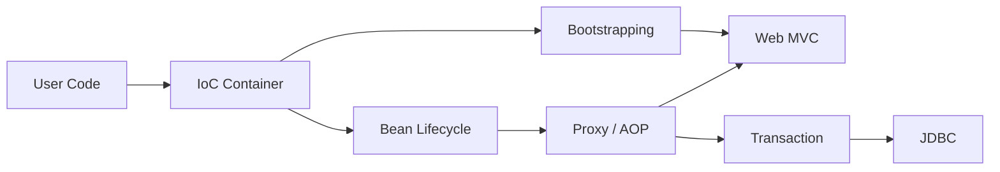
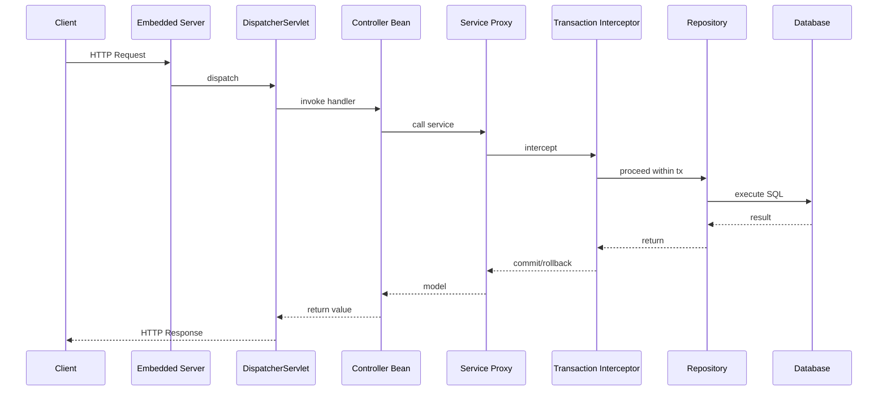
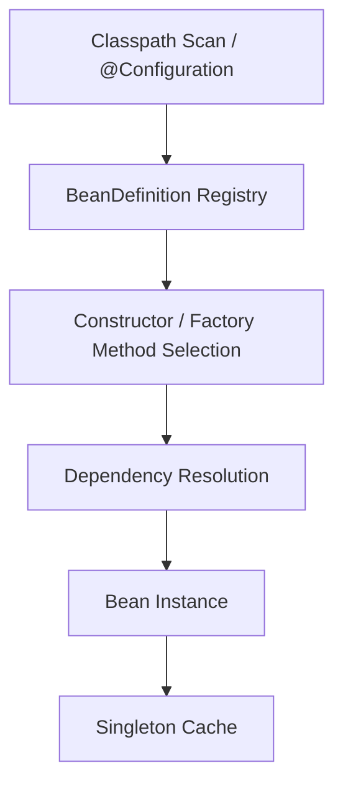
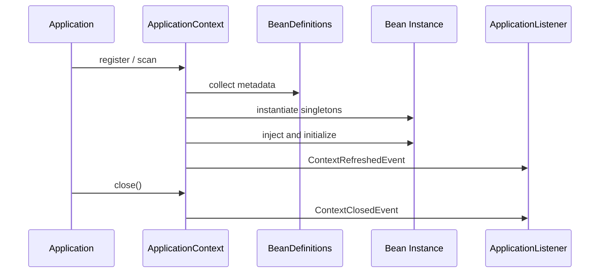
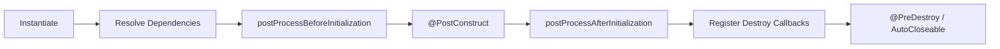
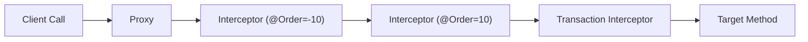
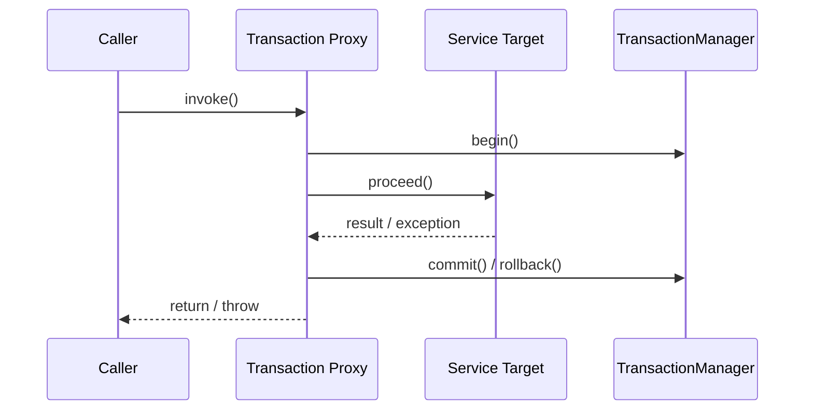
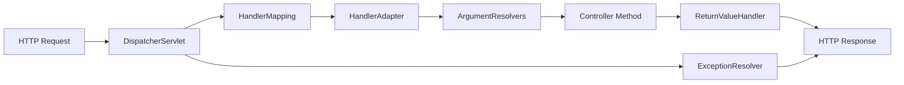
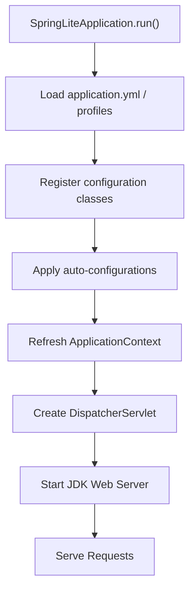

# Build Your Own Spring Lite

## 서문

이 책은 Spring을 "쓰는 법"보다 Spring이 "왜 그런 구조인지"를 이해하는 데 목적이 있다. 많은 개발자는 `@RestController`, `@Service`, `@Transactional`을 매일 사용한다. 하지만 장애를 디버깅하거나, 자동 설정 충돌을 해석하거나, 프록시 기반 동작을 설명해야 하는 순간이 오면 사용 경험만으로는 부족하다는 사실을 곧 마주한다.

Spring은 단순한 애너테이션 모음이 아니다. 객체 생성, 의존성 조립, 런타임 확장, 프록시 기반 공통 관심사, HTTP 요청 처리, 데이터 접근, 트랜잭션 경계, 애플리케이션 부트스트랩을 하나의 일관된 런타임으로 묶는 프레임워크다. 따라서 Spring을 이해한다는 말은 "애너테이션 이름을 안다"가 아니라 "그 애너테이션이 기대는 내부 계약과 호출 순서를 설명할 수 있다"는 뜻에 가깝다.

이 책은 그 구조를 직접 만들어가며 이해한다. 완전한 Spring을 복제하지는 않는다. 대신 `spring-lite`라는 학습용 경량 프레임워크를 통해 Spring의 핵심 원리를 드러낸다. 독자는 컨테이너를 만들고, 빈 라이프사이클을 다루고, 프록시를 조합하고, 트랜잭션과 MVC를 구현하고, 마지막에는 실행 가능한 애플리케이션으로 연결한다. 이 과정을 거치고 나면 실제 Spring의 복잡성도 한층 공정하게 보이기 시작한다. 그것이 과잉 설계의 결과라기보다, 더 큰 문제를 풀기 위해 확장된 구조라는 점이 자연스럽게 드러난다.

이 책은 두 가지 방식으로 읽을 수 있다.

1. 구현 중심 독서: 각 장의 구조를 직접 구현하고 테스트를 통과시키며 읽는다.
2. 구조 이해 중심 독서: 이미 완성된 `spring-lite` 코드를 읽으며 런타임 흐름을 해부한다.

어느 방식을 택하든 중요한 것은 개념, 코드, 테스트, 실제 Spring 비교를 왕복하는 것이다. 이 책의 각 장은 다음 흐름을 유지한다.

1. 이 장이 해결하려는 문제
2. 먼저 이해해야 할 Spring 개념
3. `spring-lite`에서 구현한 구조
4. 테스트와 실패 사례
5. 실제 Spring은 여기서 어떻게 더 확장되는가
6. 실무에서 이 원리를 어떻게 활용할 수 있는가

이제 프레임워크를 사용하는 사람에서, 프레임워크를 설명할 수 있는 사람으로 넘어가 보자.

이 책이 지향하는 이해 방식은 단순히 내부 구현을 많이 아는 상태와도 조금 다르다. 클래스 이름을 많이 외운다고 해서 곧바로 구조가 보이는 것은 아니다. 오히려 중요한 것은 어떤 계층이 어떤 책임을 가지며, 문제가 생겼을 때 어디서부터 확인해야 하는지에 대한 감각이다. 컨테이너 문제인지, 후처리기 문제인지, 프록시 문제인지, 웹 디스패치 문제인지 구분할 수 있어야 실제 지식이 된다. 따라서 독자는 책을 읽는 동안 세부 API보다도 책임 분리와 호출 순서에 더 주의를 기울이는 편이 좋다.

또한 이 원고는 학습과 실무를 분리하지 않는다. 학습용 구현이라고 해서 현실과 동떨어진 장난감으로 다루지 않는다. 오히려 작은 구현을 통해 실제 실무 문제를 더 선명하게 읽는 훈련을 하려는 것이다. 트랜잭션이 왜 실패하는지, 설정이 왜 엇갈리는지, 자동화가 왜 때로는 편리하고 때로는 위험한지 같은 질문은 모두 축소판 구현 안에서 먼저 구조적으로 드러난다. 그런 다음 실제 Spring으로 돌아가면, 더 큰 코드베이스와 더 복잡한 기능도 훨씬 덜 막막하게 읽을 수 있다.

---

## Part 1. 왜 Spring을 직접 만들어봐야 하는가

### Chapter 1. 프레임워크를 사용하는 사람에서 이해하는 사람으로

대부분의 Spring 사용자는 생산성을 먼저 체감한다. 컨트롤러를 만들고, 서비스에 의존성을 주입하고, 저장소 계층에 `JdbcTemplate`이나 JPA를 붙이고, `@Transactional`을 선언하면 빠르게 기능을 만들 수 있다. 문제는 여기서 끝나지 않는다는 점이다. 규모가 커지고 런타임 문제가 생기기 시작하면, "왜 그렇게 동작하는지"를 모르는 상태에서는 생산성이 곧 불안으로 바뀐다.

예를 들어 다음 질문들은 Spring 실무에서 반복적으로 등장한다.

- 왜 어떤 빈은 잘 생성되는데 어떤 빈은 순환 참조로 실패하는가
- 왜 `@Bean`과 `@Component`는 비슷해 보여도 내부 모델이 다른가
- 왜 `@Transactional`은 자기 호출(self-invocation)에서 기대대로 동작하지 않는가
- 왜 웹 요청은 컨트롤러에 바로 가지 않고 `DispatcherServlet`을 중심으로 움직이는가
- 왜 설정 파일 한 줄이 애플리케이션 전체 조립 결과를 바꿀 수 있는가

이 질문은 모두 "사용법"이 아니라 "구조"의 질문이다. Spring은 API 표면이 아니라 런타임 아키텍처로 이해해야 한다. 객체를 누가 만드는지, 어떤 메타데이터를 읽는지, 어느 시점에 후처리기가 개입하는지, 메서드 호출 경계에 프록시가 어떻게 끼어드는지를 설명할 수 있어야 한다.

그래서 이 책은 문서만 읽거나 소스 코드만 보는 방식을 넘어, 핵심 구조를 직접 구현해보는 방식을 택한다. 직접 만들어보면 추상 개념이 알고리즘으로 바뀐다. "마법"처럼 보이던 기능이 호출 순서로 바뀐다. 실제 Spring의 복잡성도 훨씬 더 설득력 있게 이해된다.

이 책에서 만들 `spring-lite`는 학습용 경량 프레임워크다. 운영용 대체품이 아니라, Spring이 해결하는 핵심 문제를 가장 작은 형태로 드러내는 구조 모델이다. 현재 저장소는 다음 모듈로 구성되어 있다.

- `spring-lite-core`: 애너테이션, 리플렉션 유틸리티, 프로퍼티/검증/변환 공통 기능
- `spring-lite-context`: IoC 컨테이너, 스캐닝, 라이프사이클, 이벤트
- `spring-lite-aop`: 프록시, 인터셉터, `@Aspect`, `@Order` 기반 체인
- `spring-lite-web`: MVC 디스패치, 인자 바인딩, 예외 처리, JSON 응답
- `spring-lite-jdbc`: `JdbcTemplate`, `RowMapper`, 커넥션 유틸리티
- `spring-lite-tx`: `@Transactional`, 전파, 롤백 정책
- `spring-lite-boot`: 애플리케이션 시작점, 자동 설정, 내장 서버
- `spring-lite-test`: `@SpringLiteTest`, `MockMvc`, transactional test support
- `example-app`: 주문 예제 애플리케이션

여기서 중요한 것은 우리는 기능 목록을 따로따로 배우지 않는다는 점이다. 컨테이너, 라이프사이클, 프록시, MVC, JDBC, 트랜잭션, 부트스트랩을 한 요청 흐름과 한 실행 흐름 안에서 끝까지 연결한다. 이것이야말로 Spring을 "설정 묶음"이 아니라 "런타임 구조"로 이해하는 길이다.

실무에서 이 차이는 생각보다 훨씬 직접적이다. 구조를 이해하지 못한 상태에서는 빈 생성 오류가 나도 로그를 증상 중심으로만 읽게 된다. "왜 이런 예외가 났지?"라는 질문은 하지만, "이 문제는 스캔 단계인가, 정의 등록 단계인가, 생성자 해석 단계인가, 후처리기 개입 단계인가?"라는 식으로 실행 단계를 기준으로 좁혀 들어가지는 못한다. 반대로 구조를 이해하고 나면 로그 한 줄의 의미가 달라진다. 어느 계층에서 실패가 발생했는지 감이 생기고, 디버깅 순서도 생긴다.

기술 선택의 깊이도 달라진다. 예를 들어 선언형 트랜잭션은 대부분의 서비스 로직에 유용하지만, 모든 경우에 정답은 아니다. 프록시 기반이라는 사실을 이해하면 비동기 경계, 자기 호출, 장시간 외부 연동 같은 상황에서 별도 설계가 필요하다는 점을 더 빨리 떠올리게 된다. MVC 자동 바인딩도 마찬가지다. 단순히 편하다고만 생각하면 입력 검증과 오류 응답 정책이 흩어지기 쉽지만, 요청 해석 파이프라인을 이해하면 어떤 책임을 프레임워크에 맡기고 어떤 책임을 도메인 계층에 남길지 더 선명하게 나눌 수 있다.

이 책은 그래서 사용법 안내서가 아니라 해석 도구를 제공하려 한다. 독자가 책을 덮은 뒤 얻어야 할 것은 "애너테이션을 많이 안다"는 감각이 아니라, 실제 Spring 애플리케이션에서 문제가 발생했을 때 이를 구조적으로 설명할 수 있는 언어다. 객체 생성, 메타데이터 등록, 후처리, 프록시 합성, 웹 디스패치, 트랜잭션 전파 같은 단어들이 각자 따로 떠다니지 않고 하나의 런타임 이야기로 연결되어야 한다.



### Chapter 2. Spring의 큰 그림: IoC, Lifecycle, AOP, MVC, Transaction

큰 그림 없이 세부 기능부터 배우면 지식은 금방 조각난다. `@Component`를 따로 배우고, `@Bean`을 따로 배우고, `@Transactional`을 따로 배우면 각각의 사용법은 기억에 남을 수 있다. 하지만 장애가 생기면 결국 기능이 아니라 흐름을 봐야 한다. 트랜잭션이 안 걸렸다면 데이터베이스가 아니라 프록시 경로를 봐야 하고, 컨트롤러 주입이 실패했다면 웹이 아니라 컨테이너 등록/생성 단계를 봐야 한다.

애플리케이션은 대략 다음 순서로 올라온다.

1. 설정 클래스와 스캔 기준을 찾는다.
2. 빈 정의를 등록한다.
3. 의존성을 해석하며 빈을 생성한다.
4. 라이프사이클 훅과 후처리기를 적용한다.
5. 필요한 빈은 프록시로 감싼다.
6. 웹 인프라와 서버를 조립한다.
7. 요청이 들어오면 디스패처가 이를 메서드 호출로 바꾼다.
8. 서비스 호출 경계에서 트랜잭션이 열리고, JDBC가 그 문맥을 따라간다.

이 구조를 가장 단순한 요청으로 그려보면 다음과 같다.



이 그림이 이후 책 전체의 기준선이다. 컨트롤러도 빈이고, 서비스도 빈이며, 트랜잭션은 서비스 호출 경계에서 개입하고, 저장소는 그 문맥 안에서 커넥션을 재사용한다. 부트스트랩 계층은 이 모든 조각을 사용자가 직접 조립하지 않아도 되도록 한 줄의 시작점으로 묶는다. Spring Boot의 생산성은 바로 여기서 나온다.

이 큰 그림을 먼저 잡아두면 이후 장에서 세부 메커니즘을 배울 때도 위치 감각을 잃지 않는다. 예를 들어 `BeanPostProcessor`를 배울 때는 "왜 이런 확장 포인트가 필요한가?"라는 질문에 곧바로 답할 수 있다. 빈이 완성된 뒤 프록시를 씌워야 AOP와 트랜잭션이 가능하기 때문이다. `DispatcherServlet`을 배울 때도 "왜 웹 계층에 전략 객체가 이렇게 많이 필요한가?"를 이해할 수 있다. 요청을 메서드 호출로 바꾸는 과정이 단순 라우팅이 아니라 매핑, 바인딩, 검증, 응답 처리, 예외 해석의 연속이기 때문이다.

독자는 이 장을 일종의 지도처럼 활용하는 편이 좋다. 이후에 어떤 기능을 배우든, 먼저 이 기능이 어디에 끼어드는지 질문해보자. 시작 시점에 개입하는가, 빈 생성 시점에 개입하는가, 메서드 호출 경계에 개입하는가, HTTP 요청과 응답 사이에 개입하는가, 데이터 접근 문맥에 개입하는가. 이 질문만 유지해도 Spring의 방대한 개념을 훨씬 덜 파편적으로 받아들일 수 있다.

Part 2부터는 이 큰 그림의 바닥인 IoC 컨테이너부터 직접 구현한다.

---

## Part 2. IoC 컨테이너를 직접 만든다

### Chapter 3. 첫 번째 컨테이너: BeanDefinition과 Bean Registry

컨테이너가 실제로 먼저 관리하는 것은 객체가 아니다. 객체를 어떻게 만들 것인가에 대한 설명이다. 어떤 클래스를 대상으로 하는지, 이름은 무엇인지, 생성 전략은 생성자인지 팩토리 메서드인지, 싱글톤인지 프로토타입인지 같은 메타데이터가 먼저 있어야 한다. Spring이 객체보다 `BeanDefinition`을 먼저 다루는 이유가 여기에 있다.

`spring-lite`에서도 같은 철학을 따른다. 클래스패스를 스캔하거나 설정 클래스를 읽더라도 곧바로 `new`를 호출하지는 않는다. 먼저 `BeanDefinition`을 등록하고, 이후 refresh 또는 `getBean()` 단계에서 실제 인스턴스를 만든다. 이 설계 덕분에 컨테이너는 스캔된 컴포넌트와 `@Bean` 메서드 결과물을 같은 생성 파이프라인으로 다룰 수 있다.

이 단계에서 중요한 분리는 두 가지다.

- 빈 정의 등록소: 아직 만들어지지 않은 빈의 생성 계획
- 싱글톤 캐시: 이미 생성된 빈 인스턴스

이 둘이 섞이면 생성 실패 시 상태 관리가 복잡해지고, 아직 만들어지지 않은 빈을 대상으로 타입 조회나 조건 판단을 하기가 어려워진다. 반대로 둘이 분리되면 빈 정의를 모두 수집한 뒤 생성 순서를 통제할 수 있고, 조건부 등록이나 후처리기 초기화도 훨씬 쉬워진다.

실제 Spring의 `DefaultListableBeanFactory`와 `BeanDefinitionRegistry` 분리도 결국 같은 문제를 푼다. 학습용 구현에서는 이 개념을 더 작게 축소했지만, 메타데이터와 인스턴스를 분리하는 발상 자체는 그대로다.

이 분리는 단순 구현상의 편의가 아니라 프레임워크 해석의 출발점이기도 하다. 실무에서 "왜 이 빈이 생겼는가"를 추적할 때도, 바로 인스턴스에서 출발하기보다 어떤 `BeanDefinition`이 먼저 등록되었는지부터 봐야 하는 경우가 많다. 스캔으로 등록되었는지, `@Bean` 메서드에서 나왔는지, 자동 설정이 추가했는지, 조건부 등록이 통과되었는지가 모두 메타데이터 단계에서 결정되기 때문이다. 인스턴스는 그 결과일 뿐이다.

또한 등록소와 캐시를 구분하면 실패 전략도 더 깔끔해진다. 생성 도중 예외가 나더라도 메타데이터는 남아 있으므로 원인을 추적하기 쉽고, 반쯤 만들어진 객체를 정상 빈처럼 다루는 사고도 피할 수 있다. 학습용 컨테이너에서는 이런 명료성이 특히 중요하다. 작은 설계 선택 하나가 이후 라이프사이클, 후처리, 프록시 적용 전략까지 연쇄적으로 영향을 주기 때문이다.

```java
public final class BeanDefinition {
    public enum Kind {
        COMPONENT,
        CONFIGURATION,
        FACTORY_METHOD,
        INFRASTRUCTURE
    }

    private final String name;
    private final Class<?> beanType;
    private final Kind kind;
    private final Class<?> configurationClass;
    private final Method factoryMethod;
    private final boolean singleton;
    private final String qualifier;
}
```



### Chapter 4. 생성자 주입과 의존성 해석

DI를 "외부에서 주입한다"는 문장으로만 이해하면 핵심을 놓친다. 컨테이너 입장에서 DI는 해석 알고리즘이다. 어떤 생성자를 선택할지, 각 파라미터에 대해 어떤 빈 후보를 찾을지, 후보가 없거나 여러 개면 어떤 예외를 낼지, `@Qualifier`가 있으면 어떤 규칙으로 선택을 좁힐지를 모두 결정해야 한다.

생성자 주입이 중요한 이유는 객체가 어떤 의존성을 반드시 요구하는지가 생성자 시그니처에 명시되기 때문이다. 컨테이너는 그 시그니처를 읽고, 파라미터 타입마다 후보 빈을 탐색한다. 후보가 없으면 즉시 실패해야 한다. 여러 후보가 있으면 모호성을 숨기지 말고 `NoUniqueBeanException`으로 실패해야 한다. 이것이 건강한 실패 전략이다.

생성자 주입은 순환 참조도 빨리 드러낸다. `A`를 만들려면 `B`가 필요하고, `B`를 만들려면 다시 `A`가 필요하면 어느 쪽도 완성될 수 없다. Spring은 역사적으로 이 문제를 더 복잡한 조기 노출 메커니즘으로 부분 해결해 왔지만, `spring-lite`는 오히려 이 실패를 그대로 드러내는 쪽을 택한다. 책의 목적이 구조를 설명하는 데 있기 때문이다. 생성자 순환 참조가 왜 구조적으로 어려운지 보이면, 이후 라이프사이클과 실패 전략 장이 훨씬 설득력 있게 이어진다.

이 장에서 독자가 꼭 익혀야 할 감각은 "DI는 문법이 아니라 탐색 규칙"이라는 점이다. 개발자 입장에서는 생성자 파라미터 하나를 선언하는 것처럼 보여도, 컨테이너 입장에서는 그 순간 여러 질문이 열린다. 어떤 생성자를 선택할 것인가, 각 파라미터 타입에 맞는 후보는 몇 개인가, qualifier가 있는가, 후보가 여러 개인데 우선순위를 정할 수 있는가, 지금 당장 생성 가능한 빈인가. 이 질문들에 대한 답이 모여야 비로소 하나의 객체가 안전하게 조립된다.

실제 코드를 읽을 때는 성공 경로보다 실패 경로를 더 중요하게 보는 편이 좋다. 후보가 없을 때 어떤 예외가 나가는지, 후보가 둘 이상일 때 왜 조용히 하나를 고르지 않는지, `@Autowired` 생성자가 둘 이상일 때 왜 즉시 실패하는지가 모두 프레임워크의 철학을 보여준다. 컨테이너는 모호함을 감추는 대신 표면화해야 한다. 그래야 애플리케이션 구조가 불안정한 상태로 실행까지 넘어가지 않는다.

실무에서도 생성자 주입이 널리 권장되는 이유는 테스트 편의성이나 불변성만이 아니다. 의존성을 계약으로 드러내고, 구조적 문제를 조기에 노출하며, 컨테이너의 판단 규칙을 더 분명하게 만든다는 점이 함께 중요하다. 책을 읽는 동안 독자는 생성자 주입을 단순 취향 문제가 아니라 프레임워크와 애플리케이션 사이의 명확한 합의로 이해하게 될 것이다.

```java
private Constructor<?> selectConstructor(Class<?> beanType) {
    Constructor<?>[] constructors = beanType.getDeclaredConstructors();
    List<Constructor<?>> autowiredConstructors = Arrays.stream(constructors)
        .filter(constructor -> constructor.isAnnotationPresent(Autowired.class))
        .toList();
    if (autowiredConstructors.size() > 1) {
        throw new BeansException("Multiple @Autowired constructors found in " + beanType.getName());
    }
    if (!autowiredConstructors.isEmpty()) {
        return autowiredConstructors.getFirst();
    }
    if (constructors.length == 1) {
        return constructors[0];
    }
    return Arrays.stream(constructors)
        .filter(constructor -> constructor.getParameterCount() == 0)
        .findFirst()
        .orElseThrow(() -> new BeansException("No suitable constructor found for " + beanType.getName()));
}

private Object resolveDependency(Parameter parameter) {
    Class<?> dependencyType = parameter.getType();
    Map<String, ?> candidates = getBeansOfType(dependencyType);
    if (candidates.isEmpty()) {
        throw new NoSuchBeanException("No bean of type " + dependencyType.getName());
    }
    Qualifier qualifier = parameter.getAnnotation(Qualifier.class);
    if (qualifier != null) {
        return resolveQualifiedDependency(dependencyType, qualifier.value(), candidates);
    }
    if (candidates.size() > 1) {
        throw new NoUniqueBeanException("Multiple beans of type " + dependencyType.getName() + ": " + candidates.keySet());
    }
    return candidates.values().iterator().next();
}
```

### Chapter 5. 컴포넌트 스캔과 메타 애너테이션

수동 등록만으로는 프로젝트가 커질수록 유지 비용이 급격히 올라간다. 그래서 Spring은 어떤 클래스를 관리 대상으로 볼 것인지를 애너테이션 메타데이터로 선언하게 하고, 클래스패스를 스캔해 이를 자동 등록한다. `@Component`, `@Service`, `@Repository`는 모두 이 전략의 일부다.

여기서 흥미로운 점은 스캔이 단순 텍스트 검색이 아니라는 것이다. 개발 환경에서는 클래스가 디렉터리에 있지만, 배포 환경에서는 JAR 안에 있을 수 있다. 따라서 스캐너는 파일 시스템과 JAR 양쪽을 이해해야 한다. 또한 `@Service`가 왜 `@Component`처럼 동작하는지를 설명하려면 메타 애너테이션 탐색도 구현해야 한다. 결국 스캔은 "어떤 타입을 빈 후보로 볼 것인가"를 결정하는 클래스패스 메타데이터 시스템이다.

빈 이름 생성 전략도 같이 중요해진다. 이름을 자동 생성하면 충돌이 생길 수 있고, 충돌이 생기면 예측 가능성이 깨진다. 그래서 클래스명 규칙, 메서드명 규칙, 명시적 이름 우선순위 같은 정책이 필요하다. 편의를 제공하는 만큼 규칙을 명확히 해야 한다는 점에서, 스캔은 프레임워크 설계의 성숙도를 보여주는 좋은 주제다.

특히 스캔은 "자동화는 언제나 규칙 위에 서야 한다"는 사실을 잘 보여준다. 개발자는 `@Service`를 붙이면 빈이 등록될 것이라고 기대하지만, 그 기대가 성립하려면 프레임워크가 패키지 경로를 어떻게 해석하는지, 어떤 애너테이션을 빈 후보로 보는지, 메타 애너테이션을 어디까지 따라가는지, 중복 클래스를 어떻게 처리하는지가 모두 정해져 있어야 한다. 자동화가 많아질수록 오히려 규칙 설명의 중요성이 커진다.

학습 관점에서도 이 장은 흥미롭다. 많은 사람이 애너테이션을 정적인 표식처럼 여기지만, 스캔을 구현해 보면 애너테이션은 런타임 메타데이터 해석의 입력값일 뿐이라는 점이 드러난다. `@Component` 계열의 스테레오타입은 결국 "이 타입을 빈 후보로 등록하라"는 의도를 표현하는 작은 DSL이다. 실제 Spring이 수많은 메타 애너테이션 조합을 지원하는 이유도, 바로 이 DSL을 풍부하게 확장해 왔기 때문이다.

실무에서 스캔 문제는 의외로 자주 발목을 잡는다. 패키지 기준이 어긋나 빈이 누락되거나, 의도치 않게 테스트 더블이 함께 스캔되거나, 이름 충돌로 등록이 실패하는 사례가 반복된다. 이런 상황에서 스캔을 "잘 모르지만 돌아가는 자동 기능"으로 보면 문제 해결이 어렵다. 반대로 스캔이 클래스패스 메타데이터 수집기라는 사실을 이해하면, 어디를 확인해야 할지가 훨씬 분명해진다.

```java
public List<Class<?>> scan(String basePackage) {
    String path = basePackage.replace('.', '/');
    Enumeration<URL> resources = Thread.currentThread().getContextClassLoader().getResources(path);
    Map<String, Class<?>> classes = new LinkedHashMap<>();
    while (resources.hasMoreElements()) {
        URL resource = resources.nextElement();
        if ("file".equals(resource.getProtocol())) {
            addClasses(classes, scanDirectory(basePackage, directory));
        } else if ("jar".equals(resource.getProtocol())) {
            addClasses(classes, scanJar(basePackage, path, resource));
        }
    }
    addClasses(classes, scanUrlsFromClassLoader(path));
    return new ArrayList<>(classes.values());
}
```

### Chapter 6. `@Configuration`과 `@Bean`

컴포넌트 모델만으로는 외부 라이브러리 빈 등록이나 조립 로직 표현에 한계가 있다. 이때 필요한 것이 설정 클래스와 팩토리 메서드다. `@Configuration`과 `@Bean`은 "이 클래스 자체가 빈이다"라는 말보다 "이 메서드 호출 결과를 빈으로 등록하라"는 선언에 가깝다.

이 차이는 컨테이너 입장에서 매우 중요하다. 클래스 기반 빈은 생성자를 호출해 만들지만, 팩토리 메서드 빈은 설정 빈을 먼저 만들고 그 위에서 특정 메서드를 호출해야 한다. 따라서 `BeanDefinition`은 타입뿐 아니라 생성 전략도 함께 표현해야 한다. `spring-lite`에서 `FACTORY_METHOD` kind가 따로 존재하는 이유가 바로 여기에 있다.

실제 Spring은 여기서 한 걸음 더 나아가 `@Configuration` 클래스를 CGLIB로 강화해 `@Bean` 메서드 간 호출도 컨테이너의 동작 규칙을 따르도록 만든다. 학습용 구현은 그만큼 복잡하지 않지만, 왜 실제 Spring이 더 무거운 모델을 채택하는지는 충분히 설명된다.

이 장에서 핵심은 "모든 빈이 클래스 자체에서 직접 태어나는 것은 아니다"라는 관점을 받아들이는 일이다. 외부 라이브러리 객체, 복잡한 설정 조합이 필요한 객체, 여러 의존성을 계산해서 만들어야 하는 객체는 컴포넌트 스캔만으로는 다루기 어렵다. `@Bean` 메서드는 이 문제를 푸는 선언적 팩토리다. 개발자는 객체 생성 로직을 평범한 자바 코드로 표현하면서도, 결과물은 여전히 컨테이너의 생명주기와 조회 규칙 안에 놓이게 된다.

설정 클래스를 특별 취급해야 한다는 점도 중요하다. 일반 빈은 생성의 결과물이지만, 설정 클래스는 다른 빈 정의를 추가로 만들어 내는 메타 계층이기도 하다. 따라서 컨테이너는 설정 클래스를 읽는 시점과 그 결과를 등록하는 시점을 의식해야 한다. 이 작은 차이를 이해하면, 실제 Spring에서 왜 설정 처리기가 별도 인프라로 존재하고 왜 `@Import`, 조건부 등록, auto-configuration 같은 메커니즘이 메타데이터 단계에서 복잡하게 얽히는지 더 쉽게 이해하게 된다.

실무에서는 `@Configuration`과 `@Bean`이 외부 시스템 연결 지점을 깔끔하게 드러내는 장점도 있다. 데이터소스, HTTP 클라이언트, 메시지 프로듀서 같은 인프라 객체를 설정 계층에 모아두면 애플리케이션의 조립 구조가 더 명확해진다. 즉, 이 장은 단순 문법 차이를 넘어 애플리케이션의 구성 책임을 어디에 둘 것인가에 대한 설계 장이기도 하다.

```java
private void registerBeanMethods(Class<?> configurationClass) {
    for (Method method : configurationClass.getDeclaredMethods()) {
        Bean bean = method.getAnnotation(Bean.class);
        if (bean == null) {
            continue;
        }
        String beanName = bean.value().isBlank()
            ? BeanNameGenerator.generateBeanName(method.getName())
            : bean.value();
        BeanDefinition beanDefinition = BeanDefinition.factoryMethod(
            beanName,
            method.getReturnType(),
            configurationClass,
            method,
            isSingleton(method),
            extractQualifier(method)
        );
        registerBeanDefinition(beanDefinition);
    }
}

private Object invokeFactoryMethod(BeanDefinition beanDefinition) {
    Object configurationBean = getBean(BeanNameGenerator.generateBeanName(beanDefinition.configurationClass()));
    Method factoryMethod = beanDefinition.factoryMethod();
    Object[] arguments = resolveExecutableArguments(factoryMethod.getParameters());
    return ReflectionUtils.invoke(factoryMethod, configurationBean, arguments);
}
```

### Chapter 7. `@Qualifier`, `@Value`, 설정 값 주입

같은 인터페이스의 구현이 여러 개 생기면 타입만으로는 어떤 빈을 주입할지 결정할 수 없다. `@Qualifier`는 이 모호성을 줄이는 장치다. 이름 매칭처럼 보일 수 있지만, 실제로는 타입 기반 자동화 위에 개발자의 의도를 추가로 얹는 장치다. 같은 타입 후보가 여러 개일 때, 컨테이너는 `@Qualifier`와 빈 메타데이터를 함께 사용해 선택을 좁힌다.

`@Value`는 또 다른 차원의 확장을 보여준다. 설정 값 주입은 단순 편의 기능처럼 보이지만, 실제로는 프로퍼티 리졸버, 플레이스홀더 문법, 기본값, 타입 변환, 환경별 재정의 우선순위가 모두 필요한 문제다. `spring-lite`는 YAML 기반 `PropertyResolver`, 프로파일 대응 `application-{profile}.yml` 병합, 공통 `ConversionService`를 통해 이 문제를 최소 구현한다.

이 장은 컨테이너가 단순 생성기에서 정책 시스템으로 확장되는 과정을 보여준다. 타입 우선 규칙, qualifier 보조, 프로퍼티 로딩, 변환, 기본값, 프로파일 재정의가 쌓일수록 컨테이너는 더 많은 조립 결정을 대신하게 된다. 바로 이 지점에서 Spring Boot의 강력함과 복잡성이 함께 시작된다.

`@Qualifier`를 이해할 때는 이름 매칭 기법으로 축소하지 않는 것이 중요하다. 본질은 타입 기반 자동 조립을 유지하되, 모호한 경우 개발자가 의도를 더 좁혀 표현할 수 있게 한다는 점이다. 이 규칙이 없으면 컨테이너는 후보가 여러 개인 순간 곧바로 모호해지고, 반대로 너무 자유롭게 허용하면 잘못된 빈이 조용히 주입될 위험이 커진다. qualifier는 자동화와 명시성 사이의 균형 장치라고 볼 수 있다.

설정 값 주입은 더 넓은 주제로 이어진다. 애플리케이션은 더 이상 코드만으로 구성되지 않는다. 포트 번호, 데이터베이스 URL, 기본 상태 값, 실행 프로파일, 외부 시스템 엔드포인트처럼 환경에 따라 달라지는 요소가 모두 조립 과정에 참여한다. 따라서 프로퍼티 해석은 컨테이너 바깥의 부가 기능이 아니라, 빈 생성과 같은 수준의 핵심 런타임 기능이다. `spring-lite`에서 YAML 로딩, 기본값 처리, 타입 변환을 함께 다루는 이유도 여기에 있다.

독자는 이 장을 통해 Spring Boot의 핵심 감각 하나를 미리 배우게 된다. 좋은 프레임워크는 값을 단순히 읽는 데서 끝나지 않고, "어떤 설정이 어떤 우선순위로 적용되었는가"를 설명할 수 있어야 한다. 프로파일별 파일 병합, 런타임 오버라이드, 플레이스홀더 기본값은 모두 그 설명력을 높이는 장치다. 실무에서 환경별 버그가 생기는 이유도 대개 여기서 시작한다.

```java
public static PropertyResolver loadApplicationProperties() {
    PropertyResolver baseResolver = loadSingleResource("application.yml");
    Map<String, String> merged = new LinkedHashMap<>(baseResolver.values);
    String activeProfiles = resolveActiveProfiles(baseResolver);
    if (activeProfiles == null || activeProfiles.isBlank()) {
        return new PropertyResolver(merged);
    }
    for (String profile : activeProfiles.split(",")) {
        String trimmed = profile.trim();
        if (trimmed.isEmpty()) {
            continue;
        }
        PropertyResolver profileResolver = loadSingleResource("application-" + trimmed + ".yml");
        merged.putAll(profileResolver.values);
    }
    merged.putAll(RUNTIME_OVERRIDES.get());
    return new PropertyResolver(merged);
}

public String resolveRequiredPlaceholder(String expression) {
    Placeholder placeholder = parsePlaceholder(expression);
    String value = values.get(placeholder.key());
    if (value != null) {
        return value;
    }
    if (placeholder.defaultValue() != null) {
        return placeholder.defaultValue();
    }
    throw new IllegalStateException("Missing required property " + placeholder.key());
}
```

### Chapter 8. Scope와 컨테이너 이벤트

컨테이너는 객체를 한 번 만들어주는 유틸리티가 아니다. 시작과 종료, 재사용과 파괴, 이벤트 발행을 가진 런타임이다. `singleton`은 한 번 만든 인스턴스를 재사용하고, `prototype`은 매번 새 인스턴스를 만든다. 차이는 단순 성능이 아니라 수명과 책임의 차이다. 싱글톤은 생성부터 종료까지 컨테이너가 관리하지만, 프로토타입은 생성 이후 관리 범위가 줄어든다.

컨텍스트 이벤트도 이 런타임 성격을 드러낸다. refresh와 close 시점에 `ApplicationListener`가 반응할 수 있으면, 프레임워크 내부에서 느슨한 연결을 만들 수 있다. 초기화 완료 후 특정 작업을 수행하거나, 종료 시 정리 로직을 묶는 식이다. `ContextRefreshedEvent`, `ContextClosedEvent`는 작아 보이지만, 수동 팩토리와 ApplicationContext를 구분하는 핵심 요소다.

Part 2를 마치면 독자는 이제 컨테이너의 기본 골격을 설명할 수 있어야 한다. 메타데이터를 등록하고, 의존성을 해석하고, 설정과 스캔을 통해 후보를 모으고, 스코프와 이벤트로 런타임 성격을 부여하는 시스템. 이것이 Spring의 바닥이다.

스코프를 단순 생성 횟수의 문제로만 이해하면 중요한 부분을 놓친다. 싱글톤은 단지 한 번만 만들어지는 객체가 아니라, 컨테이너가 생명주기 전체를 관리하는 객체다. 반대로 프로토타입은 매번 새로 만들어지지만, 생성 직후부터는 컨테이너의 관리가 약해진다. 이 차이는 파괴 콜백, 리소스 정리, 상태 보관 방식에 직접 영향을 준다. 실제 Spring에서 request, session 같은 웹 스코프를 이해할 때도 같은 관점이 필요하다. 핵심은 "몇 번 만들까"보다 "누가 언제까지 책임질까"다.

이벤트 모델 역시 컨테이너를 런타임으로 바라보게 만든다. 컨텍스트 refresh 이후에만 실행되어야 하는 작업이 있고, close 시점에 정리되어야 하는 작업이 있다면, 이를 직접 순서대로 호출하는 것보다 이벤트로 연결하는 편이 훨씬 유연하다. `ApplicationListener`는 느슨한 결합이라는 소프트웨어 설계 원칙을 컨테이너 내부 런타임에도 적용하는 예다. 프레임워크 안쪽에서도 컴포넌트 사이의 연결을 이벤트로 늦출 수 있다는 점이 중요하다.

Part 2 전체를 돌아보면, 우리는 사실 "객체를 만드는 법"보다 "객체를 조립하고 관리하는 규칙의 체계"를 만든 셈이다. `BeanDefinition`, 생성자 해석, 스캔, 설정 클래스, 값 주입, 스코프, 이벤트는 각자 다른 기능처럼 보이지만 모두 한 질문으로 연결된다. 애플리케이션 객체들을 누가 어떤 규칙으로 생성하고 연결하며, 그 수명과 확장을 누가 관리할 것인가. 이 질문에 대한 첫 번째 완성형 답이 바로 IoC 컨테이너다.



---

## Part 3. Bean Lifecycle과 확장 포인트를 이해한다

### Chapter 9. Bean Lifecycle의 전체 흐름

객체가 생성되었다고 해서 곧바로 "준비 완료" 상태가 되는 것은 아니다. 프레임워크가 관리하는 빈은 인스턴스 생성 뒤에도 의존성 주입, 초기화 전 후처리, 초기화 콜백, 초기화 후 후처리, 종료 콜백 등록 같은 단계를 거친다. 이 순서를 이해하면 왜 어떤 기능은 생성 직후 작동하고, 어떤 기능은 후처리기 이후에만 적용되며, 어떤 문제는 "생성은 되었지만 아직 완전히 초기화되지 않은 상태"에서 발생하는지 설명할 수 있다.

`@PostConstruct`, `@PreDestroy`, `AutoCloseable` 지원은 이 흐름을 독자 눈앞에 드러낸다. 초기화와 파괴를 생성자 하나에 모두 넣지 않고, 컨테이너가 관리하는 생명주기 단계로 분리하는 이유가 명확해진다. 실제 Spring에서도 라이프사이클은 독립 주제로 다뤄질 만큼 중요하다. 프레임워크는 객체를 만드는 것뿐 아니라 "어떤 순서로 준비하고 정리할 것인가"를 관리하는 시스템이기 때문이다.

```java
private Object initializeBean(String beanName, Object bean) {
    injectFieldValues(bean);
    Object current = bean;
    for (BeanPostProcessor beanPostProcessor : beanPostProcessors) {
        current = beanPostProcessor.postProcessBeforeInitialization(beanName, current);
    }
    invokeLifecycleMethods(current, PostConstruct.class);
    for (BeanPostProcessor beanPostProcessor : beanPostProcessors) {
        current = beanPostProcessor.postProcessAfterInitialization(beanName, current);
    }
    registerDestroyCallback(beanName, bean, current);
    return current;
}
```



### Chapter 10. `BeanPostProcessor`

Spring이 강력한 이유를 하나만 꼽으라면, 많은 경우 답은 `BeanPostProcessor`다. 컨테이너가 객체를 만든 뒤 그 결과를 다시 변형할 수 있기 때문이다. 프록시를 감싸거나, 특정 애너테이션을 해석하거나, 인프라 빈과 애플리케이션 빈의 조합을 바꾸는 기능 대부분이 이 지점에 기대고 있다.

`spring-lite`에서도 후처리기는 초기화 전과 후 두 단계로 나뉜다. 초기화 전 훅은 메타데이터 준비나 값 주입 같은 작업에 적합하고, 초기화 후 훅은 프록시 생성처럼 완성된 빈을 다른 객체로 대체해야 하는 작업에 적합하다. 특히 트랜잭션과 AOP는 둘 다 이 단계에서 빈을 감싸는 방식으로 동작한다. 이 사실을 이해하면 Part 4의 프록시/AOP 장은 전혀 새로운 세계가 아니라, 지금 만든 컨테이너 위에 올라가는 자연스러운 확장처럼 보인다.

```java
public interface BeanPostProcessor {
    default Object postProcessBeforeInitialization(String beanName, Object bean) {
        return bean;
    }

    default Object postProcessAfterInitialization(String beanName, Object bean) {
        return bean;
    }
}
```

### Chapter 11. 순환 참조, 실패 전략, 설계 판단

프레임워크는 모든 문제를 해결해주는 시스템이 아니라, 어떤 문제를 어느 시점에 드러낼지까지 포함해 설계된 시스템이다. 생성자 순환 참조는 대표적인 예다. `spring-lite`는 이를 즉시 실패시킨다. 메시지가 좋을수록 학습용 프레임워크의 가치는 올라간다. 실패 원인과 의존성 경로가 빨리 드러날수록 독자는 구조 문제를 더 빨리 이해할 수 있기 때문이다.

실제 Spring은 조기 노출, 3단계 캐시, 다양한 주입 방식 등을 통해 이 문제를 더 유연하게 다룬다. 하지만 그 유연성은 복잡성의 대가를 치른 결과다. 이 장의 핵심은 "Spring은 왜 이렇게 복잡해졌는가"에 대한 공정한 설명이다. 그리고 실무적으로는 순환 참조를 컨테이너 문제가 아니라 설계 경계 문제로 보는 관점까지 가져가야 한다. 서비스가 서로를 직접 물고 있다면, 프레임워크 이전에 책임 분리가 잘못되었을 가능성이 높다.

순환 참조를 다룰 때 독자가 특히 조심해야 할 점은 "프레임워크가 해결해주니까 설계상 문제도 괜찮다"는 착시다. 실제로는 그 반대인 경우가 많다. 순환 참조를 허용하는 순간 객체의 생성 시점과 완전 초기화 시점을 분리해서 생각해야 하고, 프록시 조기 노출이나 세 단계 캐시처럼 컨테이너 내부 모델도 복잡해진다. 여기에 AOP와 트랜잭션 프록시까지 결합되면, 지금 내가 주입받은 객체가 실제 타깃인지, 조기 노출된 참조인지, 프록시인지까지 함께 고려해야 한다. 학습 목적의 프레임워크에서는 이런 복잡성을 감추기보다 드러내는 편이 훨씬 교육적이다.

`spring-lite`의 선택은 그래서 의도적으로 보수적이다. 생성자 기반 순환 참조를 우회하지 않고 즉시 실패시킴으로써, 컨테이너의 책임과 애플리케이션 설계 책임을 명확히 나눈다. 이런 실패 전략은 실무에서도 유용하다. 빈 생성을 어떻게든 통과시키는 것보다 설계 경계를 재검토하게 만들기 때문이다. 주문 서비스와 결제 서비스가 서로를 직접 참조한다면, 그 사이에 도메인 서비스나 조정자(orchestrator)를 도입하는 편이 대개 더 낫다.

독자는 이 장에서 프레임워크의 친절함과 구조적 건전성이 항상 같은 방향으로 가지 않는다는 사실도 배워야 한다. 사용성만 강조하면 프레임워크는 점점 더 많은 예외를 흡수하게 되고, 그 결과 내부 규칙은 더 복잡해진다. 반대로 학습용 구현은 엄격한 실패를 통해 핵심 원리를 더 선명하게 보여줄 수 있다. 실제 Spring 소스를 읽을 때도 이 관점을 갖고 보면, "왜 이렇게까지 했을까"라는 질문에 더 공정하게 답할 수 있다.

---

## Part 4. 프록시, AOP, 트랜잭션을 직접 구현한다

### Chapter 12. 프록시의 본질

Spring이 객체 대신 프록시를 반환하는 이유는 단순한 우회가 아니라 "호출 경계에 개입할 수 있는 구조"를 만들기 위해서다. 클라이언트는 서비스를 호출한다고 생각하지만, 실제로는 그 앞에 놓인 프록시를 호출한다. 프록시는 메서드 진입 전후에 로직을 끼워 넣거나, 심지어 호출 자체를 다른 방식으로 바꿀 수 있다.

`spring-lite`는 JDK 동적 프록시와 클래스 기반 프록시를 모두 보여준다. 인터페이스가 있으면 표준 동적 프록시가 가능하고, 인터페이스가 없으면 ByteBuddy 기반 프록시를 생성한다. 여기서 독자가 얻어야 할 핵심은 프록시 전략이 곧 프레임워크의 제약과 확장성을 결정한다는 점이다. 또한 `MethodInvocation`이 왜 중요한지도 이 장에서 분명해진다. 호출 대상, 메서드, 인자, `proceed()`를 하나의 객체로 묶으면 호출 자체를 데이터처럼 다룰 수 있고, 인터셉터 체인은 이 호출 객체를 순차적으로 감싼다.

```java
public interface MethodInterceptor {
    Object invoke(MethodInvocation invocation) throws Throwable;
}

public static Object createProxy(Object target, List<MethodInterceptor> interceptors) {
    ProxyDescriptor descriptor = unwrapProxy(target);
    Object proxyTarget = descriptor.target();
    List<MethodInterceptor> mergedInterceptors = mergeInterceptors(descriptor.interceptors(), interceptors);
    Class<?>[] interfaces = proxyTarget.getClass().getInterfaces();
    if (interfaces.length == 0) {
        return createClassProxy(proxyTarget, mergedInterceptors);
    }
    SpringLiteInvocationHandler invocationHandler = new SpringLiteInvocationHandler(proxyTarget, mergedInterceptors);
    return Proxy.newProxyInstance(proxyTarget.getClass().getClassLoader(), interfaces, invocationHandler);
}
```

### Chapter 13. 최소 AOP 인프라

AOP를 추상 문구로만 이해하면 실무에서 거의 도움이 되지 않는다. 공통 관심사 분리는 결국 구체적인 계약과 호출 순서로 구현되어야 한다. `MethodInterceptor`는 그 계약의 최소 형태다. 각 인터셉터는 `MethodInvocation`을 받아 전후 처리를 하거나, 호출을 조건부로 우회하거나, 반환값을 바꿀 수 있다.

이 책의 현재 구현은 `Advisor`라는 이름의 완전한 추상화 대신, `@Order` 기반 인터셉터 체인과 프록시 합성으로 같은 문제를 더 얇게 풀었다. 이미 프록시된 빈에 다른 인터셉터를 다시 합성할 수 있고, `@Order`를 통해 실행 순서를 예측 가능하게 만들었다. 즉, 트랜잭션 인터셉터와 AOP advice가 한 체인 안에서 함께 정렬된다. 이것이 바로 실제 Spring AOP가 더 많은 추상화와 규칙으로 확장되는 출발점이다.

이 지점에서 가장 중요한 학습 포인트는 "AOP는 결국 함수 합성의 객체지향 버전"이라는 사실이다. 인터셉터 체인은 목표 메서드를 중심에 두고, 그 바깥에 전처리와 후처리를 층층이 두는 구조다. 로깅, 성능 측정, 보안 검사, 트랜잭션 경계, 재시도 정책 모두 같은 틀 안에서 설명된다. 각각이 서로 다른 기능처럼 보이더라도, 호출 경계를 감싼다는 구조만 놓고 보면 완전히 동일한 문제다.

`spring-lite-aop` 코드를 읽을 때는 체인의 조립 시점과 실행 시점을 구분해서 봐야 한다. 조립 시점에는 어떤 빈에 어떤 인터셉터를 붙일지 결정한다. 실행 시점에는 이미 만들어진 체인을 따라 `proceed()`가 재귀적으로 호출된다. 이 둘을 구분하면, 왜 어떤 문제는 애플리케이션 시작 시점에 드러나고 어떤 문제는 실제 요청이 들어왔을 때만 드러나는지 이해하기 쉬워진다. 포인트컷 매칭 실패, 프록시 대상 선택 실패는 조립 시점 문제이고, 롤백 정책이나 before/after advice 순서는 실행 시점 문제다.

실무에서도 이 분리는 매우 유용하다. 로그가 찍히지 않거나 트랜잭션이 열리지 않으면 "인터셉터가 실행되지 않았다"는 결론만 내리면 부족하다. 먼저 프록시가 생성되었는지, 그 빈이 실제로 프록시를 통해 주입되었는지, 인터셉터 체인에 원하는 순서로 들어갔는지를 봐야 한다. 내부 구조를 모르면 현상만 보이지만, 구조를 알면 점검 순서가 생긴다.



### Chapter 14. `@Aspect` 스타일 AOP

프록시와 인터셉터만 있으면 기능은 동작할 수 있지만, 사용성은 좋지 않다. 개발자는 매번 인터셉터 객체를 직접 등록하고 싶어하지 않는다. 대신 "이 클래스는 aspect이고, 이 메서드는 before advice이며, 저 메서드는 around advice다"처럼 선언하고 싶어한다. `@Aspect`, `@Before`, `@Around`, `@AfterReturning`은 그 선언 모델이다.

`spring-lite`의 `AspectBeanPostProcessor`는 이 선언을 읽어 내부적으로 순서가 있는 인터셉터를 만든다. 메서드명과 특정 애너테이션 기준의 최소 포인트컷 모델을 사용하지만, 핵심 구조는 충분히 드러난다. 선언형 AOP는 별도 마법이 아니라 "애너테이션을 읽어 인터셉터로 바꾸는 해석 계층"이다. 실제 Spring이 `@AspectJ`, 더 풍부한 포인트컷 표현식, advisor 추상화까지 발전한 이유도 같은 구조 위에서 더 많은 경우를 감당해야 했기 때문이다.

이 장을 읽을 때는 선언 모델과 실행 모델을 계속 대응시켜 보는 것이 좋다. 예를 들어 `@Before`는 문법적으로는 간단한 애너테이션이지만, 런타임에서는 "타깃 메서드 호출 직전의 인터셉터"로 변환된다. `@Around`는 더 강력하다. 호출을 감쌀 뿐 아니라 `proceed()`를 언제 호출할지, 여러 번 호출할지, 아예 호출하지 않을지까지 결정할 수 있다. 다시 말해 선언형 문법은 친숙한 표면일 뿐이고, 실제 힘은 여전히 인터셉터 체인에 있다.

실제 Spring과 비교하면 `spring-lite`의 포인트컷 모델은 훨씬 제한적이다. 하지만 바로 그 단순함 덕분에 포인트컷의 본질이 잘 보인다. 포인트컷은 결국 "어떤 메서드 호출에 개입할 것인가"를 선택하는 규칙이다. 표현식이 복잡해질수록 강력해지지만, 동시에 추론 비용도 높아진다. 실무에서 포인트컷이 지나치게 넓거나 애매하면, 어느 호출이 advice 대상인지 추적하기가 매우 어려워진다. 축소판 구현으로 먼저 본질을 이해하면 실제 Spring의 풍부한 문법도 훨씬 덜 위협적으로 느껴진다.

책을 따라가며 이 장을 읽는 독자에게 권하고 싶은 연습은, 선언형 aspect 하나를 머릿속에서 명시적 인터셉터 클래스로 다시 풀어보는 일이다. 그 연습을 반복하면 AOP가 더 이상 별도 마법 체계가 아니라는 사실이 분명해진다. 결국은 컨테이너가 메타데이터를 읽고, 인터셉터를 만들고, 프록시 체인에 꽂아 넣는 구조일 뿐이다.

### Chapter 15. `@Transactional`

`@Transactional`은 Spring에서 가장 널리 쓰이는 애너테이션이지만, 가장 자주 오해되는 기능이기도 하다. 메서드 본문이 자동으로 바뀌는 것이 아니라, 프록시가 메서드 호출 경로를 감싸 트랜잭션 경계를 여는 방식으로 동작하기 때문이다. 후처리기는 트랜잭션 대상 빈을 찾아 프록시를 만들고, 인터셉터는 메서드 진입 시 `begin()`, 정상 종료 시 `commit()`, 예외 발생 시 롤백 정책에 따라 `rollback()` 또는 `commit()`을 수행한다.

이 구조를 이해하면 자기 호출(self-invocation) 문제가 왜 생기는지도 선명해진다. 같은 클래스 안에서 `this.someTransactionalMethod()`를 호출하면 프록시를 거치지 않는다. 트랜잭션이 기대대로 동작하지 않는 이유는 데이터베이스나 선언식 자체가 아니라, 호출 경로가 프록시를 우회했기 때문이다.

여기서 독자가 꼭 붙잡아야 할 질문은 "트랜잭션은 어디에 존재하는가"다. 메서드 선언에 존재하는 것처럼 보이지만, 실제로는 호출 경계와 실행 문맥에 존재한다. `@Transactional`은 그 문맥을 열어야 한다는 의도를 선언할 뿐이고, 진짜 일은 인터셉터와 트랜잭션 매니저가 한다. 이 구분을 이해하지 못하면, 선언만 붙이면 언제나 안전하다고 착각하기 쉽다. 하지만 프록시를 거치지 않는 내부 호출, 비동기 실행, 새로운 스레드 경계, 외부 리소스와의 조합에서는 언제나 세부 동작을 다시 확인해야 한다.

`spring-lite-tx`의 구현을 읽을 때는 세 가지 객체를 중심으로 보는 것이 좋다. 첫째, 메서드 메타데이터를 읽는 후처리기. 둘째, 실제 begin/commit/rollback을 수행하는 인터셉터. 셋째, 현재 스레드에 연결 상태를 보관하는 트랜잭션 매니저다. 실제 Spring의 `TransactionInterceptor`, `PlatformTransactionManager`, `TransactionSynchronizationManager`도 같은 관심사를 더 일반화한 구조라고 볼 수 있다. 이름은 달라져도 역할 분리는 놀랄 만큼 비슷하다.

실무 활용 관점에서도 이 장은 중요하다. 많은 장애가 SQL 문장 자체보다 트랜잭션 경계 설정에서 비롯된다. 읽기 전용 조회 서비스에 굳이 긴 쓰기 트랜잭션을 걸어 락 경합을 만들거나, 하나의 거대한 서비스 메서드에 너무 많은 작업을 몰아 넣어 롤백 범위를 불필요하게 키우는 일이 흔하다. 내부 구조를 이해하면 선언형 트랜잭션을 더 전략적으로 사용할 수 있다. 어디에 경계를 둘지, 어떤 예외에서 롤백할지, 분리 가능한 작업을 어디서 끊을지를 더 명확하게 판단하게 된다.

```java
@Override
public Object postProcessAfterInitialization(String beanName, Object bean) {
    if (!requiresTransactionProxy(bean)) {
        return bean;
    }
    return ProxyFactory.createProxy(bean, List.of(transactionInterceptor(bean)));
}

@Override
public Object invoke(MethodInvocation invocation) throws Throwable {
    Method targetMethod = targetClass.getMethod(invocation.getMethod().getName(), invocation.getMethod().getParameterTypes());
    Transactional transactional = resolveTransactionalMetadata(targetClass, targetMethod);
    if (transactional == null) {
        return invocation.proceed();
    }
    transactionManager.begin();
    try {
        Object result = invocation.proceed();
        transactionManager.commit();
        return result;
    } catch (Throwable throwable) {
        if (shouldRollback(throwable, transactional)) {
            transactionManager.rollback();
        } else {
            transactionManager.commit();
        }
        throw throwable;
    }
}
```



### Chapter 16. 전파와 롤백 정책

트랜잭션은 단순히 "열고 닫는다" 수준이 아니다. 서비스 메서드가 서로를 호출할 때 기존 트랜잭션에 참여할지, 예외 종류에 따라 롤백할지 커밋할지, 중첩 호출에서 rollback-only 상태를 어떻게 전달할지가 모두 정책 문제다. `spring-lite`는 `REQUIRED`, `rollbackFor`, `noRollbackFor`, rollback-only 상태를 구현해 이 복잡성을 최소 모델로 보여준다.

이 장의 핵심은 선언형 트랜잭션이 정책 엔진이라는 사실이다. 테스트를 보면 이 사실이 훨씬 명확해진다. 같은 호출 흐름이라도 예외 타입에 따라 DB 상태가 달라지고, 기존 트랜잭션이 있으면 새로 열지 않고 깊이만 증가시킨다. 실제 Spring은 propagation, isolation, read-only, transaction synchronization 등 훨씬 더 많은 동작 규칙을 제공하지만, 기본 구조는 같다.

전파(propagation)는 특히 서비스 계층 설계와 강하게 연결된다. 서비스 A가 서비스 B를 호출했을 때, B가 독립된 업무 단위인지 아니면 A의 일부인지에 따라 원하는 트랜잭션 의미가 달라진다. `REQUIRED`는 "가능하면 기존 문맥에 합류하라"는 기본 정책이다. 이 기본값이 널리 쓰이는 이유는 서비스 메서드 여러 개가 하나의 논리적 작업을 함께 수행하는 경우가 많기 때문이다. 하지만 바로 그 편리함 때문에, 의도하지 않게 거대한 트랜잭션 문맥이 만들어지기도 한다. 따라서 전파 속성은 단순 옵션이 아니라 설계 표현식으로 이해해야 한다.

롤백 규칙 역시 예외 처리 설계와 맞물린다. 모든 예외를 무조건 롤백할 것인지, 비즈니스적으로 허용 가능한 예외는 커밋할 것인지 판단해야 한다. 예를 들어 알림 발송 실패가 주문 저장 자체를 취소해야 하는지, 아니면 주문은 저장하고 후속 재시도 대상으로 남겨야 하는지는 비즈니스 규칙이다. `rollbackFor`와 `noRollbackFor`는 프레임워크 차원의 문법이지만, 그 선택은 어디까지나 업무 의미를 반영해야 한다. 이 지점을 이해하지 못하면 선언형 트랜잭션은 편리한 도구가 아니라 의도를 숨기는 장치가 된다.

`spring-lite` 테스트를 책과 함께 읽으면 이 정책 엔진 성격이 잘 드러난다. 정상 흐름, 체크 예외, 런타임 예외, 중첩 호출, rollback-only 전파를 각각 별도 시나리오로 분리해 보면, 트랜잭션은 더 이상 추상 개념이 아니라 상태 전이 모델로 보인다. 이 감각을 익혀 두면 실제 Spring의 복잡한 전파 옵션 문서도 훨씬 읽기 쉬워진다.

---

## Part 5. Web MVC를 직접 구현한다

### Chapter 17. `DispatcherServlet`과 Front Controller 패턴

웹 프레임워크에서 하나의 중심 진입점을 두는 이유는 공통 문제를 일관된 파이프라인으로 다루기 위해서다. 인증, 예외 처리, 핸들러 선택, 인자 바인딩, 응답 생성은 요청마다 반복되는 문제다. 이를 각 컨트롤러가 직접 처리하게 하면 구조가 곧바로 흩어진다. 그래서 Spring MVC는 `DispatcherServlet`을 Front Controller로 둔다.

`spring-lite`도 같은 구조를 따른다. 모든 요청은 먼저 디스패처로 들어오고, 디스패처는 핸들러 매핑으로 컨트롤러 메서드를 찾고, 핸들러 어댑터로 메서드를 실행하고, 리턴값 핸들러로 응답을 작성한다. 예외는 별도 resolver가 처리한다. 이 구조 덕분에 컨트롤러 메서드는 전체 요청 흐름의 한 가운데 있는 도메인 처리 지점으로만 남을 수 있다.

이 구조의 강점은 단순 재사용을 넘어서 관찰 가능성까지 제공한다는 점이다. 요청이 어디서 선택되고, 어디서 바인딩되고, 어디서 실패하고, 어디서 응답으로 바뀌는지 경계가 분명하다. 따라서 로깅, 인증, 공통 헤더 처리, 예외 표준화 같은 기능도 디스패처 주변의 일정한 지점에 배치할 수 있다. 컨트롤러가 직접 모든 것을 처리하는 구조였다면, 이런 공통 정책은 애플리케이션 전체에 흩어졌을 것이다.

실제 Spring MVC와 비교해 보면 `DispatcherServlet`은 수많은 전략 인터페이스를 조합하는 거대한 허브다. `spring-lite-web`은 이 허브를 작게 축소했지만, 핵심 아이디어는 그대로 유지한다. 요청을 곧바로 메서드에 연결하지 않고, 중간 전략 계층을 두어 확장 가능한 파이프라인으로 만든다. 이 설계 덕분에 새로운 인자 해석기, 새로운 반환값 처리기, 새로운 예외 해석기를 비교적 독립적으로 추가할 수 있다.

디버깅 관점에서도 Front Controller 패턴은 강력하다. 404가 났다면 핸들러 매핑을 의심하고, 400이 났다면 바인딩과 검증 계층을 먼저 보고, 500이 났다면 컨트롤러 본문이나 예외 처리 정책을 본다. 구조를 이해한 개발자는 문제가 생겼을 때 코드를 무작정 뒤지지 않는다. 먼저 어느 계층의 책임인지부터 좁혀 들어간다.

이 장에서 독자가 특히 얻어야 할 감각은 "웹 프레임워크도 컨테이너처럼 단계적 해석기"라는 사실이다. 요청 URL 하나가 컨트롤러 메서드로 곧바로 점프하는 것이 아니라, 여러 전략 객체가 차례로 책임을 나누어 가진다. 따라서 웹 계층을 설계하거나 디버깅할 때도 한 번에 모든 것을 보려 하지 말고, 핸들러 선택, 인자 구성, 메서드 실행, 반환값 처리, 예외 변환이라는 연쇄를 따라가는 편이 정확하다. 이것은 MVC를 단순 라우터로 오해하지 않게 해 주는 중요한 시야다.

```java
public DispatcherServlet(ApplicationContext applicationContext, JsonMapper jsonMapper) {
    TypeConverter typeConverter = new TypeConverter();
    Validator validator = new SimpleValidator();
    this.handlerMapping = new RequestMappingHandlerMapping(applicationContext);
    this.handlerAdapter = new RequestMappingHandlerAdapter(
        List.of(
            new PathVariableArgumentResolver(typeConverter),
            new RequestParamArgumentResolver(typeConverter),
            new RequestBodyArgumentResolver(jsonMapper, typeConverter),
            new HttpExchangeArgumentResolver()
        ),
        validator
    );
    this.returnValueHandler = new JsonReturnValueHandler(jsonMapper);
    this.exceptionResolver = new DefaultExceptionResolver(applicationContext);
}
```



### Chapter 18. 요청을 메서드 인자로 바꾸기

HTTP 요청을 자바 메서드 호출로 바꾸는 과정은 생각보다 많은 단계를 포함한다. 경로에서 path variable을 뽑아야 하고, 쿼리 파라미터를 읽어야 하며, JSON 본문을 역직렬화해야 하고, 최종적으로 메서드 파라미터 타입에 맞게 변환해야 한다. `spring-lite`는 `PathVariableArgumentResolver`, `RequestParamArgumentResolver`, `RequestBodyArgumentResolver`, `HttpExchangeArgumentResolver`를 통해 이 흐름을 분리한다.

여기서 공통 `ConversionService`가 등장한다. 웹 바인딩과 `@Value` 주입이 서로 다른 변환 규칙을 사용하면 설명도, 동작도 흔들린다. 그래서 숫자, 불리언, enum 변환을 동일한 서비스로 끌어올리면 프레임워크 설명이 훨씬 단단해진다. 실제 Spring도 결국 변환과 바인딩을 웹 밖의 더 일반적인 인프라로 연결한다.

인자 바인딩은 자칫 사소한 편의 기능처럼 보일 수 있지만, 실제로는 사용자 입력을 애플리케이션 내부 타입 체계로 진입시키는 첫 관문이다. 따라서 이 계층은 엄격해야 한다. 값이 없을 때 어떤 예외를 낼지, 빈 문자열을 어떻게 해석할지, enum 대소문자를 허용할지, 숫자 변환 실패를 어떤 HTTP 상태 코드로 바꿀지를 명확히 정해야 한다. 이런 규칙이 애매하면 컨트롤러 본문이 방어 코드로 오염되고, 프레임워크가 제공해야 할 일관성이 깨진다.

`spring-lite-web` 구현을 읽을 때는 각 argument resolver가 "무엇을 읽는가"뿐 아니라 "무엇을 읽지 않는가"도 함께 보아야 한다. `PathVariableArgumentResolver`는 경로 변수만 책임지고, `RequestParamArgumentResolver`는 쿼리 파라미터만 책임지며, 본문 역직렬화는 `RequestBodyArgumentResolver`가 맡는다. 책임을 이렇게 분리해야 예외 메시지도 선명해지고, 나중에 새 인자 모델을 추가하기도 쉽다. 실제 Spring MVC가 수많은 `HandlerMethodArgumentResolver` 구현을 가진 이유도 같은 맥락이다.

실무 감각으로 연결해 보면, 입력 해석 계층이 단단할수록 컨트롤러는 얇고 명확해진다. 반대로 바인딩이 부실하면 컨트롤러마다 null 체크, 문자열 파싱, 기본값 처리 로직이 퍼지기 시작한다. 그것은 곧 프레임워크 책임이 애플리케이션 코드로 새어 나왔다는 신호다.

이 원칙은 책 전체의 중요한 테마와도 연결된다. 좋은 프레임워크는 애플리케이션 코드에서 반복될 수밖에 없는 경계 처리 로직을 공통 인프라로 끌어올린다. 컨테이너가 객체 생성 책임을 끌어올렸다면, MVC는 입력 해석 책임을 끌어올린다. 이 시각으로 보면 `HandlerMethodArgumentResolver` 같은 전략 객체는 단지 구현 디테일이 아니라, 웹 경계의 반복 문제를 흡수하는 아키텍처 장치다.

```java
@Override
public Object resolveArgument(Parameter parameter, HandlerMethodMatch handlerMethodMatch, HttpExchange exchange) {
    String name = parameter.getAnnotation(RequestParam.class).value();
    String value = parseQuery(exchange.getRequestURI().getRawQuery()).get(name);
    return typeConverter.convert(value, parameter.getType());
}

private Map<String, String> parseQuery(String rawQuery) {
    Map<String, String> result = new LinkedHashMap<>();
    for (String pair : rawQuery.split("&")) {
        String[] parts = pair.split("=", 2);
        String key = URLDecoder.decode(parts[0], StandardCharsets.UTF_8);
        String value = parts.length > 1 ? URLDecoder.decode(parts[1], StandardCharsets.UTF_8) : "";
        result.put(key, value);
    }
    return result;
}
```

### Chapter 19. JSON, 응답 모델, 예외 처리

컨트롤러 메서드가 값을 반환해도 요청 처리는 끝나지 않는다. 값을 JSON으로 직렬화해야 할 수도 있고, 상태 코드와 헤더를 함께 제어해야 할 수도 있으며, 예외가 발생했다면 이를 HTTP 응답으로 바꿔야 할 수도 있다. `JsonMapper`, `ResponseEntity`, `JsonReturnValueHandler`, `DefaultExceptionResolver`는 이 후반부 파이프라인을 담당한다.

예외 처리에서도 계층 구조가 중요하다. 컨트롤러 내부의 `@ExceptionHandler`는 해당 컨트롤러 범위에서 로컬 정책을 제공한다. 여기에 `@ControllerAdvice`를 추가하면 여러 컨트롤러에 공통된 에러 정책을 적용할 수 있다. 실제 Spring MVC를 설명할 때 빠지기 쉬운 부분이 바로 이 계층 차이다. 로컬 예외 처리와 전역 예외 처리의 우선순위, 그리고 예외가 응답 모델로 바뀌는 위치를 정확히 설명해야 한다.

응답 모델은 API 품질과도 직결된다. 같은 종류의 오류가 매번 다른 JSON 구조로 내려오면 클라이언트는 예외 처리 코드를 복잡하게 가져갈 수밖에 없다. 그래서 프레임워크 차원에서 오류 응답의 최소 일관성을 제공하는 것이 중요하다. `spring-lite`의 `DefaultExceptionResolver`는 매우 단순하지만, 검증 오류와 일반 서버 오류를 분리해 응답 형식을 어느 정도 안정화한다. 이 작은 차이만으로도 사용자 경험과 디버깅 경험이 눈에 띄게 개선된다.

실제 Spring MVC는 `HttpMessageConverter`, `ResponseEntityExceptionHandler`, `@RestControllerAdvice`, `ProblemDetail` 같은 더 풍부한 도구를 제공한다. 하지만 핵심은 동일하다. 값이나 예외를 HTTP 응답으로 번역하는 계층이 따로 있어야 하고, 그 규칙은 컨트롤러 본문에 흩어지지 않아야 한다. `spring-lite`의 간소한 설계를 이해하면, 실제 Spring의 풍부한 추상화도 결국 같은 책임을 더 일반적으로 푼 결과임을 알 수 있다.

이 장을 읽으며 독자는 "성공 응답"보다 "실패 응답" 설계가 종종 더 중요하다는 사실도 함께 배워야 한다. 실무 API는 항상 실패를 동반한다. 잘못된 입력, 제약 조건 위반, 비즈니스 충돌, 인프라 장애가 반드시 발생한다. 프레임워크를 설계하거나 활용하는 개발자라면, 실패를 예외적인 주변 현상이 아니라 응답 모델의 일부로 취급해야 한다.

실제 운영 환경에서는 이 차이가 클라이언트 경험과 장애 분석 품질을 크게 바꾼다. 오류 응답 형식이 일관되지 않으면 프런트엔드나 다른 서비스는 실패 케이스마다 별도 분기 처리를 추가해야 하고, 로그와 모니터링 시스템도 오류를 그룹화하기 어렵다. 반대로 예외가 구조화된 응답 모델로 변환되면, 애플리케이션 안팎에서 실패를 더 안정적으로 다룰 수 있다. 즉, 예외 처리 계층은 단순 마감 처리기가 아니라 시스템 간 계약을 정리하는 인터페이스다.

```java
@Override
public ExceptionHandlingResult resolve(Exception exception, HandlerMethodMatch handlerMethodMatch) {
    if (handlerMethodMatch != null) {
        Method handler = findExceptionHandlerMethod(handlerMethodMatch.handlerMethod().bean().getClass(), exception);
        if (handler != null) {
            return invokeHandler(handlerMethodMatch.handlerMethod().bean(), handler, exception);
        }
    }
    for (Object adviceBean : applicationContext.getBeansWithAnnotation(ControllerAdvice.class).values()) {
        Method handler = findExceptionHandlerMethod(adviceBean.getClass(), exception);
        if (handler != null) {
            return invokeHandler(adviceBean, handler, exception);
        }
    }
    if (exception instanceof ValidationException validationException) {
        return new ExceptionHandlingResult(400, Map.of(
            "error", "Validation failed",
            "violations", toViolationPayload(validationException.violations())
        ));
    }
    return new ExceptionHandlingResult(500, Map.of("error", exception.getMessage()));
}
```

### Chapter 20. 조건 매핑과 검증

실제 웹 프레임워크는 URL 경로만 보고 핸들러를 선택하지 않는다. `consumes`, `produces`, `headers`, `params` 같은 요청 조건을 함께 본다. 같은 경로라도 콘텐츠 타입이나 파라미터 값이 다르면 다른 의미가 될 수 있기 때문이다. 따라서 매핑은 단순 path lookup이 아니라 정책 평가에 가깝다.

검증도 같은 흐름 안에 있다. `@Valid`, `@NotNull`, `@Min`, `@Size`는 컨트롤러 본문 안에서 if문으로 검사하는 것이 아니라, 메서드 진입 직전에 수행되는 별도 계층이다. 검증 실패를 400 응답으로 바꾸는 것도 예외 처리와 매끄럽게 연결되어야 한다. 이 장에서 독자는 MVC가 단순 라우팅이 아니라 "입력 해석, 정책 평가, 오류 모델링"을 함께 다루는 구조라는 사실을 이해하게 된다.

조건 매핑은 생각보다 중요한 설계 도구다. 같은 URL이라도 `Content-Type`이나 특정 쿼리 파라미터 조합에 따라 완전히 다른 의미를 가질 수 있기 때문이다. 예를 들어 폼 제출과 JSON API를 같은 경로에 둘 수도 있고, 버전 파라미터나 커스텀 헤더에 따라 다른 핸들러를 연결할 수도 있다. 이런 분기 규칙이 명확하게 모델링되지 않으면, 컨트롤러 안쪽에서 if문으로 요청 의미를 다시 판별하는 일이 생긴다. 그 순간 매핑 계층이 제공해야 할 추상화가 무너진다.

검증은 더더욱 애플리케이션 경계에서 다뤄야 한다. 잘못된 입력이 도메인 서비스 안쪽까지 들어오게 두면, 서비스는 자신의 본래 책임 외에 방어적 프로그래밍까지 떠안게 된다. `spring-lite`의 검증 계층은 최소 기능만 제공하지만, 이 기본 방향은 실제 Spring과 완전히 같다. "입력은 경계에서 정리하고, 도메인 안쪽에는 더 정제된 데이터만 흘려보낸다"는 원칙이다.

독자가 실무에 바로 적용할 수 있는 포인트도 여기 있다. 검증 규칙이 컨트롤러마다 제각각이면 API 일관성이 무너진다. 반대로 프레임워크의 검증/예외 처리 파이프라인을 잘 활용하면, 입력 오류는 언제나 비슷한 방식으로 보고되고, 서비스 로직은 더 간결해진다. 프레임워크를 잘 쓴다는 것은 결국 이런 경계 책임을 제대로 위임하는 것이다.

| 단계 | 입력 | 책임 | 실패 시 결과 |
| --- | --- | --- | --- |
| 매핑 선택 | path, method, headers, params | 어떤 핸들러를 호출할지 결정 | 404 |
| 인자 바인딩 | query, path variable, body | 메서드 인자 구성 | 400 |
| 검증 | 바인딩된 인자 | 제약 조건 검사 | 400 |
| 예외 처리 | 실행 중 예외 | 로컬/전역 정책 적용 | 4xx/5xx |

---

## Part 6. JDBC, 예제 앱, Boot 계층으로 완성한다

### Chapter 21. `JdbcTemplate`

순수 JDBC는 강력하지만 반복이 많다. 커넥션 획득, statement 생성, 파라미터 바인딩, 예외 처리, 자원 정리 같은 주변 코드는 거의 항상 반복된다. `JdbcTemplate`은 이 반복 구조를 템플릿 패턴으로 추상화한다. 개발자는 SQL과 결과 매핑만 넘기고, 프레임워크는 나머지 흐름을 처리한다.

`RowMapper`가 중요한 이유는 프레임워크가 결과 집합의 이동은 책임지되, 그 결과를 도메인 객체로 해석하는 책임은 애플리케이션에 남기기 때문이다. 이렇게 불변 골격과 가변 전략을 나누는 방식은 Spring 전반에 반복되는 설계 패턴이다.

여기서 트랜잭션과의 연결도 중요하다. 같은 트랜잭션 문맥 안에서는 커넥션을 재사용해야 한다. `spring-lite`의 `TransactionManager`와 `SingleConnectionProxy`는 이 지점을 드러낸다. JDBC 추상화는 단순 편의 도구가 아니라, 트랜잭션 문맥을 데이터 접근 계층으로 전달하는 장치다.

JDBC 추상화의 가치를 제대로 이해하려면 "무엇을 숨기고 무엇을 남기는가"를 봐야 한다. `JdbcTemplate`은 커넥션 관리, statement 생성, 자원 반납, 공통 예외 래핑을 숨긴다. 하지만 SQL 자체와 결과 매핑 책임은 애플리케이션에 남긴다. 이 균형이 중요하다. 모든 것을 감추면 디버깅이 어려워지고, 너무 적게 감추면 반복 코드가 폭증한다. Spring JDBC가 오랫동안 유효했던 이유도 바로 이 절충점 덕분이다.

`spring-lite-jdbc`를 읽을 때는 정상 흐름보다 예외와 자원 정리 흐름을 더 주의 깊게 보는 편이 좋다. 데이터 접근 코드는 성공 시보다 실패 시에 더 많은 버그가 숨어 있기 때문이다. statement는 닫혔는지, 트랜잭션 참여 커넥션을 실수로 끊지 않는지, 예외 메시지는 SQL 문맥을 충분히 담는지 같은 부분이 중요하다. 이런 세부 구현을 직접 다뤄보면, 왜 프레임워크가 템플릿 추상화를 제공하는지 몸으로 이해하게 된다.

또한 이 장은 ORM과의 관계를 생각해보는 출발점이기도 하다. JPA나 MyBatis 같은 상위 추상화는 더 많은 편의를 제공하지만, 결국 그 아래에는 여전히 커넥션, SQL 실행, 트랜잭션 문맥이라는 현실이 있다. `JdbcTemplate` 수준을 이해해 두면 상위 추상화를 사용할 때도 병목과 실패 지점을 더 잘 예측할 수 있다.

이 점은 실무에서 매우 중요하다. 상위 추상화가 제공하는 생산성은 분명하지만, 장애가 발생하면 결국 더 아래 계층의 현실을 마주하게 된다. 커넥션이 언제 열리고 닫히는지, 같은 트랜잭션 안에서 어떤 리소스가 공유되는지, 예외가 어디서 래핑되는지를 모르면 문제를 정확히 좁히기 어렵다. `JdbcTemplate`을 직접 구현해 보는 경험은 추상화 아래의 바닥을 다시 확인하게 해 주며, 이는 어떤 데이터 접근 기술을 사용하더라도 오래 남는 자산이 된다.

```java
public int update(String sql, Object... args) {
    try (
        Connection connection = obtainConnectionIfNeeded();
        PreparedStatement statement = connection.prepareStatement(sql)
    ) {
        bind(statement, args);
        int updated = statement.executeUpdate();
        if (transactionManager.currentConnection() != null) {
            statement.close();
        }
        return updated;
    } catch (SQLException exception) {
        throw new IllegalStateException("Failed to execute update: " + sql, exception);
    }
}

private Connection obtainConnectionIfNeeded() throws SQLException {
    Connection current = transactionManager.currentConnection();
    if (current != null) {
        return new SingleConnectionProxy(current);
    }
    return dataSource.getConnection();
}
```

### Chapter 22. 예제 앱으로 연결하기

예제 앱은 책에서 매우 중요한 역할을 한다. 앞 장들의 구조가 각각 따로 이해되더라도, 하나의 비즈니스 시나리오 안에서 모두 연결되어 보이지 않으면 프레임워크가 완성된 느낌이 들지 않기 때문이다. 주문 생성 요청은 컨트롤러에서 시작해, 서비스로 전달되고, 트랜잭션 프록시를 거쳐, JDBC 저장소를 호출하고, 결과가 다시 JSON 응답으로 돌아온다.

이 흐름을 테스트로 함께 보면 설명은 더 강해진다. 검증 실패는 400으로 매핑되고, 저장소는 같은 트랜잭션 커넥션을 사용하며, 성공 시에는 seed 데이터 뒤에 새 주문이 추가된다. 예제 앱은 데모가 아니라 증거다. 프레임워크 설명이 실제 런타임에서 성립한다는 증거다.

특히 예제 앱은 각 모듈의 추상 개념을 하나의 서사로 엮어 준다. 컨테이너 장에서는 빈이 등록되고 생성되는 과정을 보았고, AOP 장에서는 프록시가 호출 경계에 끼어드는 방식을 보았으며, MVC 장에서는 요청이 메서드 호출로 번역되는 과정을 살폈다. 주문 생성 시나리오는 이 모든 것을 한 번에 통과한다. 따라서 예제 앱을 읽는 일은 단순 사용 예제를 보는 것이 아니라, 앞선 모든 장의 개념이 실제로 결합되는 방식을 확인하는 일이다.

이 장에서 독자에게 권하고 싶은 읽기 방법은 "한 요청을 끝까지 추적해보는 것"이다. HTTP POST `/orders`가 들어오면 어떤 매핑이 선택되는지, 요청 본문이 어떤 DTO로 바인딩되는지, 검증은 어디서 수행되는지, 서비스 빈이 왜 프록시인지, JDBC 저장 시 어떤 커넥션이 선택되는지, 응답 JSON은 어디서 만들어지는지를 차례대로 따라가 보자. 이 추적 경험이 쌓이면 실제 Spring 애플리케이션에서도 요청 흐름을 훨씬 덜 추상적으로 보게 된다.

실무에서도 작은 예제 앱은 단순 튜토리얼을 넘어 아키텍처 설명 도구가 될 수 있다. 신규 팀원 온보딩, 장애 재현, 프레임워크 업그레이드 검증에 모두 도움이 된다. 이 책에서 예제 앱을 유지하는 이유도 마찬가지다. 설명은 말로 끝나지 않고, 동작하는 사례로 닫혀야 한다.

```java
@RestController
@RequestMapping("/orders")
public class OrderController {
    private final OrderService orderService;

    @GetMapping
    public List<Order> listOrders() {
        return orderService.listOrders();
    }

    @PostMapping
    public Order createOrder(@Valid @RequestBody CreateOrderRequest request) {
        return orderService.createOrder(request.product(), request.quantity());
    }
}

@Service
public class DefaultOrderService implements OrderService {
    @Override
    @Transactional
    public Order createOrder(String product, int quantity) {
        return orderRepository.save(product, quantity, defaultStatus);
    }
}
```

### Chapter 23. `SpringLiteApplication`

사용자는 컨테이너, 웹, JDBC, AOP를 하나씩 직접 조립하고 싶어하지 않는다. 보통은 `run()` 한 줄로 시작하고 싶어한다. 그래서 부트스트랩 계층이 필요하다. `SpringLiteApplication`은 설정 클래스 인식, 스캔 시작점 설정, 인프라 자동 등록, 웹 서버 시작을 하나의 진입점으로 묶는다.

여기서 프로파일 대응 프로퍼티 로딩이 등장하면 Boot 계층의 설명력이 크게 올라간다. `application.yml`과 `application-{profile}.yml`이 병합되고, `spring.profiles.active`가 실행 환경에 따라 다른 조립 결과를 만든다는 사실은 실제 Spring Boot의 핵심 개념과도 닿아 있다.

물론 실제 Spring Boot는 이보다 훨씬 더 크다. starter, 조건부 자동 설정, 방대한 환경 추상화, 내장 서버 생태계, 관측성, 운영 지원이 있다. 하지만 축소판이기 때문에 오히려 본질이 잘 보인다. 사용자가 한 줄로 애플리케이션을 시작한다는 사실 뒤에, 얼마나 많은 조립 논리가 숨어 있는지를 드러내는 것이 이 장의 목적이다.

부트스트랩 계층을 이해하는 일은 프레임워크의 사용성과 내부 복잡성이 어디서 만나는지 이해하는 일이기도 하다. 개발자는 `main()`에서 몇 줄만 쓰고 싶어 하지만, 그 몇 줄 뒤에는 설정 클래스 판별, 프로퍼티 병합, 인프라 빈 등록, 컨텍스트 refresh, 웹 서버 시작 같은 단계가 줄지어 있다. 좋은 부트스트랩 API는 이 복잡성을 감추되, 필요할 때는 각 단계를 다시 꺼내 볼 수 있게 해야 한다. `spring-lite-boot`는 바로 그 균형점을 작은 규모에서 보여준다.

또한 Boot 계층은 "기본값의 철학"을 가장 잘 드러내는 곳이기도 하다. 어떤 인프라를 자동으로 등록할지, 어떤 설정을 사용자가 명시하지 않아도 켤지, 충돌 시 무엇을 우선할지 모두 부트스트랩 설계의 일부다. 실제 Spring Boot가 생산성을 극적으로 끌어올린 이유는 단순히 기능이 많아서가 아니라, 좋은 기본값과 일관된 오버라이드 모델을 제공했기 때문이다. `spring-lite`의 런타임 프로퍼티 오버라이드와 프로파일 병합도 그 감각을 축소해 보여준다.

실무자는 이 장을 통해 자동 설정을 "마법" 대신 "미리 짜인 조립 규칙"으로 보는 눈을 얻을 수 있다. 그러면 자동 설정 충돌이 났을 때도 덜 당황한다. 어떤 조건이 맞아서 빈이 등록되었는지, 사용자가 제공한 설정이 어디에서 우선했는지, 어떤 기본 인프라가 함께 올라왔는지 질문할 수 있기 때문이다.

결국 Boot 계층의 진짜 가치는 기능 수보다 진입 비용 절감에 있다. 수십 개의 인프라 빈과 정책을 매번 손으로 조립하지 않고도 일관된 애플리케이션 시작점을 얻을 수 있다는 점이 중요하다. 하지만 그 편의가 안전하려면, 자동으로 조립된 구조를 필요할 때 해부할 수 있어야 한다. 이 장은 바로 그 균형을 보여준다. `run()` 한 줄은 단순화된 표면이고, 그 뒤에는 여전히 해석 가능한 단계들이 존재한다.

```java
public static AnnotationConfigApplicationContext run(Class<?> applicationClass, String... args) {
    AnnotationConfigApplicationContext context = PropertyResolver.withOverrides(parseCommandLineArgs(args), () -> {
        AnnotationConfigApplicationContext createdContext = new AnnotationConfigApplicationContext();
        createdContext.register(applicationClass);
        createdContext.registerSingleton(
            "commandLineApplicationProperties",
            ApplicationProperties.from(PropertyResolver.loadApplicationProperties())
        );
        BootInfrastructureRegistrar.registerDefaults(createdContext);
        createdContext.refresh();
        return createdContext;
    });
    context.getBean(WebServer.class).start();
    return context;
}
```



### Chapter 24. 테스트 지원과 검증 전략

프레임워크는 테스트 없이는 설명되기 어렵다. 애플리케이션 테스트가 기능을 검증한다면, 프레임워크 테스트는 계약과 경계를 검증한다. 컨테이너가 언제 실패해야 하는지, 프록시가 어떤 순서로 동작해야 하는지, MVC가 어떤 요청을 어떤 응답으로 바꿔야 하는지, 트랜잭션이 언제 rollback해야 하는지를 테스트가 문서처럼 보여준다.

`@SpringLiteTest`와 `MockMvc`는 이 테스트 문서화를 돕는 최소 도구다. 여기에 트랜잭션 테스트 지원까지 들어가면, 테스트 메서드가 트랜잭션 안에서 실행되고 종료 후 롤백된다는 Spring Test의 중요한 감각도 전달할 수 있다. 이 장을 통해 독자는 "테스트 지원도 프레임워크의 일부"라는 사실을 받아들이게 된다. 실제 Spring 생태계가 TestContext, MockMvc, 트랜잭션 테스트 지원을 오랫동안 중요한 축으로 유지해 온 이유도 바로 여기에 있다.

테스트 지원이 중요한 또 다른 이유는 프레임워크가 스스로를 증명하는 방식이기 때문이다. 애플리케이션은 프레임워크를 믿고 사용하지만, 프레임워크는 자신의 계약을 테스트로 계속 입증해야 한다. `spring-lite`에서 컨테이너, AOP, MVC, JDBC, 트랜잭션에 걸쳐 다양한 분기 케이스를 촘촘히 검증하는 이유가 여기에 있다. 정상 경로뿐 아니라 중복 빈, 순환 참조, 검증 실패, 예외 핸들러 우선순위, rollback-only 전파 같은 불편한 경우까지 테스트해야 비로소 구조가 단단해진다.

독자가 실무에서 얻을 수 있는 교훈도 분명하다. 테스트를 비즈니스 기능에만 집중하면 프레임워크 사용 계약이 깨질 때 늦게 발견하게 된다. 예를 들어 컨트롤러 테스트가 없다면 입력 바인딩 규칙이 바뀐 사실을 놓칠 수 있고, 트랜잭션 테스트가 없다면 롤백 경계가 흐트러진 사실을 늦게 알 수 있다. 결국 좋은 테스트는 구현을 보호할 뿐 아니라, 팀이 의존하는 프레임워크 규칙을 문서화한다.

이 책을 따라가는 독자라면 원고의 설명과 테스트 코드를 함께 읽는 습관을 들이는 것이 좋다. 설명은 의도를 말하고, 테스트는 그 의도가 실제로 어떤 형태로 고정되는지 보여준다. 특히 프레임워크 학습에서는 이 둘이 분리되면 이해가 반쪽이 되기 쉽다.

더 나아가 테스트는 프레임워크 설계의 윤리와도 연결된다. 프레임워크는 많은 개발자의 코드 아래에 깔리는 기반이므로, 사소해 보이는 회귀도 광범위한 영향을 낳는다. 그래서 분기 케이스와 실패 케이스를 세밀하게 잠그는 일이 중요하다. `spring-lite-test`를 별도 모듈로 둔 이유도 단순 편의가 아니다. 프레임워크를 배우는 사람에게 "좋은 프레임워크는 스스로를 검증하는 도구까지 제공한다"는 사실을 보여주기 위한 설계다.

```java
@Override
public void beforeEach(ExtensionContext extensionContext) {
    if (!isTransactionalTest(extensionContext)) {
        extensionContext.getStore(NAMESPACE).put(TRANSACTION_ACTIVE_KEY, false);
        return;
    }
    AnnotationConfigApplicationContext context = getOrCreateContext(extensionContext);
    context.getBean(TransactionManager.class).begin();
    extensionContext.getStore(NAMESPACE).put(TRANSACTION_ACTIVE_KEY, true);
}

@Override
public void afterEach(ExtensionContext extensionContext) {
    Boolean transactionActive = extensionContext.getStore(NAMESPACE).remove(TRANSACTION_ACTIVE_KEY, Boolean.class);
    if (!Boolean.TRUE.equals(transactionActive)) {
        return;
    }
    AnnotationConfigApplicationContext context = getOrCreateContext(extensionContext);
    context.getBean(TransactionManager.class).rollback();
}
```

---

## Part 7. 실제 Spring과 실무 활용으로 연결한다

### Chapter 25. 실제 Spring과의 구조 대응

이제 `spring-lite`를 실제 Spring과 정확히 대응시킬 차례다. 비교는 기능 목록의 나열이 아니라 구조의 대응이어야 한다. `AnnotationConfigApplicationContext`는 `ApplicationContext`/`BeanFactory` 계층의 축소판이고, `BeanDefinition`은 더 풍부한 Spring 빈 메타데이터의 축소판이다. `DispatcherServlet`, `TransactionalBeanPostProcessor`, `TransactionManager`, `JdbcTemplate`, `SpringLiteApplication`도 각각 실제 Spring MVC, Spring Transaction, Spring JDBC, Spring Boot의 핵심 개념과 맞닿아 있다.

중요한 것은 실제 Spring이 같은 문제를 더 큰 규모와 더 긴 역사 속에서 푼 결과물이라는 점이다. 그래서 추상화 계층이 많고, 설정 조합이 풍부하며, 하위 호환을 위한 장치도 많다. 학습용 구현이 없었다면 이 복잡성은 종종 과하게만 느껴졌을 것이다. 하지만 직접 축소판을 만들어본 뒤에는 "왜 이런 클래스가 존재하는가"를 더 쉽게 추론할 수 있다.

| 축 | Spring Framework / Boot | spring-lite |
| --- | --- | --- |
| 컨테이너 | `ApplicationContext` + `BeanFactory` + 다층 post-processor | `AnnotationConfigApplicationContext` 중심 |
| AOP | advisor, pointcut, auto-proxy creator, `@AspectJ` | `@Order` 기반 인터셉터 체인 + 최소 `@Aspect` |
| MVC | `DispatcherServlet` + 다수 전략 + 메시지 컨버터 | `DispatcherServlet` + mapping/adapter/resolver 최소 세트 |
| 트랜잭션 | `PlatformTransactionManager` + 풍부한 동작 규칙 | `TransactionManager` + `REQUIRED`/rollback rules |
| Boot | 대규모 auto-config와 환경 추상화 | 경량 auto-config + 프로파일 대응 프로퍼티 로딩 |

이 비교 표를 읽을 때는 기능의 많고 적음보다 "책임의 대응"을 보는 편이 중요하다. 예를 들어 실제 Spring의 `BeanFactoryPostProcessor`, `BeanPostProcessor`, `ImportSelector`, `DeferredImportSelector`, `Condition` 같은 풍부한 확장 포인트는, 결국 컨테이너 메타데이터를 등록하거나 수정하거나 해석하는 여러 시점을 세분화한 결과다. `spring-lite`에서는 그중 가장 핵심적인 흐름만 남겨 두었다. 축소는 생략이 아니라 강조다. 무엇을 남기고 무엇을 덜어냈는지가 곧 학습 설계다.

또한 구조 대응은 소스 코드 읽기의 지도를 제공한다. 실제 Spring을 공부할 때 독자는 더 이상 거대한 패키지 트리를 무작정 헤매지 않아도 된다. 먼저 "이 기능은 컨테이너 등록 단계인가, 후처리기 단계인가, 프록시 생성 단계인가, 웹 디스패치 단계인가"를 물을 수 있다. 그런 다음 대응되는 Spring 모듈과 클래스를 찾아가면 된다. 작은 구현을 발판으로 큰 구현을 읽는 방식이다.

이 장은 결국 자신감을 회복시키는 장이기도 하다. 실제 Spring 소스는 분량과 역사 때문에 압도적으로 보일 수 있다. 하지만 핵심 책임을 축으로 분해하면, 복잡성은 더 이상 무정형의 덩어리가 아니다. 많은 계층과 클래스가 있어도, 그 상당수는 이 책에서 이미 본 구조를 더 일반화하고 더 안전하게 만든 결과라는 사실을 깨닫게 된다.

이 비교를 제대로 활용하려면 "같다/다르다" 수준에서 멈추지 말고 "왜 여기서 더 많은 추상화가 필요해졌는가"를 계속 물어야 한다. 실제 Spring은 학습용 프레임워크보다 더 많은 사용자, 더 많은 역사, 더 많은 하위 호환 요구를 감당한다. 그러므로 클래스 수가 많은 것은 단지 과설계의 결과가 아니라, 더 넓은 문제 공간을 수용하려는 장기적 선택의 흔적이기도 하다. 작은 구현으로 본질을 잡은 뒤 큰 구현으로 일반화를 읽는 태도가 중요하다.

### Chapter 26. 실무에서 원리를 쓰는 법

프레임워크 내부를 이해하면 실무에서 가장 먼저 달라지는 것은 문제를 바라보는 순서다. 트랜잭션이 걸리지 않은 것 같으면 DB보다 호출 경로를 먼저 본다. 빈 생성 실패가 나면 애너테이션을 다시 붙이기보다 등록 단계, 생성자 해석, 조건부 등록, 설정 재정의 경로를 먼저 본다. MVC 매핑이 이상하면 컨트롤러 코드보다 디스패처의 핸들러 선택 조건부터 떠올린다.

이 차이는 생산성으로 이어진다. 장애를 더 빨리 좁힐 수 있고, 자동 설정 충돌을 더 덜 두려워하게 되며, 설계 리뷰에서도 더 깊이 있는 판단을 할 수 있다. 예를 들어 순환 참조 위험을 빨리 감지하고, 선언형 트랜잭션이 적합하지 않은 경계를 더 잘 식별하고, 프로파일과 설정 조립 전략을 더 깔끔하게 설계할 수 있다.

Spring을 잘 쓴다는 말은 결국 내부 구조를 바탕으로 더 나은 판단을 할 수 있다는 뜻이다.

조금 더 구체적으로 말하면, 내부 원리를 아는 개발자는 문제를 "기능 이름"이 아니라 "실행 단계"로 분류한다. 빈이 안 보이면 스캔과 등록 단계 문제다. 주입은 되는데 동작이 이상하면 라이프사이클이나 프록시 개입 시점을 의심한다. 요청은 들어오지만 415나 400이 나온다면 메시지 변환과 바인딩 규칙을 본다. SQL은 정상인데 데이터 정합성이 깨진다면 트랜잭션 전파와 롤백 정책을 점검한다. 이런 사고 순서는 실무에서 매우 큰 차이를 만든다.

또한 프레임워크 원리를 이해한 사람은 "편한 기본값"과 "위험한 숨김"을 구분할 수 있다. 자동 설정은 강력하지만, 언제 꺼내서 명시적으로 제어해야 하는지도 알아야 한다. 선언형 트랜잭션은 편리하지만, 긴 배치 작업이나 외부 API 호출이 섞인 흐름에서는 더 세심한 경계 설계가 필요하다. MVC 자동 바인딩은 생산적이지만, 입력 경계에서 검증과 변환 규칙을 분명히 해야 한다. 즉, 원리 이해는 단순 지식이 아니라 절제된 사용법으로 이어진다.

팀 차원에서도 효과가 있다. 설계 리뷰에서 "그냥 Spring이 해준다"는 말 대신, 어떤 후처리기와 어떤 프록시 규칙에 기대는지 설명할 수 있다면 의사결정 품질이 달라진다. 장애 회고에서도 증상 중심이 아니라 구조 중심의 재발 방지책을 세울 수 있다. 결국 프레임워크를 깊이 이해하는 일은 개인 생산성뿐 아니라 팀의 기술적 대화 수준을 끌어올린다.

### Chapter 27. 다음 확장 과제

책의 끝은 학습의 끝이 아니라 확장의 시작이어야 한다. 현재 `spring-lite`는 핵심 원리를 충분히 드러내지만, 실제 Spring과의 거리를 더 탐색할 수 있는 주제도 남아 있다.

- 더 풍부한 `Advisor` / pointcut 모델
- `HttpMessageConverter` 추상화와 콘텐츠 협상
- 정적 리소스 서빙
- 더 풍부한 조건부 auto-configuration
- 이벤트 관측성, metrics, 운영 지원
- `FactoryBean` 유사 모델
- 더 다양한 트랜잭션 동작 규칙

이 목록은 단순 TODO가 아니다. 각 항목은 실제 Spring이 복잡해지는 이유를 다시 배우게 만드는 학습 과제다. 독자가 이 책을 덮은 뒤에도 `spring-lite`를 계속 확장하며 배울 수 있도록 남겨둔 의도된 여지다.

예를 들어 `HttpMessageConverter` 추상화를 도입하면, MVC가 JSON 한 가지 표현을 넘어 다양한 미디어 타입과 협상 규칙을 어떻게 다루는지 더 깊이 탐구할 수 있다. `FactoryBean` 유사 모델을 추가하면 "빈 정의가 곧 최종 인스턴스를 뜻하지 않는다"는 Spring의 중요한 관점을 배울 수 있다. 조건부 auto-configuration을 확장하면 Boot가 환경과 클래스패스 조건을 바탕으로 어떤 판단을 자동화하는지 더 정확히 재현할 수 있다. 즉, 다음 과제들은 단순 기능 추가가 아니라 각기 하나의 새로운 학습 축이다.

독자가 직접 확장을 시도할 때는 구현 자체보다 테스트 전략을 먼저 설계하는 편이 좋다. 새로운 포인트컷 모델을 넣는다면 어떤 호출이 매칭되어야 하고 어떤 호출은 제외되어야 하는지부터 정의해야 한다. 정적 리소스 서빙을 넣는다면 캐시 헤더, 경로 정규화, 존재하지 않는 파일 처리 같은 분기를 먼저 떠올려야 한다. 프레임워크 기능은 작아 보여도 분기와 정책이 많기 때문이다. 책을 마무리하는 시점에서 이런 태도를 갖추는 것이 중요하다.

궁극적으로 `spring-lite`의 확장 과제는 실제 Spring을 더 잘 읽기 위한 연습장이다. 직접 하나씩 구현해 보면 Spring의 더 큰 추상화가 왜 필요한지, 어디서 복잡성이 추가되는지, 무엇이 필수이고 무엇이 역사적 산물인지 구분하는 눈이 생긴다. 그때 비로소 "Spring을 안다"는 말이 조금 더 실질적인 의미를 갖게 된다.

책 관점에서도 이 확장 목록은 부록이 아니라 후속 학습 커리큘럼이다. 독자는 한 번에 모든 것을 구현할 필요는 없지만, 어떤 방향으로 확장할지 선택하는 순간 다시 동일한 학습 사이클을 밟게 된다. 문제를 정의하고, 실제 Spring의 대응 구조를 살피고, `spring-lite`에 맞는 축소판 모델을 설계하고, 테스트로 계약을 고정하는 과정이다. 즉, 이 프로젝트는 완결된 결과물이면서 동시에 계속 성장할 수 있는 실습 기반이다.

---

## 맺음말

우리는 이 책에서 Spring을 흉내 낸 것이 아니라, Spring의 핵심 원리를 드러내는 실행 가능한 축소판을 만들었다. 컨테이너가 어떻게 메타데이터를 등록하고, 의존성을 해석하며, 라이프사이클과 후처리기로 확장을 가능하게 하는지 살펴보았다. 프록시와 인터셉터가 어떻게 공통 관심사를 호출 경계에 끼워 넣는지도 확인했고, 웹 요청이 어떻게 메서드 호출과 응답 모델로 바뀌는지도 추적했다. JDBC와 트랜잭션, 부트스트랩과 테스트 지원까지 연결해 하나의 런타임으로 완성한 셈이다.

이제 Spring은 더 이상 마법이 아니다. 복잡하지만 설명 가능한 구조다. 그리고 구조를 이해한 개발자는 설정을 외우는 사람보다 훨씬 더 잘 디버깅하고, 더 잘 설계하고, 더 잘 판단할 수 있다. 그것이 이 책이 독자에게 남기고 싶은 가장 중요한 성과다.

이 원고를 완성된 끝점으로만 볼 필요는 없다. 오히려 더 큰 소스 코드와 더 복잡한 실무 문제로 나아가기 위한 해석 도구로 보는 편이 맞다. 앞으로 실제 Spring Framework와 Spring Boot의 코드를 읽게 되더라도, 독자는 빈 등록과 생성, 후처리, 프록시 개입, 요청 디스패치, 트랜잭션 경계라는 공통 축을 기준으로 구조를 따라갈 수 있다. 거대한 클래스 수와 다양한 확장 포인트에 압도되기보다, "이것은 내가 이미 알고 있는 문제의 더 일반화된 해법"이라고 인식하게 될 것이다.

프레임워크를 깊이 공부하는 일은 당장 기능 하나를 빨리 만드는 일과는 거리가 있어 보일 수 있다. 그러나 장기적으로 보면 그 반대다. 내부 원리를 이해하는 개발자는 예외 상황에서 덜 흔들리고, 추상화의 한계를 더 빨리 감지하며, 새로운 기술을 배울 때도 더 빠르게 핵심을 붙잡는다. Spring Lite를 직접 만들며 얻은 감각이 실제 실무에서 오래 남는 이유가 여기에 있다.
