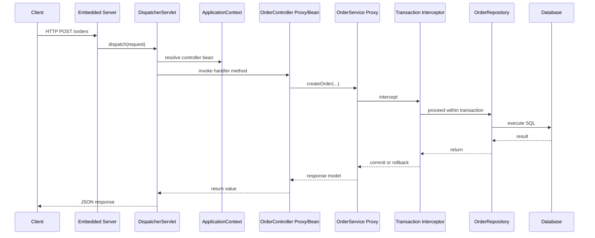
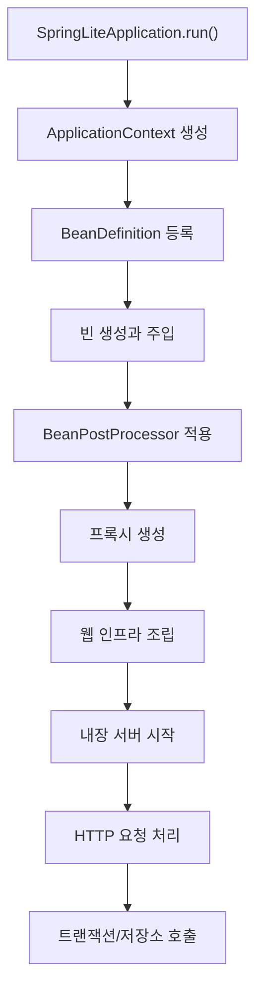

# Part 1 Draft

## Part 1. 왜 Spring을 직접 만들어봐야 하는가

이 문서는 책의 Part 1 원고 초안이다. 출간 원고로 다듬기 전 단계이므로, 문장 톤과 사례, 그림 캡션은 이후 편집 과정에서 보강될 수 있다. 다만 설명 구조와 핵심 메시지는 실제 본문 기준으로 작성했다.

---

## Chapter 1. 프레임워크를 사용하는 사람에서 이해하는 사람으로

### 1.1 우리가 Spring을 "쓴다"는 말의 한계

대부분의 개발자는 Spring Boot를 꽤 익숙하게 사용한다. `@RestController`를 붙이고, `@Service`를 만들고, `@Transactional`을 선언하면 웬만한 웹 애플리케이션은 금방 동작한다. 처음에는 이것만으로도 생산성이 압도적으로 좋아 보인다. 실제로도 그렇다. 문제는 어느 순간부터 시작된다. 애플리케이션이 단순 CRUD를 넘어가고, 장애가 발생하고, 설정 충돌이 생기고, 빈 생성이 꼬이고, 트랜잭션이 기대대로 동작하지 않을 때다.

이 시점에 많은 개발자가 같은 벽을 만난다. "Spring을 사용해 본 경험"은 있는데 "왜 그렇게 동작하는지에 대한 구조적 설명"은 어렵다는 점이다. 예를 들어 아래 질문들에 명확하게 답할 수 있는지 생각해보자.

- 왜 `@Transactional`은 같은 클래스 안에서 자기 메서드를 호출할 때 잘 동작하지 않을까?
- 왜 어떤 빈은 생성되는데 어떤 빈은 순환 참조로 실패할까?
- 왜 `@Bean` 방식과 `@Component` 방식은 비슷해 보여도 내부 모델이 다를까?
- 왜 Spring MVC는 단순 라우터가 아니라 `DispatcherServlet`이라는 별도 중심축을 둘까?
- 왜 설정 한 줄이 애플리케이션 전체 동작을 바꿔버릴 수 있을까?

이 질문들은 사용법만으로는 잘 풀리지 않는다. 공식 문서를 많이 읽어도 단편적인 답변만 남는 경우가 많다. 이유는 간단하다. Spring은 단순 API 모음이 아니라, 객체 생성, 런타임 확장, 요청 처리, 데이터 접근, 트랜잭션 경계 설정을 하나의 일관된 모델로 묶는 프레임워크이기 때문이다. 즉, Spring을 이해한다는 말은 애너테이션 이름을 외우는 것이 아니라, 그 애너테이션이 기대는 런타임 구조를 이해한다는 뜻이다.

### 1.2 사용법이 아니라 구조를 이해해야 하는 이유

실무에서 프레임워크를 깊이 이해하면 얻는 이점은 생각보다 직접적이다.

첫째, 장애를 더 빠르게 좁힐 수 있다.  
빈 생성 오류가 났을 때 로그를 훑는 것만으로도, 이것이 스캔 문제인지, 생성자 해석 문제인지, `@Configuration` 조립 문제인지 감이 잡히기 시작한다.

둘째, 설정 충돌을 덜 두려워하게 된다.  
자동 설정과 사용자 설정이 부딪힐 때, "왜 이런 빈이 들어왔는가"를 추적할 수 있으면 문제 해결 속도가 크게 달라진다.

셋째, 기술 선택을 더 정확하게 할 수 있다.  
예를 들어 선언형 트랜잭션이 편리하다고 해서 모든 경우에 무조건 좋은 것은 아니다. 프록시 기반이라는 사실을 이해하면, 어떤 경우에는 구조를 바꾸거나 명시적 경계 제어가 더 적절하다는 판단을 내릴 수 있다.

넷째, 면접이나 아키텍처 토론에서 설명의 깊이가 달라진다.  
Spring을 잘 쓴다는 말은 더 이상 "많이 써봤다"에 머물지 않는다. 왜 그 구조가 필요한지, 어떤 한계가 있고 어떤 대안이 있는지 설명할 수 있어야 한다.

이 책은 바로 그 지점을 목표로 한다. 단순히 Spring을 사용하는 책이 아니라, Spring이 왜 그런 모양이 되었는지 납득하게 만드는 책이다.

### 1.3 가장 좋은 학습법: 직접 만들어보기

프레임워크 내부 구조를 이해하는 방법에는 크게 세 가지가 있다.

1. 문서를 읽는다.
2. 실제 소스 코드를 읽는다.
3. 핵심 구조를 직접 구현해본다.

문서는 방향을 잡아준다. 소스 코드는 진실에 가깝다. 하지만 둘만으로는 종종 연결이 끊긴다. 문서는 요약되어 있고, 실제 소스 코드는 너무 크고 일반화되어 있기 때문이다. 특히 Spring처럼 수많은 확장 포인트와 하위 호환성을 품은 프레임워크는 처음부터 소스 코드로 들어가면 "어떤 것이 본질이고 어떤 것이 확장인지"를 구분하기 어렵다.

그래서 이 책은 세 번째 방법을 택한다. 직접 만들어본다. 물론 실제 Spring 전체를 복제하려는 것은 아니다. 그것은 비현실적일 뿐 아니라 학습 효율도 떨어진다. 대신 Spring의 핵심 원리를 드러내는 최소 구조를 직접 구현한다. 객체를 생성하고, 의존관계를 해석하고, 애너테이션을 읽고, 프록시를 만들고, 웹 요청을 메서드 호출로 바꾸고, 트랜잭션을 감싼다. 그렇게 한 층씩 쌓아 올리면, 실제 Spring이 훨씬 더 큰 구조를 왜 그런 식으로 갖추었는지 자연스럽게 보이기 시작한다.

직접 구현해보는 방식의 장점은 분명하다.

- 추상적인 개념이 구체적인 알고리즘으로 바뀐다.
- "마법처럼 보이던 동작"이 실제 호출 순서로 보이기 시작한다.
- 실제 Spring의 복잡성이 어디서 비롯됐는지 더 공정하게 이해하게 된다.

### 1.4 이 책에서 만들 `spring-lite`

이 책의 실습 대상은 `spring-lite`다. 이름 그대로 Spring의 핵심 원리를 학습용으로 드러내는 경량 프레임워크다. 목적은 운영 환경에서 곧바로 쓰기 위한 대체품이 아니라, 구조를 이해하기 위한 구현 가능한 모델을 제공하는 데 있다.

현재 저장소는 다음과 같은 모듈로 구성되어 있다.

- `spring-lite-core`: 공통 유틸리티와 메타데이터 처리
- `spring-lite-context`: IoC 컨테이너, 스캐닝, 라이프사이클, 이벤트
- `spring-lite-aop`: 프록시와 인터셉터 인프라
- `spring-lite-web`: MVC 요청 처리와 JSON 응답
- `spring-lite-jdbc`: JDBC 템플릿과 데이터 접근 유틸리티
- `spring-lite-tx`: 선언형 트랜잭션 인프라
- `spring-lite-boot`: 애플리케이션 부트스트랩과 기본 인프라 조립
- `spring-lite-test`: 프레임워크와 애플리케이션 테스트 지원
- `example-app`: 주문 도메인 예제로 전체 흐름을 검증하는 애플리케이션

이 구성이 중요한 이유는, 우리가 Spring을 단일 기능으로 배우지 않기 때문이다. IoC만 배우고 끝내지 않는다. 웹만 배우고 끝내지 않는다. 컨테이너, 라이프사이클, 프록시, 트랜잭션, MVC, 부트스트랩이 하나의 요청 흐름 안에서 어떻게 연결되는지를 끝까지 본다.

### 1.5 무엇을 구현하고 무엇을 의도적으로 줄였는가

학습용 프레임워크를 설계할 때 가장 중요한 것은 "무엇을 뺄 것인가"다. 너무 많이 줄이면 본질이 사라지고, 너무 많이 담으면 실제 Spring만큼 복잡해져 학습 가치가 떨어진다.

`spring-lite`는 아래 범위를 핵심 목표로 삼는다.

- `@Component`와 생성자 주입 기반 IoC 컨테이너
- `@Configuration`과 `@Bean` 기반 설정 모델
- `BeanPostProcessor`를 포함한 라이프사이클 훅
- 프록시 기반 AOP와 `@Aspect` 최소 구조
- `@Transactional`과 `REQUIRED` 전파, rollback 정책
- `DispatcherServlet` 스타일의 경량 MVC
- `JdbcTemplate` 기반 데이터 접근 추상화
- `SpringLiteApplication.run()` 형태의 실행 모델
- 테스트 지원 모듈과 예제 애플리케이션

반대로 아래 항목은 일부만 구현했거나 의도적으로 단순화했다.

- 완전한 Spring Expression Language 지원
- 고급 BeanFactory 후처리기 모델
- 풍부한 포인트컷 표현식과 advisor ordering
- 서블릿 컨테이너 전체 추상화
- 복잡한 auto-configuration 조건 체계
- 다중 트랜잭션 매니저, 고급 전파/격리 수준

이 단순화는 타협이 아니라 설계다. 학습 목적에서 중요한 것은 "왜 이런 계층이 필요한가"를 드러내는 일이지, 전체 기능 목록을 복제하는 일이 아니기 때문이다.

### 1.6 이 책을 읽는 두 가지 방법

이 책은 두 가지 방식으로 읽을 수 있다.

첫 번째는 구현 중심 독서다. 각 장의 설명을 따라가며 직접 코드를 작성하고 테스트를 통과시키는 방식이다. 이 방식은 시간이 들지만 가장 강력하다. 손으로 구현한 구조는 오래 남는다.

두 번째는 구조 이해 중심 독서다. 이미 완성된 `spring-lite` 코드를 읽으면서 각 장의 설명과 연결하는 방식이다. 실무 개발자 중에는 이 방식이 더 현실적인 경우도 많다. 중요한 것은 어느 쪽이든 "코드와 설명을 왕복"하는 것이다.

이 책에서는 각 장마다 아래 순서를 유지하려 한다.

1. 이 장에서 풀 문제를 제시한다.
2. 먼저 Spring 개념을 설명한다.
3. `spring-lite` 구현을 해설한다.
4. 테스트로 동작과 실패를 검증한다.
5. 실제 Spring과 비교한다.
6. 실무에서 어떤 판단에 도움이 되는지 연결한다.

이 구조를 반복하면, 독자는 단순히 구현을 따라가는 것이 아니라 "프레임워크를 보는 눈"을 얻게 된다.

### 1.7 저장소를 어떻게 읽으면 좋은가

`spring-lite` 저장소는 책 본문과 함께 읽도록 정리되어 있다. 가장 먼저 보면 좋은 문서는 아래와 같다.

- `README.md`: 프로젝트 범위와 모듈 개요
- `docs/architecture/overview.md`: 전체 아키텍처 요약
- `docs/architecture/spring-core-principles-and-code-guide.md`: 핵심 원리와 코드 매핑
- `docs/architecture/spring-framework-comparison-and-architecture-guide.md`: 실제 Spring 비교
- `docs/book/book-outline.md`: 책 전체 목차
- `docs/book/chapter-synopsis-and-writing-plan.md`: 장별 집필 계획

코드를 읽을 때는 모듈 순서를 무시하고 아무 데서나 들어가기보다, 아래 순서를 권한다.

1. `spring-lite-context`
2. `spring-lite-aop`
3. `spring-lite-tx`
4. `spring-lite-web`
5. `spring-lite-jdbc`
6. `spring-lite-boot`
7. `spring-lite-test`
8. `example-app`

이 순서는 런타임 의존 방향과도 대체로 맞는다. 컨테이너가 먼저 있고, 그 위에 후처리와 프록시가 올라가며, 웹과 트랜잭션, 부트스트랩이 이어진다.

### 1.8 이 장의 핵심 정리

이 장에서 기억해야 할 메시지는 세 가지다.

- Spring은 애너테이션 모음이 아니라 런타임 구조다.
- 내부 구조를 이해하는 가장 좋은 방법은 핵심 원리를 직접 구현해보는 것이다.
- `spring-lite`는 Spring의 모든 기능이 아니라 핵심 원리를 드러내는 학습용 모델이다.

다음 장에서는 이 구조를 한 번에 조망한다. IoC, 라이프사이클, AOP, MVC, 트랜잭션, 부트스트랩이 각각 따로 존재하는 것이 아니라, 하나의 요청과 하나의 애플리케이션 실행 흐름 안에서 어떻게 연결되는지를 큰 그림으로 본다.

### 그림 초안 후보


### 코드 참조

- [README.md](/Users/hammac/Projects/spring-lite/README.md)
- [docs/architecture/overview.md](/Users/hammac/Projects/spring-lite/docs/architecture/overview.md)
- [settings.gradle.kts](/Users/hammac/Projects/spring-lite/settings.gradle.kts)

---

## Chapter 2. Spring의 큰 그림: IoC, Lifecycle, AOP, MVC, Transaction

### 2.1 큰 그림을 먼저 보는 이유

프레임워크를 공부할 때 흔한 실패는 세부 기능을 먼저 배우는 것이다. `@Component`를 배우고, `@Bean`을 배우고, `@Transactional`을 배우고, `@RestController`를 배우지만, 이 기능들이 하나의 런타임 안에서 어떻게 연결되는지 보지 못하면 지식이 조각난다. 그러면 실제 문제를 만났을 때도 기능 단위로만 생각하게 된다.

예를 들어 트랜잭션 문제를 만났을 때, 많은 사람은 데이터베이스 설정만 본다. 하지만 실제 원인은 프록시 생성 시점일 수 있다. 혹은 컨트롤러에서 주입이 실패했을 때 웹 계층 문제처럼 보이지만, 실은 컨테이너의 스캔 범위 문제일 수 있다. 결국 Spring을 이해하려면 기능 목록이 아니라 실행 흐름을 봐야 한다.

이번 장에서는 그 실행 흐름을 한 번에 그려본다. 아직 세부 구현에 들어가지는 않는다. 대신 앞으로 만들 구조들이 어떤 위치에 놓이는지, 무엇이 무엇을 전제로 하는지, 요청 하나가 시스템 안을 어떻게 통과하는지를 큰 그림으로 잡는다.

### 2.2 시작점: 애플리케이션은 어떻게 올라오는가

사용자는 보통 `main` 메서드에서 애플리케이션을 시작한다. `SpringLiteApplication.run()` 같은 진입점을 호출하면 프레임워크는 내부적으로 여러 단계를 수행한다.

1. 애플리케이션 설정 클래스를 찾는다.
2. 컴포넌트를 스캔하고 `BeanDefinition`을 만든다.
3. 인프라 빈과 사용자 빈을 등록한다.
4. 의존성을 해석하며 빈을 생성한다.
5. 라이프사이클 콜백과 후처리기를 적용한다.
6. 필요한 경우 프록시를 생성한다.
7. 웹 인프라를 조립하고 내장 서버를 시작한다.

이 시점에서 이미 중요한 사실 하나가 드러난다. 웹 서버가 뜨기 전에 컨테이너가 먼저 준비되어야 한다는 점이다. 컨트롤러도 결국 빈이고, 트랜잭션을 적용받는 서비스도 빈이며, 데이터 접근 객체도 빈이다. 즉, 대부분의 Spring 기능은 컨테이너라는 바닥 위에 서 있다.

### 2.3 IoC: 객체 생성 책임을 애플리케이션 밖으로 밀어내기

IoC(Inversion of Control)는 표현만 보면 거창하지만, 핵심은 단순하다. 객체를 누가 만들고, 누가 조립할 것인가의 책임을 애플리케이션 코드에서 프레임워크로 옮기는 것이다.

순수 자바로 애플리케이션을 짤 때는 보통 다음과 같은 코드가 생긴다.

```java
OrderRepository repository = new JdbcOrderRepository(dataSource);
OrderService service = new OrderService(repository, discountPolicy);
OrderController controller = new OrderController(service);
```

작은 프로그램에서는 문제가 없다. 하지만 애플리케이션이 커질수록 객체 생성과 연결 책임이 곳곳으로 흩어진다. 어떤 구현체를 쓸지, 싱글톤으로 재사용할지, 설정 값은 어디서 읽을지, 초기화는 언제 할지 같은 문제가 점점 커진다.

IoC 컨테이너는 이 문제를 해결한다. 컨테이너는 객체를 직접 들고 있기 전에, 먼저 그 객체를 어떻게 만들지에 대한 메타데이터를 관리한다. 그것이 `BeanDefinition` 같은 구조다. 이후 컨테이너는 이 메타데이터를 바탕으로 객체를 생성하고, 의존성을 찾아 주입하고, 필요한 경우 캐시에 보관한다.

즉, IoC는 단순히 "주입받는다"가 아니라 아래 질문 전체를 포함한다.

- 어떤 클래스를 빈으로 볼 것인가?
- 어떤 생성자를 선택할 것인가?
- 의존성 후보가 여러 개면 어떻게 결정할 것인가?
- 생성 시점과 수명은 어떻게 관리할 것인가?

이 질문들이 Part 2의 핵심이 된다.

### 2.4 Lifecycle: 빈은 생성만으로 끝나지 않는다

많은 초급 설명은 빈 생성까지만 다루고 끝난다. 하지만 실제 프레임워크는 객체를 만들고 끝나지 않는다. 만들어진 객체를 초기화하고, 필요한 확장을 적용하고, 종료 시점에 정리해야 한다.

예를 들어 어떤 빈은 데이터베이스 연결 풀을 초기화해야 할 수 있고, 어떤 빈은 생성 직후 프록시로 감싸져야 할 수 있다. 또 어떤 빈은 애플리케이션 종료 시 자원을 정리해야 한다. 이 모든 과정을 묶어서 라이프사이클이라고 부른다.

`spring-lite`에서도 빈은 대략 아래 순서를 거친다.

1. 인스턴스 생성
2. 의존성 주입
3. 초기화 전 후처리
4. 초기화 콜백 실행
5. 초기화 후 후처리
6. 필요 시 종료 콜백 등록

이 순서를 이해하면, 왜 `BeanPostProcessor`가 강력한지, 왜 `@PostConstruct`와 프록시 적용 시점이 중요한지, 왜 일부 문제는 "생성은 되었는데 아직 완전히 준비되지 않은 상태"에서 발생하는지 보이기 시작한다.

### 2.5 AOP: 비즈니스 로직 바깥에서 공통 관심사를 다루기

Spring을 처음 배울 때 AOP는 종종 가장 추상적으로 보이는 개념이다. 하지만 실제로는 매우 실용적이다. 핵심은 "핵심 비즈니스 로직과 반복되는 인프라 로직을 분리하자"는 것이다.

예를 들어 서비스 메서드마다 아래 코드를 반복하고 싶지는 않을 것이다.

- 호출 시간 측정
- 로그 기록
- 트랜잭션 시작과 종료
- 예외 발생 시 롤백 처리
- 권한 검사

이런 공통 로직을 메서드마다 직접 쓰면 코드가 오염된다. AOP는 프록시를 이용해 메서드 호출 앞뒤에 개입함으로써 이 문제를 해결한다.

중요한 것은 AOP가 별도의 마법이 아니라는 점이다. 대부분의 경우 Spring은 원본 객체 대신 프록시 객체를 반환한다. 그리고 그 프록시가 메서드 호출을 가로채 인터셉터 체인을 실행한 뒤 실제 대상 메서드를 호출한다.

이 구조를 이해하면 `@Transactional`도 훨씬 쉽게 보인다. `@Transactional`은 특별한 트랜잭션 엔진이 아니라, 결국 AOP 인프라 위에 얹힌 선언형 기능이다.

### 2.6 Transaction: 데이터 일관성을 선언형으로 다루기

트랜잭션은 보통 데이터베이스 이야기처럼 보이지만, 애플리케이션 구조 문제이기도 하다. 어디서 트랜잭션을 시작하고, 어떤 예외에서 롤백할지, 서비스 메서드가 중첩 호출될 때 경계를 어떻게 처리할지는 단순 JDBC 코드만으로는 일관되게 다루기 어렵다.

Spring은 이 문제를 프록시와 인터셉터로 푼다. 서비스 빈이 `@Transactional` 대상이면, 컨테이너는 해당 빈을 감싼 프록시를 만들 수 있다. 그 프록시는 메서드 진입 시 트랜잭션을 시작하고, 정상 종료 시 커밋하며, 예외 정책에 따라 롤백한다.

여기서 중요한 오해 하나를 바로잡아야 한다. `@Transactional`이 메서드 자체를 바꾸는 것은 아니다. 메서드를 호출하는 경로가 바뀌는 것이다. 그래서 프록시를 거치지 않는 self-invocation은 기대와 다르게 동작할 수 있다. 이 문제는 나중에 자세히 다루겠지만, 큰 그림 단계에서 미리 기억해둘 가치가 있다.

### 2.7 MVC: HTTP 요청을 메서드 호출로 바꾸는 파이프라인

웹 프레임워크를 처음 접하면 컨트롤러 메서드가 곧바로 URL과 연결되는 것처럼 보인다. 하지만 실제로는 그 사이에 꽤 많은 계층이 있다. 요청 경로를 해석하고, 적절한 핸들러를 찾고, 메서드 인자를 바인딩하고, 반환값을 응답으로 직렬화하고, 예외를 HTTP 응답으로 바꾸는 흐름이 필요하다.

Spring MVC는 이 과정을 `DispatcherServlet` 중심의 전략 객체 집합으로 구성한다. `spring-lite`도 같은 아이디어를 따른다.

- `HandlerMapping`: 이 요청을 어떤 핸들러가 처리할지 찾는다.
- `HandlerAdapter`: 찾은 핸들러를 실제로 호출 가능한 형태로 실행한다.
- `ArgumentResolver`: 요청 데이터를 메서드 인자로 변환한다.
- `ReturnValueHandler`: 메서드 반환값을 HTTP 응답으로 바꾼다.
- `ExceptionHandler` 계층: 예외를 상태 코드와 본문으로 변환한다.

이 구조를 이해하면, 컨트롤러 메서드는 전체 요청 처리 과정의 중간 지점일 뿐이라는 사실이 드러난다. 문제를 디버깅할 때도 "컨트롤러가 호출됐는가"만 보는 것이 아니라, 그 전후 파이프라인 전체를 살펴봐야 한다.

### 2.8 JDBC: 반복을 줄이는 템플릿 패턴

데이터 접근 계층은 본질적으로 반복이 많다. 커넥션을 열고, SQL을 실행하고, 파라미터를 바인딩하고, 결과를 매핑하고, 자원을 정리하는 코드가 계속 나온다. 순수 JDBC는 강력하지만 장황하다.

Spring JDBC의 핵심은 이 반복 구조를 템플릿 패턴으로 줄이는 데 있다. `spring-lite`의 `JdbcTemplate`도 같은 방향을 따른다. 가변적인 부분은 SQL과 row mapping 같은 콜백으로 넘기고, 나머지 자원 관리와 예외 처리, 트랜잭션 연계는 프레임워크가 맡는다.

이것은 단순 편의 기능이 아니다. 트랜잭션과 커넥션 재사용까지 연결되기 때문에, 데이터 접근 추상화는 컨테이너와 트랜잭션 인프라의 영향을 직접 받는다.

### 2.9 Bootstrapping: 조립된 부품을 "실행 가능한 프레임워크"로 만들기

여기까지 보면 IoC, AOP, MVC, JDBC, 트랜잭션이 모두 별도 기능처럼 보일 수 있다. 하지만 사용자는 보통 이런 부품을 하나씩 직접 조립하고 싶어하지 않는다. `run()` 한 줄로 시작하고 싶어한다. 그래서 부트스트랩 계층이 필요하다.

부트스트랩 계층은 다음 역할을 맡는다.

- 애플리케이션 시작점 정의
- 스캔 기준과 설정 클래스 해석
- 필수 인프라 자동 등록
- 웹 서버 시작
- 컨텍스트 생명주기 관리

이 계층이 있어야 프레임워크는 "부품 모음"에서 "사용 가능한 플랫폼"으로 바뀐다. Spring Boot가 폭발적인 생산성을 준 이유도 여기에 있다. `spring-lite`는 그 구조를 훨씬 작고 읽기 쉬운 형태로 보여준다.

### 2.10 하나의 요청이 시스템을 통과하는 전체 흐름

이제 모든 조각을 하나의 요청으로 묶어보자. 사용자가 `/orders`로 POST 요청을 보낸다고 가정하자.



이 흐름을 보면 각 계층이 분리되어 있으면서도 강하게 연결되어 있음을 알 수 있다.

- 컨트롤러는 컨테이너가 만든 빈이다.
- 서비스는 필요하면 프록시로 감싸진다.
- 트랜잭션은 서비스 호출 경계에서 작동한다.
- 저장소는 트랜잭션에 연결된 커넥션을 재사용한다.
- 웹 계층은 반환값을 JSON 응답으로 바꾼다.

즉, Spring을 이해한다는 것은 이 흐름 안에서 어떤 계층이 어떤 책임을 지는지 설명할 수 있다는 뜻이다.

### 2.11 `spring-lite` 모듈을 큰 그림에 매핑하기

아래 표는 현재 저장소를 앞으로의 학습 흐름에 맞게 단순화해 보여준다.

| 축 | `spring-lite` 모듈 | 핵심 역할 |
| --- | --- | --- |
| IoC / DI | `spring-lite-context` | 빈 정의, 스캔, 생성, 주입 |
| Lifecycle | `spring-lite-context` | 초기화, 종료, 후처리, 이벤트 |
| AOP | `spring-lite-aop` | 프록시, 인터셉터, 호출 체인 |
| Transaction | `spring-lite-tx` | `@Transactional`, 전파, 롤백 정책 |
| Web MVC | `spring-lite-web` | 디스패치, 인자 바인딩, 응답 생성 |
| JDBC | `spring-lite-jdbc` | SQL 실행, 결과 매핑, 커넥션 유틸리티 |
| Bootstrap | `spring-lite-boot` | 실행 시작, 인프라 조립, 서버 시작 |
| Testing | `spring-lite-test` | 컨텍스트/웹 테스트 지원 |
| Example | `example-app` | 전체 흐름 검증 |

이 표는 앞으로 장이 진행될 때 계속 머릿속에 남아 있어야 한다. 각 장은 이 중 하나를 깊게 파지만, 마지막에는 모두 다시 연결된다.

### 2.12 실제 Spring은 왜 더 복잡한가

큰 그림을 잡는 단계에서 흔히 생기는 오해가 있다. "생각보다 구조가 단순하네, 그럼 실제 Spring도 이 정도면 되는 것 아닌가?"라는 오해다. 그렇지 않다. 실제 Spring은 이 기본 구조 위에 수많은 확장 포인트와 호환성 요구, 성능 고려, 운영 환경 제약을 얹은 결과물이다.

예를 들어 실제 Spring은 아래 문제까지 다뤄야 한다.

- 훨씬 다양한 빈 등록 방식
- 풍부한 후처리기와 팩토리 후처리기
- 훨씬 정교한 포인트컷 표현식과 advisor ordering
- 다양한 웹 실행 환경과 서블릿 컨테이너 통합
- 여러 데이터소스와 다층 트랜잭션 전략
- 조건부 자동 설정과 방대한 starter 생태계

`spring-lite`는 그 모든 복잡성을 재현하지 않는다. 대신 그 복잡성이 기대는 핵심 골격을 드러낸다. 그러면 실제 Spring의 소스 코드를 볼 때도 "왜 이런 클래스가 존재하는지"를 더 쉽게 추론할 수 있다.

### 2.13 다음 Part에서 본격적으로 만들 것

이제 큰 그림은 잡혔다. 다음 Part부터는 이 흐름의 시작점인 IoC 컨테이너를 직접 구현한다.

먼저 할 일은 세 가지다.

1. 빈을 메타데이터로 표현할 구조를 만든다.
2. 컨테이너에 빈 정의를 등록하는 방법을 만든다.
3. 등록된 정의를 바탕으로 실제 객체를 생성하고 주입한다.

이 과정에서 DI는 선언이 아니라 해석 알고리즘이라는 사실이 드러난다. 그리고 그 위에 라이프사이클, 프록시, 웹 요청 처리, 트랜잭션이 차례로 쌓인다.

### 2.14 이 장의 핵심 정리

이 장에서 기억해야 할 핵심은 아래와 같다.

- Spring의 기능은 따로 노는 것이 아니라 하나의 실행 흐름으로 연결된다.
- 컨테이너는 대부분의 기능이 서는 기반 계층이다.
- `@Transactional`은 AOP 인프라 위에 올라가는 선언형 기능이다.
- MVC는 단순 URL 매핑이 아니라 요청-응답 변환 파이프라인이다.
- 부트스트랩 계층이 있어야 프레임워크가 실제 애플리케이션으로 실행된다.

다음 장부터는 이 큰 그림을 바탕으로, 가장 먼저 컨테이너의 시작점인 `BeanDefinition`과 Bean Registry를 구현한다.

### 그림 초안 후보



### 코드 참조

- [spring-lite-context](/Users/hammac/Projects/spring-lite/spring-lite-context)
- [spring-lite-aop](/Users/hammac/Projects/spring-lite/spring-lite-aop)
- [spring-lite-web](/Users/hammac/Projects/spring-lite/spring-lite-web)
- [spring-lite-jdbc](/Users/hammac/Projects/spring-lite/spring-lite-jdbc)
- [spring-lite-tx](/Users/hammac/Projects/spring-lite/spring-lite-tx)
- [spring-lite-boot](/Users/hammac/Projects/spring-lite/spring-lite-boot)
- [example-app](/Users/hammac/Projects/spring-lite/example-app)

---

## Part 1 집필 메모

- Chapter 1은 독자의 문제의식을 정확히 건드리는 사례를 더 보강하면 좋다.
- Chapter 2는 출간 단계에서 그림 2개와 실제 코드 스냅샷 2~3개를 넣으면 이해 속도가 빨라진다.
- Part 1 전체 분량은 현재 초안 기준 약 22~26쪽 수준으로 확장 가능하다.
